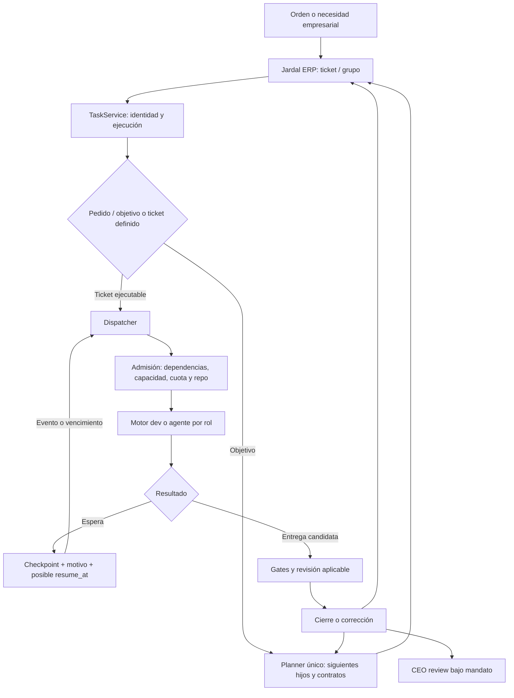
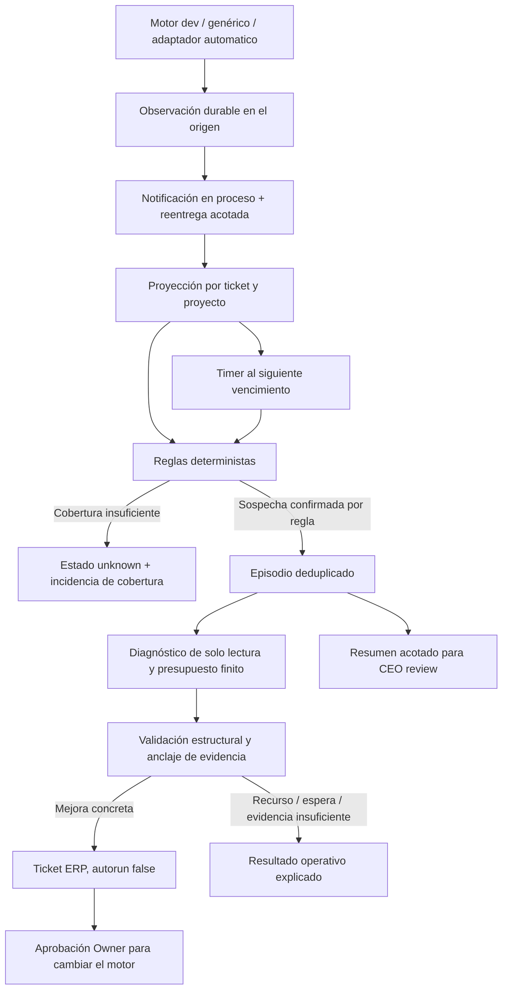

# OpenCEO: contexto técnico y propuesta del cazador de atascos

**Ticket:** TASK-2026-00357. **Proyecto:** `jardal-openceo`. **Fecha de corte:** 2026-10-28 UTC.

**Estado del documento:** propuesta para revisión del Owner y su equipo. Este documento no constituye aprobación ni implementa el sistema. Los nombres de módulos nuevos, esquemas, umbrales y fases que se proponen requieren aprobación antes de convertirse en contratos del runtime.

**Base examinada:** commit `930eccdd5008222225878bb9eb954aadb157e370` y archivos del checkout disponibles durante la preparación. Había diferencias locales relevantes: `openceo-core/task_service.py` tenía modificaciones y `automatico.py` era un archivo local sin versionar. Su lectura describe ese checkout, no acredita que todos esos contenidos estén desplegados. No se inspeccionaron datos de producción en Mongo, logs crudos ni sesiones de proveedores.

**Propósito:** entregar al equipo suficiente contexto para diseñar y cuestionar la solución sin depender de esta conversación: funcionamiento actual, propietarios de datos, protocolos, frenos, huecos, integración, propuesta, decisiones y criterios verificables.

Este es un entregable solicitado en `docs/`, no un workfile temporal ni un backlog. El seguimiento y la aprobación pertenecen al ticket. No contiene credenciales, datos personales ni instrucciones de pago.

## Índice

1. [Qué pide el ticket](#1-qué-pide-el-ticket)
2. [Evidencia y correcciones al diagnóstico original](#2-evidencia-y-correcciones-al-diagnóstico-original)
3. [Qué es OpenCEO y quién posee cada dato](#3-qué-es-openceo-y-quién-posee-cada-dato)
4. [Mapa del proyecto y recorrido del trabajo](#4-mapa-del-proyecto-y-recorrido-del-trabajo)
5. [Identidades, estados y autoridad](#5-identidades-estados-y-autoridad)
6. [Cómo ejecutan los motores actuales](#6-cómo-ejecutan-los-motores-actuales)
7. [Esperas, reintentos y recuperación existentes](#7-esperas-reintentos-y-recuperación-existentes)
8. [Qué observabilidad existe y qué falta](#8-qué-observabilidad-existe-y-qué-falta)
9. [Restricciones que el diseño debe respetar](#9-restricciones-que-el-diseño-debe-respetar)
10. [Definiciones de progreso y atasco](#10-definiciones-de-progreso-y-atasco)
11. [Arquitectura propuesta](#11-arquitectura-propuesta)
12. [Eventos, cobertura y entrega durable](#12-eventos-cobertura-y-entrega-durable)
13. [Señales y umbrales propuestos](#13-señales-y-umbrales-propuestos)
14. [Huellas y medición de progreso](#14-huellas-y-medición-de-progreso)
15. [Modelo de datos propuesto](#15-modelo-de-datos-propuesto)
16. [Timers, concurrencia y recuperación](#16-timers-concurrencia-y-recuperación)
17. [Diagnóstico acotado](#17-diagnóstico-acotado)
18. [Evidencia, privacidad y permisos](#18-evidencia-privacidad-y-permisos)
19. [Tickets de mejora y aprobación del Owner](#19-tickets-de-mejora-y-aprobación-del-owner)
20. [Integración con CEO review](#20-integración-con-ceo-review)
21. [Puntos de integración por archivo](#21-puntos-de-integración-por-archivo)
22. [Configuración propuesta](#22-configuración-propuesta)
23. [Descomposición F1–F5](#23-descomposición-f1f5)
24. [Validación y casos de prueba](#24-validación-y-casos-de-prueba)
25. [Despliegue, operación y reversión](#25-despliegue-operación-y-reversión)
26. [Decisiones propuestas y alternativas](#26-decisiones-propuestas-y-alternativas)
27. [Revisión del equipo y aceptación](#27-revisión-del-equipo-y-aceptación)
28. [Fuentes, límites y glosario](#28-fuentes-límites-y-glosario)

## 1. Qué pide el ticket

TASK-2026-00357 se titula «[Diseño] Cazador de atascos: watchdog de progreso + diagnóstico + ticket de automejora (propuesta de épica)». Es un ticket de diseño, inicialmente sin ejecución automática (`autorun=false`).

El problema es que una ejecución puede seguir consumiendo sesiones, reaparcándose o esperando sin avanzar, aunque no se produzca una excepción que active los mecanismos actuales. Hoy una persona puede tener que advertirlo, reconstruir la causa y abrir el trabajo correctivo.

El resultado buscado tiene tres eslabones:

1. **Detectar no progreso**, con lógica determinista y sin gastar tokens para decidir si hay una sospecha.
2. **Diagnosticar la causa**, con entradas delimitadas, evidencia y un presupuesto finito.
3. **Registrar una mejora**, con identidad empresarial, deduplicación y autorización del Owner antes de modificar el propio motor.

El diseño debe cerrar cinco áreas:

| Área | Decisiones requeridas |
| --- | --- |
| Señales | Qué constituye repetición o ausencia de progreso; dónde se mide; qué evita el ruido. |
| Watchdog | Qué observa, cuándo despierta, qué hace, cómo se limita y cómo se recupera. |
| Diagnóstico | Qué contexto recibe, qué puede leer, qué devuelve y cuánto puede consumir. |
| Mejora | Evidencia mínima, creación automática frente a aprobación y protección del motor. |
| CEO review | Cómo comunicar trayectorias de ejecución además de los estados actuales. |

La aceptación original exige un diseño aprobado, con señales, cadencia, frenos y gate decididos; y una descomposición F1–F5 lista para registrar como hijos de una épica. Crear esa épica y sus hijos es un paso posterior. No se crean mediante este documento.

**Fuera de alcance:** construir ahora el cazador; ejecutar diagnósticos con modelos vivos para validar esta propuesta; minar patrones entre proyectos; leer notas ajenas; reparar automáticamente el motor; convertir la bandeja técnica en otro gestor de trabajo.

## 2. Evidencia y correcciones al diagnóstico original

### 2.1 Incidente que motiva el diseño

El ticket de diseño documenta un incidente de TASK-2026-00349 dentro de la épica TASK-2026-00346: dieciséis sesiones worker devolvieron `TICKET_CONTINUE` porque consideraban pendiente la revisión, aunque el trabajo de implementación estaba listo.

La secuencia problemática era:

```text
worker implementa y verifica
    → considera que falta revisión/cierre
    → emite TICKET_CONTINUE
    → automatico.py lanza otro worker
    → el nuevo worker encuentra el mismo estado
    → repite el mismo razonamiento
```

La revisión solo se iniciaba al recibir `TICKET_READY`. El contrato del prompt no comunicaba con suficiente claridad que el runner era responsable de esa transición. Los comentarios recientes de TASK-2026-00349 corroboran workers que vuelven a verificar el mismo helper sin cambios nuevos y dejan el live para el cierre. El número de dieciséis procede del relato de TASK-2026-00357 y del test de regresión; no se reconstruyó un historial de logs completo.

El prompt local ahora dice que revisión y cierre se ejecutan después de `TICKET_READY`, y reserva `TICKET_CONTINUE` para implementación sin terminar. Existe `tests/test_automatico_prompt_349.py`. Esto corrige ese contrato concreto; no equivale a un detector general de progreso.

### 2.2 TASK-2026-00350 ya está completado

La descripción de TASK-2026-00357 trata `scheduled_wait` sin tope como un hueco hallado. A la fecha de esta revisión, TASK-2026-00350 está **Completed** y su cambio está en la base examinada.

El estado verificado en código es:

| Camino | Comportamiento actual |
| --- | --- |
| Dev A/B/C | `scheduled_wait_count` persiste entre reanudaciones; la tercera declinación programada consecutiva termina en `WAITING` con motivo `needs_owner` y sin `resume_at`. |
| Agentes genéricos | Usan el mismo helper y el mismo máximo de tres declinaciones. |
| Fecha pasada | `scheduled_resume()` la rechaza; no se acepta como espera futura. |
| Conteo inválido | El helper tolera valores de `params` que no sean diccionarios; no rompe por ese dato. |
| Resultado posterior | Existen caminos de limpieza del contador para no arrastrarlo indebidamente. |

No hay que volver a diseñar ese contador como si faltara. El cazador debe observarlo y complementar los frenos del motor.

### 2.3 Tier S necesita una lectura más precisa

En `TierSCycle._build()` existe una ruta `bloqueado` con `resume_at` que llama a `_park_build(..., "scheduled_wait", ...)`; el checkpoint vuelve a fase de build al reanudar. En ese tramo no aparece el contador de tres declinaciones usado por A/B/C y el agente genérico.

Por tanto, la frase histórica «Tier S aparca el bloqueado sin resume» no cubre todos los casos actuales. Tier S tiene frenos propios para proveedores, revisión, gates y correcciones, pero no se puede afirmar que toda posible espera esté limitada por el contador de TASK-2026-00350. Esto es un **hueco localizado por inspección**, no una reproducción de un bucle en producción.

### 2.4 El runner externo también tiene límites, pero distintos

`automatico.py` limita sesiones por invocación mediante `s.max_sessions` y guarda `t["sessions"]`. Sin embargo, la comparación de corte usa el contador local de esa ejecución de `advance()`. La rama `TICKET_CONTINUE` reinicia el contador local de fallos y no compara una huella de progreso.

Reiniciar el runner puede permitir otra tanda aunque continúe el mismo problema. El contador acumulado sirve como evidencia, pero el tramo leído no demuestra un freno durable basado en progreso.

### 2.5 CEO review ya tiene algunos agregados históricos

El motor de objetivos mantiene `planning_runs`, `material_failures` y `planner_telemetry.no_progress_cycles`. CEO review recibe, entre otros, número de planificaciones, tickets creados y fallos materiales.

Lo que falta no es todo dato histórico: falta una representación consistente de **trayectorias por ticket/run**, con rachas de espera, reanudaciones equivalentes y duración desde el último progreso. La propuesta debe reutilizar lo existente y añadir esa representación.

## 3. Qué es OpenCEO y quién posee cada dato

OpenCEO es un plano de control de agentes: coordina trabajo ejecutable, proveedores, workers, sesiones, colas, cuotas, workflows y aprobaciones técnicas. El backend usa Python/FastAPI y componentes LangGraph; Mongo conserva el runtime. Existen interfaz React, voz y cliente Android, pero no se necesita cambiar esas interfaces para el primer detector.

| Dominio | Autoridad | Consecuencia para el cazador |
| --- | --- | --- |
| Proyectos, tickets, prioridades, aprobaciones y estados empresariales | Jardal ERP | Una mejora que alguien debe ejecutar se registra por la API de tickets. |
| Sesiones, runs, colas, checkpoints y observaciones técnicas | OpenCEO / Mongo | Aquí viven contadores, episodios y timers del detector. |
| Implementación y configuración versionada | Git | La evidencia debe identificar revisión y archivos. |
| Conocimiento reusable y decisiones aprobadas | Vault del proyecto | Solo conclusiones estables, con aislamiento y cita del ticket. |
| Planes, feedback y handoffs de una ejecución | Scratch / archivos de ejecución | Son evidencia temporal; no sustituyen el ticket ni el vault. |
| Contexto personal del Owner | Horizon, con fronteras propias | No forma parte del contexto empresarial del diagnóstico. |

Los nombres heredados `ERPNext`, `Jardal ERP`, `openceo_ref` o ciertos nombres de adapters pueden coexistir en contratos y código. No se debe concluir que hay dos registros empresariales independientes ni diseñar otro adapter basándose solo en el nombre. La superficie actual es `business/` y las herramientas semánticas de tickets.

## 4. Mapa del proyecto y recorrido del trabajo

### 4.1 Componentes relevantes

| Ruta | Función |
| --- | --- |
| `openceo-core/main.py` | Ensambla servicios, lifespan, HTTP, MCP, dispatcher y CEO loop. |
| `openceo-core/task_service.py` | Creación y ejecución de tareas, embudo de actualizaciones, señales e integración empresarial. |
| `openceo-core/db/mongo.py` | Persistencia, claims, locks, estados, runs y observers. |
| `openceo-core/dispatcher.py` | Admisión determinista de tickets ejecutables. |
| `openceo-core/objectives/` | Planner único de objetivos, planificación incremental y aceptación agregada. |
| `openceo-core/ceo/` | Compilación de señales, revisión estratégica y reacciones bajo mandato. |
| `openceo-core/company_mandate.py` | Política de autonomía y categorías de escalado al Owner. |
| `openceo-core/agents/dev/session.py` | Sesión dev, tiers simples y puente al ciclo S. |
| `openceo-core/agents/dev/tier_s/` | Plan, build, gates, rondas de revisión, arbitraje y cierre S. |
| `openceo-core/orchestration/` | Ejecutores compartidos, revisión, findings, inbox, recuperación y aprendizaje. |
| `openceo-core/orchestration/generic_agent.py` | Ejecución por rol fuera del camino dev específico. |
| `openceo-core/catalog.py`, `catalog/` | Catálogo validado de agentes, perfiles y recursos permitidos. |
| `projects/<proyecto>/project.yaml` | Contratos de ejecución por proyecto; consultar solo el proyecto activo. |
| `workflows/` | Recetas deterministas; pasos humanos tienen semántica propia. |
| `automatico.py` | Runner local de épicas, distinto del dispatcher interno. |

### 4.2 Recorrido empresarial y técnico



El planner decide qué trabajo se necesita y, en dev, el tier. No decide libremente la cuenta, el proveedor o el modelo; el runtime resuelve esos recursos. Un watcher no debe crear un segundo planner ni elegir un tier por precio.

### 4.3 Admisión del dispatcher

Antes de lanzar considera intención `autorun`, vínculo empresarial, dependencias, límites activos, disponibilidad de cuota y exclusión de repositorio. Existe un claim atómico para evitar doble lanzamiento. La comprobación del repo en dispatcher es orientativa: el lock efectivo se adquiere en el motor.

Los valores por defecto leídos incluyen un activo por proyecto y seis por objetivo; la capacidad global y las reservas de proveedores tienen su propia lógica. Son valores de configuración, no una garantía universal de cada despliegue.

La reanudación de una espera vencida vuelve a pasar por admisión. Que llegue la fecha no permite saltarse dependencias, QA, secretos, aprobación ni capacidad.

## 5. Identidades, estados y autoridad

### 5.1 Identificadores que no se deben confundir

| Identificador | Qué representa |
| --- | --- |
| `TASK-2026-00357` | Referencia empresarial que se cita en conversaciones, notas y evidencia. |
| `business_ticket_id` / `businessReference` | Identidad de la API empresarial y su referencia visible. |
| `task_id` / `openceo_ref` | Ejecución local asociada al trabajo empresarial. |
| `ticket_number` | Número de ejecución de OpenCEO; no sustituye al `TASK-...`. |
| `run_id` | Un ciclo concreto; un ticket puede tener varios. |
| `objective_id` / misión | Agrupación y continuidad por encima del ticket. |
| `source` + `source_id` | Identidad idempotente de creación de trabajo. |
| `project_key` / `project` | Límite de aislamiento, autorización y consulta. |

Los adaptadores pueden exponer nombres equivalentes con formatos distintos. La correlación se obtiene de los vínculos existentes, no de comparar títulos ni de asumir igualdad de todos los UUID.

### 5.2 Dos máquinas de estado

El estado empresarial tiene `Open`, `Working`, `Pending Review`, `Completed` y `Cancelled`. El runtime tiene, entre otros, `queued`, `in_progress`, `waiting`, `failed`, `escalated`, `interrupted`, `converted`, `completed` y `cancelled`.

| Situación | Estado empresarial según política |
| --- | --- |
| Aceptación sin cumplir y aún no ejecutándose | `Open`. |
| Trabajo en curso o espera técnica/dependencia | `Working`, con motivo exacto. |
| Falta credencial, autenticación, recurso o acción del host | `Working`, con recurso y condición de reanudación. |
| Solo falta una aprobación/decisión humana requerida | `Pending Review`, con `human_action` concreta. |
| Hecho y verificado, sin acción humana restante | `Completed`, con evidencia. |

**`waiting` no equivale a `Pending Review`.** Tampoco una cadena `needs_owner` demuestra por sí sola que proceda revisión humana: puede nombrar restauración de acceso o recursos y requerir `Working`.

`converted` cierra una modalidad de ejecución al convertir el pedido en objetivo; no prueba que toda la entrega empresarial haya terminado. La aceptación del grupo se verifica aparte.

### 5.3 Reglas de escritura

- La actualización de asunto/descripción/prioridad no cambia el estado de negocio.
- Los cambios de estado usan el canal semántico de transición, con contexto suficiente y relectura.
- Un nuevo ticket normalmente lleva `autorun=false`.
- Las dependencias se respetan en orden topológico; una dependencia abierta impide completar el dependiente.
- Los comentarios y adjuntos son evidencia del ticket; el cazador agrega los suyos, no reescribe decisiones humanas.
- Una bandera en Mongo no sustituye una aprobación empresarial. Una réplica tardía tampoco inventa esa aprobación.

## 6. Cómo ejecutan los motores actuales

### 6.1 Tiers A/B/C

Son rutas dev con builder principal diferente: A usa la familia Claude, B Codex y C una selección disponible de su cadena configurada. La resolución efectiva depende de configuración y disponibilidad; no debe degradarse silenciosamente A/B a C por cuota.

Comparten gates y revisión independiente. La revisión está activada por defecto y A/B/C admiten `review=off` cuando esté permitido. El código leído define tres candidatos de revisión, quórum de dos familias independientes, máximo de tres esperas sin quórum y dos turnos de corrección.

Un checkpoint puede conservar rama, SHA, handoff y estado de revisión para reanudar sin reconstruir todo. La aceptación puede consistir en verificar entregables existentes: no es obligatorio fabricar un cambio de código o commit vacío para considerar progreso.

### 6.2 Tier S

Añade planificación de ticket, revisión del plan, builder, gates, dos rondas independientes, correcciones, arbitraje y cierre. Los defaults incluyen gates con dos reintentos y timeouts por rol, por ejemplo build de sesenta minutos y planner de veinte. Esos valores deben resolverse desde la configuración efectiva.

Los agentes emiten señales como `PLAN_READY`, `BUILD_DONE` o `REVIEW_DONE_...`. Solo el orquestador emite la finalización de ticket. `.openceo/` aloja scratch; Mongo `tier_s_runs` conserva estado y checkpoints. Un run sustituido pasa a `superseded` para que no quede como reanudable.

**Un build S normal puede mantener HEAD sin cambios mientras modifica el working tree.** El orquestador gestiona commits e integración. Usar solo HEAD como progreso produciría falsos atascos.

### 6.3 Agentes genéricos y efectos externos

Un agente por rol puede investigar, preparar una operación, registrar algo o devolver un artefacto. Su progreso puede no producir un diff Git. Debe representarse con entregables y evidencia del contrato.

El resultado estructurado `AgentResult` incluye `resultado` (`hecho`, `bloqueado`, `no_aplica`), `motivo`, `necesidad`, `entregables`, `evidencia` y `resume_at` opcional. Es una declaración que se valida y contextualiza; no reemplaza gates ni aprobación.

Los ejecutores con posibles efectos externos no se reintentan a ciegas. Un diagnóstico no debe enviar correos, pagar, desplegar ni repetir una operación para comprobar si «se destraba».

### 6.4 El protocolo separado de automatico.py

El runner local usa fases `work → review → close → verify → done` y marcadores `TICKET_READY`, `TICKET_CONTINUE`, `TICKET_DONE`, `TICKET_OWNER` y `TICKET_BLOCKED`.

| Marcador | Significado en ese runner |
| --- | --- |
| `TICKET_CONTINUE` | La implementación necesita otra sesión worker. |
| `TICKET_READY` | La implementación está lista para que el runner lance revisión/cierre. |
| `TICKET_DONE` | En cierre conduce a verificación; la verificación independiente confirma el negocio. |
| `TICKET_OWNER` | Hay una decisión reservada al Owner. |
| `TICKET_BLOCKED` | Bloqueo no resoluble por otra sesión, con motivo y condición de reanudación. |

Su política local de revisión acepta un informe válido del conjunto de revisores del bucle. **No es el quórum del motor S.** Tampoco su política de commits de workers es la de un executor Tier S.

Para cubrir el incidente motivador hay que instrumentar este runner, o declarar expresamente que la primera entrega no lo cubre. Añadir solo hooks al dispatcher interno no captura automáticamente sus sesiones y marcadores.

## 7. Esperas, reintentos y recuperación existentes

### 7.1 Espera técnica legítima

Una observación de veinticuatro horas, propagación o cuota con fecha conocida puede usar `bloqueado` y un `resume_at` futuro con zona horaria. Conserva inicio, plazo, efectos ya confirmados y qué falta verificar. La espera libera el repo y no debe mantener un modelo durmiendo.

Al vencer, se comprueba la condición. El vencimiento no acredita éxito. Una respuesta o evento puede despertar al coordinador antes, pero no autoriza adelantar una espera que aún no vence ni superar una aprobación humana.

### 7.2 Temporizador del dispatcher

El dispatcher despierta por eventos y conserva un trigger de respaldo condicionado a trabajo pendiente. Si solo quedan esperas `scheduled_wait`, puede esperar al vencimiento exacto. Con cola vacía y sin esperas programadas no tiene timer.

También realiza consultas de admisión y una reconciliación de arranque. Esta infraestructura existente no autoriza añadir un barrido periódico de todos los tickets como cazador. El patrón compatible es **eventos y vencimientos concretos**.

### 7.3 Frenos existentes y sus límites

| Camino | Freno observado | Límite de la afirmación |
| --- | --- | --- |
| A/B/C y genérico, declinación programada | Tercera consecutiva sin reaparcar. | No demuestra igualdad semántica de las tres razones. |
| S, fallo transitorio del builder | Hasta tres parks con backoff; después deja de programar ese camino. | No cubre todas las excepciones o esperas del ciclo. |
| S, quórum | Backoff configurado, por defecto 15/30/60 minutos; luego `needs_owner`. | No debe diagnosticarse como fallo antes de acabar una recuperación legítima. |
| A/B/C, quórum | Tres esperas sin quórum; después detiene ese reintento. | Debe preservar los informes válidos y checkpoint. |
| Gates dev | Reintentos acotados, normalmente dos. | Una repetición entre runs distintos requiere correlación adicional. |
| Correcciones A/B/C | Dos turnos definidos. | No demuestra progreso de entrega en cada turno. |
| Recuperación compartida de revisores | Defaults de tres intentos por slot, pausas de 300 s y plazo máximo de 43.200 s. | Son presupuestos efectivos configurables; no son un SLA universal. |
| Recuperación de proveedores | Pausas compartidas de 300/900/1800 s en caminos elegibles. | Autenticación inválida, suscripción caducada o efectos inciertos no autorizan repetir. |
| Objetivos | Límites de tickets/activos, detección de planes vacíos y devolución al planner. | No sustituye detección de rachas dentro del ticket. |
| Runner externo | Máximo local de sesiones por invocación y límite local de fallos. | No es un freno durable por huella de progreso entre invocaciones. |

El cazador debe observar los límites y sus agotamientos; no añadir reintentos por encima de ellos ni reabrir una tarea que ya está detenida por seguridad.

### 7.4 Reinicios y cierres

El core tiene una regla de instancia única en el host. El script canónico es `scripts/openceo-core-host.sh`; iniciar otra instancia de forma improvisada puede producir efectos de lifespan antes de fallar por puerto ocupado.

Hay mecanismos de checkpoints y recuperación de arranque, incluido un checkpoint de cierre para separar lo publicado de lo pendiente de verificar. Eso no permite prometer exactly-once de efectos externos arbitrarios. Cada replay debe reconciliar qué se confirmó antes de repetir una escritura.

## 8. Qué observabilidad existe y qué falta

### 8.1 Fuentes disponibles

| Fuente | Contenido útil | Cuidado |
| --- | --- | --- |
| `tasks` | Estado, fase, espera, fecha de reanudación, pasos, params, resultado y coste si consta. | `updated_at` cambia por escrituras que no representan progreso. |
| `tier_s_runs` | Fase, checkpoint, métricas, gates y estado S. | Un nuevo run no prueba avance del ticket. |
| `dev_sessions` | Ciclo de sesión, estado y correlación. | Sesión viva o terminal no equivale a entrega verificada. |
| `metrics.sessions` de S | Rol, slot, modelo, duración, exit code y usage disponible. | No se debe inventar uso cuando no se midió. |
| Gates / informes | Resultado, contexto y hallazgos verificables. | Hay que distinguir baseline rojo de regresión nueva. |
| Objetivos | Planificaciones, fallos materiales, contratos e hijos. | Las agregaciones actuales no cubren cada trayectoria. |
| Ticket empresarial | Alcance, dependencias, comentarios, decisiones y adjuntos. | Lecturas acotadas; no descargar todo el historial por defecto. |
| Git y scratch autorizado | Código candidato, plan, handoff, decisiones de revisión. | Working tree, artefactos y HEAD tienen semánticas diferentes. |
| Estado local de `automatico.py` | Fase, sesiones, marcador y handoff resumido. | Requiere un adaptador explícito. |

### 8.2 Hay señales de interfaz, pero no un bus durable general

`events.RealtimeHub` emite actualizaciones WebSocket al dashboard. Su función es difusión en vivo. No conserva cursor, acknowledgements o replay durable para consumidores del detector.

`MongoRepository.set_status_observer()` instala un observer único usado para sincronizar negocio. La notificación se produce cuando el patch incluye `status`; no representa cualquier cambio de fase, espera o artefacto. Reemplazar ese observer rompería una responsabilidad existente.

`TaskService.patch_task()` no es el único camino de escritura: el propio código coloca el observer en persistencia porque algunas rutas se saltan ese embudo. Además, su historial solo incorpora determinados cambios cuando hay actor. **No se puede deducir una trayectoria completa de `history` ni de broadcasts.**

### 8.3 Aprendizaje ya disponible

La inbox de findings consolida hallazgos de revisión con huella de archivo/categoría/cita y reglas de promoción. Tiene estados técnicos, deduplicación y vínculo al ticket creado. No detecta por sí sola un ciclo de waits.

La cristalización de skills, precedentes y candidatos globales trabaja sobre experiencias y resultados con sus gates. La promoción global requiere confirmación del Owner. El cazador puede alimentar evidencia futura, pero no debe convertir una sospecha local en regla global ni darse autoridad sobre otros proyectos.

## 9. Restricciones que el diseño debe respetar

1. **Sin polling ni barridos periódicos.** Sustituir «barrer tickets/runs» por observación reactiva y timers de entidades conocidas. Si se quisiera un barrido real, haría falta una excepción explícita; esta propuesta no la presupone.
2. **Aislamiento por proyecto desde la consulta.** No consultar globalmente y filtrar después. No seguir vínculos a otros vaults o proyectos para ampliar contexto.
3. **Negocio primero.** Cuando alguien debe hacer trabajo, ticket empresarial por OpenCEO. Un episodio técnico no es todavía un backlog.
4. **Sin cambio automático del motor.** Detectar, diagnosticar o registrar un ticket no autoriza implementar, activar ni desplegar una reparación del motor.
5. **Lectura y permisos mínimos.** El diagnóstico recibe un paquete saneado; no credenciales de negocio, monturas del host ni sesiones autenticadas.
6. **Desconocido explícito.** Ausencia de telemetría no es ausencia de progreso ni coste cero.
7. **Presupuestos finitos propios.** El detector y su diagnóstico no pueden generar otro bucle. Son frenos del servicio propuesto, no nuevas cuotas arbitrarias para el desarrollo de tickets.
8. **No repetir efectos.** Una recuperación vuelve al mismo contrato, comprobando lo ya confirmado.
9. **Validación autorizada.** Mocks, fixtures, relojes y ejecutores simulados; sin llamadas generativas de prueba, pilotos vivos ni ensayos integrales extensos.
10. **Política antes que defaults.** Nunca confiar en que un adapter elija bien `Pending Review`; aportar la acción humana real y releer.

## 10. Definiciones de progreso y atasco

**Actividad:** ocurrió un evento, un proceso escribió algo o una sesión consumió tiempo. No basta para probar progreso.

**Progreso observado:** cambió una parte relevante del candidato o del estado de ejecución. Es evidencia intermedia, no prueba de aceptación.

**Progreso verificado:** un componente autorizado validó un hito de la entrega: gate antes fallido que pasa, informe válido nuevo, hallazgo resuelto, contrato verificado, artefacto aceptado o fase completada correctamente.

**Atasco candidato:** secuencia cubierta por telemetría que supera una regla de no progreso o un plazo aplicable. La detección prueba que se cumplió esa regla, no la causa raíz.

**Espera legítima:** hay una condición externa, aprobación, dependencia o fecha verificable que explica la falta de avance. Puede necesitar seguimiento operativo; no es automáticamente un bug del motor.

**Episodio:** tramo de sospecha para un ticket y fase lógica desde el último progreso verificado, con reglas, cobertura y contexto identificados. Reintentar un run no crea automáticamente un episodio nuevo.

**Cobertura:** qué productores y campos se observaron y desde cuándo. Un cambio de versión, pérdida de eventos o un ejecutor sin adaptador degrada la cobertura. El sistema debe poder decir «no sé».

### 10.1 Casos que deben tratarse de forma distinta

| Caso | Lectura correcta |
| --- | --- |
| Builder S cambia código sin commit | Puede haber avance aunque HEAD no cambie. |
| Ticket de auditoría confirma un entregable existente | Puede terminar sin diff si hay evidencia y verificación. |
| Observación externa de 24 h antes de su fecha | Espera legítima; no invocar diagnóstico por antigüedad sola. |
| Recuperación de revisión que recibe un nuevo informe válido | Progreso de revisión aunque no haya diff. |
| Comentarios repetidos «todo verde, falta cierre» | Actividad sin progreso; puede indicar error de protocolo. |
| Cuota pendiente sin ejecutar modelos | Espera operativa; no atribuir quema de tokens a cada wake del dispatcher. |
| Gate rojo porque el baseline ya estaba rojo | No atribuir automáticamente una regresión al ticket actual. |
| Run terminado pero no hay observación final | Cobertura incompleta hasta reconciliar; no afirmar cero artefactos. |

## 11. Arquitectura propuesta

**Recomendación:** un servicio interno por proyecto que consume observaciones de lifecycle, mantiene una proyección durable de progreso y programa solo sus próximos vencimientos. El diagnóstico se lanza bajo admisión y límites propios. La creación de trabajo pasa por la API empresarial.



### 11.1 Responsabilidades y límites

| Pieza propuesta | Responsabilidad | Autoridad |
| --- | --- | --- |
| Adaptador del motor | Emitir inicio/fin, resultado, checkpoint, gate y hito con correlación. | Describe hechos de su ejecución; no diagnostica libremente. |
| Proyección de progreso | Deduplicar, ordenar, contar y conservar evidencia reciente. | Solo runtime del proyecto autorizado. |
| Evaluador | Aplicar reglas puras y ventanas. | Marcar sospechas y programar comprobaciones. |
| Coordinador | Consumir trabajo, administrar timers y leases. | Lanzar diagnóstico admitido; no relanzar el ticket atascado. |
| Diagnóstico | Proponer causa y acción mínima con referencias. | Lectura del paquete; sin escritura empresarial ni código. |
| Validador/publicador | Comprobar salida, deduplicar y registrar evidencia o ticket. | API semántica con policy y trazabilidad. |
| CEO review | Priorizar o escalar dentro del mandato. | No aprobar en nombre del Owner una automejora protegida. |

### 11.2 Conducta inicial recomendada

La primera versión detecta, explica y registra. **No mata procesos, pausa automáticamente el ticket original, cambia sus dependencias, lo completa ni aumenta sus reintentos.** Los frenos duros existentes siguen a cargo de los motores.

Esto implica una limitación explícita: el cazador no garantiza por sí solo detener la siguiente sesión de un camino sin freno nativo. Si el equipo exige prevención automática de consumo, debe añadir una política de admisión/pausa separada, aprobada, con fencing y condición de reanudación. No debe esconderse dentro de «enviar una alerta».

## 12. Eventos, cobertura y entrega durable

### 12.1 Observaciones mínimas

Los nombres siguientes son propuestos, no herramientas ni eventos actuales:

| Observación | Emisor canónico | Datos esenciales |
| --- | --- | --- |
| `attempt_started` | Executor / runner | Ticket, proyecto, intento, fase, run y timeout efectivo. |
| `attempt_finished` | Executor / runner | Exit code, veredicto normalizado, usage medido y huellas. |
| `wait_entered` | Camino que persiste el checkpoint | Clase de espera, motivo estable, deadline y contador nativo. |
| `resume_requested` | Reanudación efectiva del motor | Checkpoint e intento que se pretende continuar. |
| `gate_finished` | Runner de gates | Gate, candidato, resultado, firma de fallo y baseline. |
| `review_report_accepted` | Validador de revisión | Familia, informe aceptado, ronda y cobertura. |
| `milestone_verified` | Orquestador / verificador autorizado | Hito, contrato y evidencia de validación. |
| `execution_terminal` | Persistencia / finalización | Terminal, causa y relación con sustitución/cancelación. |
| `runner_marker` | Adaptador de `automatico.py` | Marcador parseado y fase local; no contar otra sesión por este evento. |

El inicio y fin de una misma sesión deben compartir `attempt_id`. Varios eventos sobre ese intento no multiplican el contador. Una notificación duplicada tampoco cuenta otra vez.

### 12.2 El hook debe cubrir cambios sin status

No basta con observar `status`: dos parks pueden mantener `waiting` y cambiar solo el checkpoint o la fecha. El contrato debe instrumentar explícitamente los puntos donde termina un intento, se programa una espera o se valida un hito.

Las escrituras de persistencia que afectan lifecycle deben conservar la observación durable correspondiente. El adapter del runner externo debe emitir esa misma forma normalizada o quedar marcado como no cubierto. No se usan regex de logs completos como fuente primaria.

### 12.3 Persistencia del evento y del estado original

Recomendación para el despliegue actual: incorporar un pequeño journal/outbox en el mismo documento que cambia el estado de la entidad origen. La mutación, su secuencia y la observación pendiente se escriben atómicamente. Esto evita requerir transacciones entre colecciones solo para registrar el evento.

La notificación en memoria acelera el consumo, pero la observación pendiente permite replay tras crash. El consumidor actualiza su proyección con control de versión y `event_id`/secuencia, y solo entonces confirma la observación. Un crash entre proyectar y confirmar produce reentrega idempotente.

Hay que distinguir dos casos:

- **Progreso del proceso después de un efecto no persistido:** no puede reconstruirse mágicamente con outbox; requiere reconciliación del efecto o `unknown`.
- **Transición de estado ya persistida:** su observación sí debe estar en el mismo cambio atómico; no debe depender exclusivamente de un callback posterior.

### 12.4 Orden y duplicados

- Secuencia monotónica por entidad origen, con `producer_epoch` al cambiar el adaptador o comenzar una continuidad nueva.
- Un evento viejo no regresa la fase actual ni reabre un terminal.
- Un salto de secuencia degrada cobertura; no se infiere una racha completa.
- Para combinar run, sesión y ticket se usa correlación de intento e hitos, no un orden total inventado entre relojes.
- El `observed_at` del productor y el `received_at` del servidor se conservan; el servidor controla deadlines y rechazo de fechas corruptas.
- El cursor pendiente debe identificar exactamente el evento aplicado; confirmar un lote no puede borrar eventos llegados después.

### 12.5 Recuperación sin barridos periódicos

Al arrancar se permite una reconciliación **única, acotada e indexada del proyecto habilitado**: outbox pendiente, episodios activos, leases vencidas y deadlines conocidos. Se pagina con cursor; continuar páginas pertenece a esa recuperación finita, no a un timer recurrente sobre toda la base.

Para entidades existentes sin journal, una habilitación explícita puede registrar una línea base de las ejecuciones activas del proyecto. No reconstruye rachas anteriores ni abre diagnósticos históricos por antigüedad desconocida.

Sin outbox ni episodios pendientes y sin deadline, el coordinador espera un evento sin timeout de mantenimiento. Si se pierde un wake dentro del mismo proceso, el patrón clear-before-drain y el journal permiten drenar al siguiente evento; la recuperación de arranque cubre reinicios. Si se requiere tolerancia a una notificación perdida sin ningún otro evento, debe existir un vencimiento de reentrega asociado al journal pendiente, no un sondeo global.

La garantía de la primera versión debe declararse con precisión: después de persistir, el productor del mismo proceso ejecuta un `Event.set()` local sin I/O adicional; un crash en ese intervalo se recupera al arrancar. El patrón no garantiza descubrir una pérdida arbitraria de notificación si el proceso sigue vivo, nunca llega otro evento y ningún timer quedó armado. Cubrir también ese fallo exige un mecanismo durable de entrega/despertar probado; no basta con llamar «outbox» al documento. Esta condición forma parte de la aceptación de F2 y no debe ocultarse como exactly-once.

### 12.6 Capacidad y saturación del journal

La outbox tiene tamaño máximo por origen. No se descarta silenciosamente un evento requerido para probar progreso. Al saturarse, el origen registra `coverage_degraded` y conserva una marca durable de reconciliación; la entrega empresarial no se declara fallida únicamente por una caída de observabilidad.

Los contadores del detector quedan `unknown` en ese intervalo hasta obtener una nueva línea base confiable. Un evento de error del detector no genera otro episodio diagnosticable del propio detector. El modo de operación debe mostrar esa pérdida de cobertura.

## 13. Señales y umbrales propuestos

Los números son defaults de diseño para discutir y calibrar; **no son reglas aprobadas ni valores que existan hoy en configuración**. Se versionan para que una alerta explique qué regla la produjo.

| Regla propuesta | Condición inicial | Acción y prevención de ruido |
| --- | --- | --- |
| R1: resultado repetido | Tres intentos terminados distintos, misma fase y mismo resultado/motivo estable, sin progreso verificado. | Abrir candidato; diagnosticar solo si no es espera legítima y hay cobertura suficiente. |
| R2: reanudación sin avance | Tres reanudaciones efectivas con huella de trabajo equivalente, sin nuevo hito. | Candidato de livelock; reencolar por capacidad sin ejecutar no cuenta como reanudación efectiva. |
| R3: gate idéntico | Tres ejecuciones terminadas del mismo gate, mismo candidato y firma de fallo, sin hito nuevo. | Correlacionar con baseline y frenos nativos; no reiniciar el gate para confirmar. |
| R4: sesión sin entrega | Tres intentos terminados sin artefacto relevante nuevo ni hito. | Solo donde el contrato exige entrega observable; no confundir verificación válida sin diff. |
| R5: contrato de fase vencido | Superado el timeout efectivo de la operación más una gracia de `max(5 min, 20 % del timeout)`. | Un deadline puntual; comprobar estado fresco antes de diagnosticar. |
| R6: espera técnica incumplida | `resume_at` pasó hace más de diez minutos y no hubo intento efectivo ni justificación de admisión. | Distinguir espera por capacidad/cuota/dependencia de un fallo de wake. |
| R7: retroceso/alternancia | Cuatro intentos alternan dos estados/huellas ya vistos sin hito nuevo. | Captura A↔B; no considerar cada hash distinto como progreso durable. |
| R8: freno nativo agotado | El motor reporta agotamiento de contador o recuperación. | Evidencia inmediata; clasificar causa antes de pedir acción humana. |

### 13.1 Cómo se combinan

R1–R4 abren una sospecha basada en intentos completos, no en número de mensajes. Una regla basta si su contexto descarta una espera legítima y la observación está completa; varias reglas del mismo tramo se agrupan en un solo episodio y un solo diagnóstico.

R5–R6 no prueban por sí solas una causa. Consultan una vez la entidad y su contexto permitido: si la operación terminó, el timer queda obsoleto; si hay admisión bloqueada conocida, se explica; si faltan datos, `unknown`.

R8 puede ser una espera por credencial o una recuperación agotada. La salida diferencia «recurso que debe restaurar una persona» de «decisión que requiere aprobación». No convierte automáticamente el ticket a `Pending Review`.

### 13.2 Supresiones que deben existir

- `autorun=false`: el ticket registrado no tiene obligación de empezar.
- Espera humana explícita: no diagnosticar que el worker no progresa ni reanudar por reloj.
- Dependencia abierta: observar la dependencia mediante eventos autorizados; no recorrer otros proyectos.
- Espera con fecha futura: respetar esa fecha y el contrato de observación.
- Recuperación de proveedor/revisión dentro de su plazo: esperar los eventos o el deadline efectivo.
- Entidad terminal, cancelada o run sustituido: invalidar timers y diagnósticos aún no iniciados.
- Mantenimiento declarado del servicio: suspender inferencias de tiempo activo durante esa ventana.
- Adaptador ausente, versión incompatible o evidencia truncada esencial: cobertura desconocida.

Las supresiones se muestran con su causa. No se usa una exclusión eterna y silenciosa para esconder tickets que sí requieren acción operativa.

## 14. Huellas y medición de progreso

### 14.1 Separar tres huellas

1. **Huella de trabajo:** candidato de código o artefactos relevantes y evidencia externa confirmada.
2. **Firma del síntoma:** fase lógica, resultado, clase de espera y error/gate normalizado.
3. **Identidad del episodio:** ticket, proyecto, versión de reglas y generación de progreso verificado.

Esto evita que cambiar la redacción de un motivo o la fecha de resume cree otro incidente; y evita que dos tickets de proyectos distintos se fusionen por tener el mismo error.

### 14.2 Composición de la huella de trabajo

En dev puede incluir base SHA, HEAD, diff normalizado respecto de la base, cambios staged/unstaged y archivos nuevos autorizados. Tiene que ver también el contenido del working tree; HEAD solo no sirve.

Se excluyen `.git`, caches, logs, timestamps, transcripts, artefactos generados de observabilidad y cambios de formato del propio detector. Los archivos de plan/handoff se clasifican: su modificación indica actividad; su aceptación estructural o contractual puede acreditar un hito.

Para tareas de documentación el Markdown solicitado sí puede ser el entregable. No excluir todos los `.md` por considerarlos logs. Para agentes no dev se usan contratos/entregables y comprobantes saneados, no un hash Git obligatorio.

### 14.3 Límite de lectura y cambios grandes

Calcular huellas es determinista, pero cuesta I/O. Se propone un máximo de 100 rutas y 2 MiB de entrada total por snapshot, en un worker de I/O con timeout. Si se supera, se conserva tamaño/rutas acotadas y `fingerprint_complete=false`.

Una huella parcial no prueba igualdad completa ni ausencia de artefactos. Se puede seguir usando una señal independiente, como un freno nativo agotado, pero no R2/R4 basadas en igualdad ausente. No recorrer dependencias, otros repos o todo el host para completar la huella.

El snapshot se toma en el límite de un intento o sobre una revisión congelada. Si hay escritura concurrente, se comprueba la revisión/versión antes y después; una muestra incoherente queda incompleta y no prueba igualdad. Resolver rutas y symlinks debe mantener cada lectura dentro de la raíz autorizada. El watcher no hace checkout, stash o reset para facilitar su inspección.

### 14.4 Normalización del síntoma

Normalizar espacios, identificadores volátiles conocidos, timestamps y sufijos de intentos para comparar clases estables. Conservar siempre la razón original saneada y la versión del normalizador.

No reducir todos los errores a «falló»: distinguir gate, código de proveedor, clase de bloqueo y condición requerida. El normalizador no ejecuta un LLM ni usa una descripción libre como autorización.

### 14.5 Reset correcto de contadores

Un nuevo intento, run, comentario, `updated_at`, archivo de log o SHA vacío **no** reinicia la racha. Un cambio real del candidato puede interrumpir una racha de huella idéntica, pero no debe borrar la edad sin progreso verificado.

Los hitos verificados avanzan una generación. Repetir un hito ya acreditado no crea otra generación. Alternar hashes A/B sin mejorar gates o entregables mantiene la sospecha. La proyección conserva una pequeña ventana de huellas y el conjunto acotado de hitos para detectar esa alternancia.

Una redefinición autorizada del alcance crea una línea base nueva con motivo y actor. Cambiar de `run_id` por reintento no lo hace.

## 15. Modelo de datos propuesto

Los siguientes nombres son propuestas de entidades runtime; no se afirma que estas colecciones existan hoy. Deben ser tipos validados, con límites de tamaño y versión de esquema.

### 15.1 Observación normalizada, ejemplo sintético

```json
{
  "schema_version": 1,
  "event_id": "evt-sintetico-003",
  "project_key": "jardal-openceo",
  "business_reference": "TASK-2026-00357",
  "task_id": "task-sintetico",
  "producer": "dev_simple",
  "producer_epoch": "epoch-1",
  "source_sequence": 3,
  "run_id": "run-sintetico",
  "attempt_id": "attempt-3",
  "kind": "attempt_finished",
  "phase": "building",
  "observed_at": "2026-10-28T16:00:00Z",
  "received_at": "2026-10-28T16:00:01Z",
  "outcome": "bloqueado",
  "wait_class": "scheduled_wait",
  "reason_code": "condition_not_yet_observed",
  "work_fingerprint": "sha256:sintetico",
  "fingerprint_complete": true,
  "verified_milestone_ids": [],
  "native_retry_count": 2,
  "usage": null,
  "coverage": "complete"
}
```

Las fechas, identidades y huellas del ejemplo son ilustrativas. El documento no es un registro de esa ejecución.

### 15.2 Proyección por ticket

| Grupo | Campos propuestos |
| --- | --- |
| Identidad | Proyecto, ticket, versión de esquema/reglas y generation. |
| Continuidad | Cursor/epoch por origen y versión CAS de la proyección. |
| Estado | Run vigente, fase lógica, último intento y estado terminal si consta. |
| Progreso | Último hito verificado, instante, huella actual y ventana acotada de huellas. |
| Contadores | Resultados repetidos, resumes sin avance, gates iguales, intentos sin entrega. |
| Tiempo | Inicio de fase, deadline efectivo, próxima comprobación y mantenimiento aplicable. |
| Calidad | Cobertura, campos desconocidos, truncamientos y gaps de secuencia. |
| Evidencia | Últimas veinte observaciones resumidas y referencias a artefactos permitidos. |
| Episodio | Episodio abierto, reglas activadas y último diagnóstico/publicación. |

La proyección no debe guardar todos los prompts, historiales o logs del ticket. La ventana de veinte es para contexto reciente; contadores y deduplicación requieren su propio estado durable para que expulsar una fila de la ventana no permita contarla otra vez.

### 15.3 Episodio y estados

Estados propuestos: `candidate`, `diagnosis_queued`, `diagnosing`, `diagnosed`, `improvement_linked`, `insufficient_evidence`, `diagnosis_failed`, `resolved`, `dismissed`.

`resolved` significa que hay evidencia de progreso posterior o de resolución; no que el ticket empresarial original se completó. `dismissed` requiere motivo verificable, regla no aplicable o decisión autorizada; no basta con que el diagnóstico «crea» que no importa.

Cada episodio conserva sus señales, generación, fuente, evidencia, diagnóstico, intentos consumidos, ticket enlazado y vencimientos. La identidad no cambia por restart o nueva sesión del mismo tramo.

### 15.4 Índices y retención recomendados

| Entidad | Índice / límite |
| --- | --- |
| Proyección | Único `(project_key, task_id)`; versión CAS para actualizaciones. |
| Episodio | Único `(project_key, task_id, progress_generation, rule_version)`; agrupa varias señales del tramo. |
| Evento aplicado | Identidad estable o cursor/ack por origen; no usar solo la ventana de veinte para deduplicar. |
| Deadline | Índice por proyecto, estado activo y `next_check_at`. |
| Diagnóstico | Claim por episodio, contador durable y fencing token. |
| Ticket de mejora | Identidad `source/source_id` y vínculo durable al episodio. |
| Datos cerrados | Expiración propuesta de treinta días para detalle técnico y noventa para resumen de episodio. |

El TTL solo aplica a registros cerrados elegibles. No borrar episodios activos, aprobaciones, vínculos de idempotencia necesarios ni evidencia empresarial. Los tombstones de deduplicación deben sobrevivir al plazo de posible replay; si el origen pierde ese cursor, se cambia epoch y se degrada cobertura en vez de tratar replays viejos como nuevos.

Los adjuntos de tickets mantienen su propia política: el TTL de runtime no los elimina.

## 16. Timers, concurrencia y recuperación

### 16.1 Un vencimiento conocido, no una cadencia de barrido

La respuesta propuesta a «¿cada cuánto corre?» es: **después de un evento relevante o al vencer el siguiente deadline conocido**. No hay «cada N minutos revisar todo».

Un coordinador por despliegue mantiene el próximo vencimiento de sus proyectos habilitados. Las consultas siempre llevan el proyecto autorizado. Puede administrar varios timers lógicos con una sola espera física al mínimo vencimiento; no mezclar contenido entre proyectos.

Un evento de cambio despierta el coordinador para recalcular. Antes de procesar se limpia la señal de wake, de modo que un evento llegado durante el drenaje quede pendiente. Sin deadline y sin eventos, espera indefinidamente.

### 16.2 Toma y fencing

El claim de un episodio usa una operación atómica que verifica estado elegible, fecha y lease. Incrementa un `fencing_token`; la finalización debe presentar ese token y la versión del episodio.

Un diagnóstico que vence o pierde la lease no puede publicar después de que otro worker lo sustituyó. Como el servicio de host exige instancia única, la primera versión puede tener un solo coordinador; las primitivas evitan duplicados por tareas concurrentes y recuperación.

`asyncio.Event` es local al proceso. Si se despliega más de un proceso o host, se necesita un canal compartido explícito y una elección/claim adecuados; esta propuesta no afirma que ese canal ya exista.

### 16.3 Timers obsoletos

Cada deadline incluye generación y versión. Antes de actuar se relee el estado específico del ticket/run. Progreso, cancelación, sustitución, cambio de alcance o terminal invalidan el timer viejo. Un timer tardío no restaura un checkpoint descartado ni inicia un diagnóstico obsoleto.

### 16.4 Frenos del propio cazador

| Recurso | Propuesta inicial |
| --- | --- |
| Observaciones por lote de evaluación | Cincuenta; ceder al event loop entre lotes. |
| Operación determinista individual | Timeout de cinco segundos; I/O fuera del event loop. |
| Reintentos transitorios de almacenamiento/publicación | Dos adicionales, con deadlines de 30 y 90 segundos sobre la operación concreta. |
| Diagnósticos simultáneos | Uno por proyecto; sujetos también a capacidad global existente. |
| Procesos generativos por episodio | Máximo dos en total, incluyendo reparación de esquema o recuperación. |
| Diagnósticos por ventana | Máximo tres inicios por proyecto en una hora, en el coordinador del servicio. |
| Ventana de evidencia en memoria/documento | Veinte observaciones recientes, más agregados acotados. |
| Bucle de autoobservación | Excluido para episodios del propio detector/diagnosticador. |

La ventana horaria se mantiene a partir de inicios registrados; solo se programa el próximo hueco si existe un episodio esperando. No requiere un sondeo periódico ni reserva consumo monetario ficticio.

Si se agota el presupuesto, el episodio conserva `diagnosis_failed` o espera por admisión con razón. No se reintenta de forma infinita al volver a arrancar. El contador se consume antes de lanzar el proceso, en el mismo claim durable.

### 16.5 Pérdidas y fallos parciales

- Caída antes de emitir una observación del proceso: registrar límite de cobertura; reconciliar solo la entidad conocida.
- Caída después de persistir outbox: reentrega idempotente.
- Caída tras proyectar y antes de ack: no duplicar contadores.
- API empresarial responde timeout tras crear: reintentar con el mismo `source_id`; no crear otro ticket.
- API inaccesible: conservar intención de publicación y razón; no anunciar ticket creado ni aceptación completada.
- Diagnóstico parcial con exit distinto de cero: no aceptar una propuesta aparentemente válida como resultado exitoso.
- Diagnóstico tardío tras progreso real: conservarlo como evidencia histórica si corresponde, pero no iniciar una reparación obsoleta.
- Al volver el servicio después de horas: una comprobación útil por deadline vencido, sin replay de cada minuto perdido.

## 17. Diagnóstico acotado

### 17.1 Antes de gastar un modelo

El compilador determinista descarta espera legítima, terminal, datos incompletos esenciales y alertas duplicadas. Casos obvios pueden producir una clasificación operativa sin generación: por ejemplo, una credencial declarada inválida o un `autorun=false`.

El diagnóstico se justifica cuando hay una anomalía cubierta y contexto suficiente para proponer una causa que la regla determinista no conoce. No se usa un LLM para contar las rachas ni para elegir qué proyectos puede leer.

### 17.2 Entradas permitidas

| Entrada | Límite inicial propuesto |
| --- | --- |
| Alcance y aceptación del ticket | Extracto de hasta 12 KiB. |
| Trayectoria | Últimas veinte observaciones resumidas y contadores completos. |
| Comentarios relevantes | Hasta diez recientes, máximo conjunto de 16 KiB. |
| Código/diff | Hasta diez extractos autorizados y 24 KiB en total. |
| Logs | Hasta dos colas saneadas, 8 KiB cada una; solo del intento relacionado. |
| Políticas | Fragmentos indispensables de protocolo, espera y aprobación. |
| Manifest | Identidad de la fuente, hash, revisión, completitud y motivo de cada omisión. |

El paquete total no supera 64 KiB y además se somete a un máximo estimado de 12.000 tokens de entrada; gana el límite más restrictivo. Se priorizan hitos y los intentos que prueban la racha. Si no cabe evidencia esencial, se responde `insufficient_evidence`, no se omite silenciosamente para presentar una conclusión fuerte.

### 17.3 Ejecución y presupuesto

- Perfil diagnóstico de solo lectura resuelto por el catálogo/runtime existente; no elegir un modelo por precio ni fijar una cuenta en el watcher.
- Máximo de cinco minutos por proceso, dos procesos por episodio y diez minutos de ejecución generativa acumulada.
- Salida de hasta 2.000 tokens por proceso cuando el proveedor/CLI permita imponerlo; el compilador limita además el tamaño aceptado.
- El segundo proceso solo puede corregir una salida inválida o recuperar un fallo transitorio reconocido con el mismo contexto; no encadenar agentes investigadores.
- El contador de dos engloba reintentos internos del wrapper: el executor debe recibir ese presupuesto o desactivar recuperaciones anidadas que pudieran multiplicarlo.
- Al vencer se termina y recolecta el grupo de procesos antes de reutilizar el workspace. No aceptar un JSON parcial porque quedó escrito.
- Uso y coste proceden de métricas reales; si el proveedor no informa, se conservan `null` y el límite por procesos/tiempo.

Un límite de archivo o cortar stdout no garantiza un techo de tokens facturados por un CLI que no soporta `max_output_tokens`. El adaptador debe declarar esa capacidad. Si el requisito de gasto exige un techo monetario demostrable, no habilitar ese camino hasta disponer de reserva/medición compatibles con la política existente.

### 17.4 Contrato de salida

```json
{
  "schema_version": 1,
  "classification": "protocol_gap",
  "confidence": "supported_hypothesis",
  "root_cause": "El worker espera una revisión que solo comienza tras su marcador de listo.",
  "evidence_refs": ["event:attempt-1", "event:attempt-2", "source:worker-prompt"],
  "alternatives": [
    {"cause": "Implementación incompleta", "status": "not_supported", "evidence_refs": ["artifact:handoff"]}
  ],
  "proposed_action": "Aclarar la transición de worker a revisión y añadir detección de racha sin progreso.",
  "target_component": "automatico_runner",
  "scope": "engine",
  "owner_approval_required": true,
  "suggested_tests": ["Secuencia de tres CONTINUE equivalentes produce un solo episodio."],
  "unknowns": [],
  "safe_to_create_ticket": true
}
```

El ejemplo ilustra una hipótesis del incidente; no es un diagnóstico ejecutado ahora.

Clasificaciones propuestas: `protocol_gap`, `retry_policy_gap`, `admission_or_timer_gap`, `provider_or_resource`, `dependency_wait`, `human_decision`, `delivery_or_gate_failure`, `coverage_gap`, `insufficient_evidence`.

La confianza es una categoría de respaldo, no un porcentaje inventado. Una causa solo se presenta como confirmada si la evidencia realmente la demuestra; en los demás casos se publica como hipótesis con alternativas y desconocidos.

### 17.5 Validación antes de publicar

El publicador verifica el esquema cerrado, valores permitidos, referencias presentes en el manifest, proyecto, episodio vigente y componente autorizado. No ejecuta comandos sugeridos. Una referencia inventada invalida la propuesta hasta corregirla o la convierte en evidencia insuficiente.

`safe_to_create_ticket` y `owner_approval_required` son sugerencias del modelo. La decisión efectiva la calcula policy determinista; el modelo no se autoautoriza.

## 18. Evidencia, privacidad y permisos

### 18.1 Paquete de lectura, no acceso general al host

El diagnóstico recibe archivos copiados/saneados a un workspace aislado: evidencia de solo lectura y un directorio separado de salida limitado. No monta `.env`, credenciales empresariales, perfiles de motores ajenos, sockets de Docker, sesiones autenticadas de navegador, el home completo del usuario ni API de escritura de tickets. La autenticación mínima necesaria para el proveedor se suministra por el mecanismo del executor seleccionado, sin incluirla en el paquete del caso ni dar acceso a cuentas de otros motores.

**Frontera existente que hay que reutilizar y ajustar:** `orchestration/agent_sandbox.py` ya usa Bubblewrap, entorno permitido, raíces acotadas y fallo cerrado si el backend no está disponible. El workspace habitual es escribible y `plan_agent()` permite red compartida. El home estándar incluye configuración/autenticación de motores; algunos perfiles de revisores lo restringen al motor correspondiente. Esa sandbox no demuestra por sí sola evidencia de solo lectura, egress por destino o mínimo home para cualquier diagnóstico nuevo.

Los wrappers de desarrollo con permisos amplios no son una sandbox de diagnóstico. Hay que verificar las capacidades reales del executor compartido y crear el perfil restringido necesario. Si solo se dispone de un ejecutor con acceso total, la función generativa debe permanecer deshabilitada.

No se habilita egress genérico. Si el CLI requiere conectividad con su proveedor, la política permite ese destino concreto; no que el diagnóstico navegue libremente o extraiga contexto adicional.

Por tanto, la restricción de red del perfil diagnóstico es trabajo explícito de F3, o una razón para mantenerlo deshabilitado. Un badge MCP de lectura limita las operaciones de esa API; no limita por sí solo shell, filesystem o red. El publicador determinista conserva las credenciales empresariales y nunca se las entrega al proceso diagnóstico.

### 18.2 Saneamiento previo

No confiar únicamente en una regex de «API key». Primero seleccionar campos permitidos y fuentes pertinentes; después redactar secretos/PII, URLs firmadas, cuerpos de correo, cabeceras, DSN y payloads externos sensibles. Cada extracto registra si fue truncado o redactado.

Las rutas se expresan relativas al repo y las referencias externas se reducen a identificadores permitidos. No copiar logs completos, prompts completos ni variables de entorno a adjuntos por conveniencia.

Si se detecta que una publicación ya contiene material protegido, aplicar el procedimiento de retirada inmediata del adjunto y registrar el incidente sin volver a exponerlo.

### 18.3 Instrucciones dentro de evidencias

Logs, comentarios de terceros, código y documentos leídos son datos del caso. No autorizan cambiar alcance, pedir credenciales, llamar APIs, leer otro proyecto ni modificar reglas. El prompt de diagnóstico debe distinguir instrucciones del sistema de citas de evidencia.

### 18.4 Otros proyectos que usen los mismos motores

La capacidad futura puede operar separadamente en varios proyectos autorizados. Eso no permite correlacionar sus notas o minar patrones entre ellos en esta épica.

Si un episodio de otro proyecto sugiere un fallo del motor OpenCEO, el diagnóstico de origen permanece dentro de su alcance. La transferencia al proyecto OpenCEO requiere autorización explícita para ese destino y un extracto mínimo saneado. No copiar el historial de negocio, repo o vault del origen al ticket del motor.

Para esta propuesta solo se usó contexto de `jardal-openceo` y sus tickets directamente relacionados. El contexto personal de Horizon no fue inspeccionado.

## 19. Tickets de mejora y aprobación del Owner

### 19.1 Cuándo crear automáticamente un registro

Se propone permitir la **creación de un ticket sin ejecución** cuando hay un episodio válido, evidencia mínima, mejora accionable dentro del proyecto autorizado y búsqueda previa de duplicados.

| Resultado | Conducta propuesta |
| --- | --- |
| Defecto concreto del protocolo/motor, evidencia suficiente | Crear o enlazar ticket de mejora con `autorun=false`; pedir aprobación antes de modificar el motor. |
| Defecto concreto del proyecto activo, sin ampliar alcance | Registrar ticket según policy del proyecto, igualmente sin autorun en esta versión. |
| Cuota, caída de proveedor o recurso | Registrar resultado operativo y condición de reanudación; no inventar un bug de código. |
| Falta credencial o autenticación | Informar recurso y acción del Owner; ticket original `Working` si sigue bloqueado. |
| Espera legítima o dependencia | Explicar y suprimir diagnóstico repetido; conservar seguimiento por eventos. |
| Causa incierta o evidencia insuficiente | Conservar episodio y desconocidos; no abrir automáticamente un fix con una causa afirmada. |
| Mejora requiere otro proyecto o cambio global | Solicitar autorización del alcance/Owner por canal autorizado antes de esa operación. |

La autorización para registrar automáticamente estos tickets debe formar parte del diseño aprobado. Este documento no inicia ninguna de esas creaciones.

### 19.2 Evidencia mínima del ticket

1. Proyecto y referencias de ticket/run/intentos afectados.
2. Regla, versión, umbral y secuencia que lo supera.
3. Último progreso verificado, estado actual y fecha de corte.
4. Huellas relevantes y calidad/cobertura de observación.
5. Causa confirmada o hipótesis claramente etiquetada, con alternativas.
6. Impacto demostrado: sesiones repetidas, tiempo o coste medido; desconocido donde corresponda.
7. Cambio mínimo propuesto y pruebas de aceptación.
8. Permiso requerido, efecto de no actuar y condición de reanudación.
9. Vínculo al episodio y adjunto privado saneado, si hace falta preservar el detalle.

No copiar el ticket original completo ni un transcript como descripción de la mejora.

### 19.3 Idempotencia y duplicados

Buscar primero por proyecto y tema usando la herramienta de búsqueda empresarial. Después crear con una identidad estable como `source="spillover"` y `source_id="stagnation:<project>:<episode_id>"`. La misma combinación debe reutilizar el registro si un timeout dejó incertidumbre.

La búsqueda por texto ayuda a enlazar trabajo ya existente; no es una exclusión atómica. El servicio necesita además un registro único por episodio para serializar publicaciones. Si se quieren unir episodios distintos del mismo defecto dentro del proyecto, usar un registro de problema específico con identidad estable, sin hacer minería entre proyectos.

No volver a comentar en cada wake. Agregar evidencia solo cuando cambia materialmente el caso. No crear una cascada de tickets por un mismo fallo del publicador.

### 19.4 Gate real para modificar el propio motor

El gate propuesto cubre, como mínimo, dispatcher, inbox, ciclo, sesiones, admisión, recuperación, límites, publicador de observaciones, diagnóstico y los prompts/policies que puedan alterar esas conductas. Cambios al detector también están protegidos para que no pueda rebajar su propio control.

La autorización se refiere a **un cambio concreto**: ticket de mejora, alcance, componentes y revisión de propuesta. El Owner puede aprobar o rechazar mediante el canal empresarial previsto. La aprobación del diseño general no es una aprobación ilimitada de reparaciones futuras.

Se necesita una representación tipada de aprobación con origen verificado, actor autorizado, versión y vínculo al ticket. Un agente no puede fabricar `owner_approved=true` en `params` o en su JSON y franquear el gate.

Debe comprobarse en todos los caminos de entrada relevantes: creación con autorun, cambio posterior de autorun, lanzamiento manual, dispatcher y reanudación de checkpoints. Una aprobación de una versión anterior no cubre una ampliación del alcance. El fallo de acceso a la aprobación detiene la ejecución protegida; no permite por defecto.

**Este gate específico de automejora debe implementarse.** Los candados existentes de gasto, QA o candidatos globales no prueban que ya esté cubierto el cambio arbitrario del propio motor.

### 19.5 Estado del ticket de mejora

Después de preparar y verificar la propuesta, si solo falta que el Owner apruebe ese cambio protegido, puede quedar `Pending Review`, con una acción como: «Aprobar o rechazar el cambio de política de reanudación descrito en la propuesta versión X del ticket Y».

Si aún faltan diagnóstico, implementación autorizada, recursos o una dependencia, corresponde `Working` o `Open` según el caso. Nunca usar `Pending Review` para esconder trabajo técnico que el agente aún puede hacer.

Tras aprobación comienza la ejecución autorizada por el mecanismo existente; no se reanuda mágicamente la fuente del atasco. El fix se integra, verifica y despliega; después se decide cómo reanudar el trabajo original sin repetir efectos.

## 20. Integración con CEO review

**Recomendación:** incluir la representación y el consumo de trayectorias en F5 de esta épica. Evita que la información quede en una bandeja técnica invisible para el decisor existente.

### 20.1 Lo que ya ocurre

`CEOSignals` compila señales acotadas de negocio, objetivos, misiones, bloqueos, resultados recientes, escalados y KPIs. Los fallos/escalados empresariales pueden despertar al CEO; el loop agrupa motivos y aplica límites reactivos. Sin mandato válido no debe inventarse autonomía ni gastar modelos como si la tuviera.

Una ejecución que permanece `waiting` o un runner externo que repite `CONTINUE` puede no convertirse en esos eventos de fallo. El agregado de planificaciones tampoco explica la racha concreta del worker.

### 20.2 Qué añadir

Una nueva sección acotada podría exponer hasta diez episodios del proyecto autorizado, ordenados por severidad, impacto y antigüedad:

- Ticket, run/fase y edad desde progreso verificado.
- Regla disparada y número de intentos/reanudaciones relevantes.
- Espera legítima descartada o motivo operativo conocido.
- Cobertura y desconocidos.
- Diagnóstico y confianza, o estado de cola/fallo del diagnóstico.
- Ticket de mejora enlazado y aprobación pendiente.
- Coste/sesiones medidos, sin tratar ausencia de medición como cero.

La lista declara límite, truncamiento y fecha de corte; diez filas no significan que solo existan diez episodios. CEO review usa la proyección y no vuelve a leer todos los logs o repos para recomputarla.

### 20.3 Qué despierta al CEO

Un episodio nuevo material, el agotamiento de un freno relevante o una mejora lista que requiere decisión. Las repeticiones del mismo episodio se agrupan y respetan el debounce existente. Cada nueva fila de observación no lanza otra revisión generativa.

La compilación de señales permanece determinista. El CEO puede priorizar, pedir información o elevar una decisión dentro del mandato; no puede aprobar por el Owner un cambio protegido ni eliminar los frenos del detector.

La lista se compila únicamente para proyectos autorizados en el contexto de esa revisión. La vista empresarial agregada existente no concede al diagnóstico permiso para abrir información de otros proyectos.

## 21. Puntos de integración por archivo

Esta tabla indica dónde estudiar o modificar durante la implementación; no afirma que esas modificaciones se hayan hecho.

| Archivo/componente | Trabajo propuesto | Riesgo que debe cubrirse |
| --- | --- | --- |
| `db/mongo.py` | Journal atómico de transiciones relevantes, proyecciones, claims e índices. | No perder observer empresarial ni introducir escrituras duplicadas. |
| `task_service.py` | Cablear normalización, publicación autorizada y eventos semánticos. | Hay caminos fuera de su `patch_task`; evitar cobertura ficticia. |
| `agents/dev/session.py` | Emitir lifecycle de A/B/C, checkpoint, gate, revisión y resultado. | No cambiar los contadores de 00350 por accidente. |
| `agents/dev/tier_s/cycle.py` | Eventos por fase/intento, hitos y espera; correlación con run. | No contar doble ni resetear por nuevo run. |
| `agents/dev/tier_s/telemetry.py` | Reutilizar métricas disponibles para observaciones. | No convertir la lista de sesiones en historial ilimitado del cazador. |
| `orchestration/generic_agent.py` | Adaptador de progreso por entregables y efectos confirmados. | No exigir diff Git ni repetir efectos externos. |
| `automatico.py` | Adaptador de sesión, marcador y fase local. | Archivo local: decidir su mantenimiento/versionado antes de soportarlo en producción. |
| `dispatcher.py` | Exponer decisiones/deadlines necesarios; integrar gate de mejora cuando se apruebe. | No trasladar el detector a un barrido global ni agregar reintentos. |
| `orchestration/engines.py` y executors | Resolver perfil de diagnóstico y declarar límites efectivos. | Un wrapper con permisos amplios no equivale a solo lectura. |
| `orchestration/inbox.py` | Reutilizar ideas de promoción y vínculo, sin forzar formato de finding de código. | Un atasco no siempre tiene archivo/cita con el esquema de inbox. |
| `objectives/engine.py` | Consumir hitos/telemetría y contratos cuando proceda. | No crear otro planner ni replanear por cada evento técnico. |
| `ceo/review.py` y `ceo/service.py` | Proyección acotada de trayectorias y desconocidos. | No ampliar alcance del diagnóstico por ser review de empresa. |
| `ceo/loop.py` | Wake material deduplicado. | Evitar tormenta de revisiones. |
| `main.py` | Inyección de dependencias y lifecycle del coordinador. | Instancia única, apagado limpio, recuperación de arranque. |
| Config loader / settings / catálogo | Esquemas, defaults, perfil y validación fail-closed. | No inventar tools o modelos no registrados. |
| Tests existentes y nuevos de contrato | Verificar integración mínima con fakes. | No convertir el diseño en un piloto de modelos vivos. |

Como organización nueva se puede usar `openceo-core/orchestration/progress/` con modelos, reglas, proyección, coordinador y publicador. Es una propuesta de ubicación, no una obligación de crear otro servicio o una abstracción genérica de eventos para todo OpenCEO.

## 22. Configuración propuesta

El bloque siguiente es ilustrativo y **no se puede pegar en el `project.yaml` actual esperando que el loader lo acepte**. F1/F2 deben agregar su validación explícita antes.

```yaml
progress_watchdog:
  enabled: false
  mode: observe
  rule_version: 1
  repeated_outcome_attempts: 3
  unchanged_resume_attempts: 3
  identical_gate_attempts: 3
  empty_delivery_attempts: 3
  alternating_attempts: 4
  deadline_grace_min_seconds: 300
  deadline_grace_ratio: 0.20
  resume_lateness_seconds: 600
  recent_observations_limit: 20
  event_batch_limit: 50
  snapshot_max_paths: 100
  snapshot_max_bytes: 2097152
  diagnostic:
    enabled: false
    max_concurrent_per_project: 1
    max_starts_per_project_per_hour: 3
    max_processes_per_episode: 2
    timeout_seconds_per_process: 300
    max_input_bytes: 65536
    max_input_tokens_estimated: 12000
    max_output_tokens_when_supported: 2000
  improvement_ticket:
    enabled: false
    autorun: false
    engine_changes_require_owner: true
```

Los valores de reloj se validan como positivos y las fracciones se acotan. Un override no puede desactivar el gate del Owner ni permitir acceso entre proyectos; esas invariantes pertenecen a policy, no a un ajuste libre del ticket.

La configuración de observabilidad puede empezar deshabilitada sin crear tickets empresariales huérfanos. Esto es distinto de apagar la integración de negocio, que sigue siendo obligatoria para registrar trabajo de empresa.

## 23. Descomposición F1–F5

Son especificaciones listas para trasladar a tickets cuando se apruebe el diseño; **no son tickets ya creados ni un backlog paralelo permanente**. La épica deberá registrar alcance, aceptación global y aprobación de esta versión del documento.

### F1 — Observaciones y señales deterministas

**Objetivo:** definir tipos, adaptadores mínimos y reglas de progreso con cobertura explícita.

**Incluye:** observación normalizada; correlación de intentos; huellas con límites; semántica de hitos; contadores; supresiones; reglas versionadas; adapters dev simple, S, genérico y runner externo cuando esté disponible y se decida mantenerlo.

**Dependencias:** diseño aprobado. **Entrega:** modelos y funciones puras, contratos de productores y tests pequeños.

**Aceptación:** las secuencias equivalentes del incidente disparan una sospecha; actividad administrativa y cambios de run no la borran; una espera de 24 h, una revisión válida sin diff y un baseline rojo no se clasifican incorrectamente; cobertura incompleta queda explícita.

**Límite:** no lanzar modelos, no registrar mejoras, no cambiar gates/reintentos de negocio.

### F2 — Coordinador reactivo y persistencia durable

**Objetivo:** hacer que las señales sobrevivan a reentrega, concurrencia y restart sin polling.

**Incluye:** journal/outbox atómico en orígenes; proyección; episodio; índices; deadlines; claim/lease/fencing; recuperación acotada por proyecto; saturación y degradación; cableado de lifecycle.

**Dependencias:** F1. **Entrega:** runtime determinista con fake clock/store y adaptadores de persistencia.

**Aceptación:** no hay wake periódico con cola vacía; un deadline se verifica una vez útil; reentregar no aumenta rachas; un terminal invalida timers; crash entre persistencia/proyección/ack no pierde una transición confirmada ni duplica diagnóstico; no hay consulta sin scope.

### F3 — Diagnóstico con evidencia y límites

**Objetivo:** producir una hipótesis útil sin ampliar permisos ni permitir bucles del diagnosticador.

**Incluye:** paquete saneado/manifest, perfil restringido, esquema de salida, validación de referencias, contador total de procesos y presupuesto compartido con recuperaciones del executor.

**Dependencias:** F2. **Entrega:** compilador y executor integrado, comprobados con respuestas fixture y procesos fake/echo.

**Aceptación:** no monta secretos ni puede escribir; no excede dos procesos incluyendo reintentos; salida parcial, referencia falsa o contexto incompleto no se convierten en causa confirmada; el segundo timeout queda terminal para ese presupuesto.

**Límite:** el test no invoca un proveedor generativo real. La habilitación real se decide después conforme a la política del Owner.

### F4 — Ticket de mejora y gate del Owner

**Objetivo:** convertir evidencia accionable en trabajo empresarial sin autorizar autotransformación del motor.

**Incluye:** búsqueda por proyecto, source id estable, create/comment/attach/relectura, clasificación de estados y gate con aprobación auténtica en entradas de ejecución.

**Dependencias:** F3. **Entrega:** publicador y política protegida, comprobados con API fake.

**Aceptación:** timeout después de create no duplica ticket; por defecto `autorun=false`; un JSON del diagnosticador no puede autoaprobar; se bloquean creación/activación/lanzamiento/reanudación protegidos sin permiso; las esperas por recurso permanecen `Working` con motivo.

**Límite:** no implementar automáticamente el fix ni promover reglas globales.

### F5 — Trayectorias en CEO review y operación

**Objetivo:** que el CEO reciba señales accionables y acotadas, y que operación conozca cobertura y fallos del cazador.

**Incluye:** proyección de episodios en señales, wake material deduplicado, desconocidos, métricas del servicio, modo observación y documentación de activación/reversión.

**Dependencias:** F2 y F4 para la aceptación completa; el consumo de la proyección puede desarrollarse tras F2. **Entrega:** integración y runbook.

**Aceptación:** un episodio material produce un wake agrupado; veinte eventos equivalentes no provocan veinte reviews; no se mezclan proyectos ni datos personales; una proyección inaccesible se presenta como desconocida; el CEO no franqueará el gate protegido.

### Orden y cierre global

```text
Diseño aprobado → F1 → F2 → F3 → F4 → F5
                          └────────→ base de señales F5
```

La épica no se completa con hijos abiertos. Los estados se cambian y verifican en orden de dependencias. El ensayo sin modelos vivos demuestra lógica y contratos; no acredita precisión del diagnóstico en producción.

## 24. Validación y casos de prueba

### 24.1 Política de pruebas

Usar el venv raíz, tests dirigidos, clocks inyectados, stores fake, fakes de API y ejecutores con respuestas pregrabadas. No ejecutar una misión completa, un objetivo completo o una prueba generativa integral para validar esta entrega.

Los comandos obligatorios del proyecto son:

```bash
./.venv/bin/python -m pytest tests/test_tier_s_final.py tests/test_tier_s_contract.py \
  tests/test_coding_tool_routing.py tests/test_tier_s_config_validation.py -q
```

Para Python modificado en la implementación, además: `python3 -m py_compile <archivos_modificados>`. El documento en sí no modifica archivos Python. Los tests futuros se seleccionarán por el cambio de cada fase; no hace falta correr toda la suite para cerrar este diseño.

### 24.2 Matriz de contratos que debe revisar el equipo

| Caso | Resultado esperado |
| --- | --- |
| Tres CONTINUE equivalentes en work | Un episodio, evidencia de tres intentos y diagnóstico encolable. |
| Dieciséis CONTINUE del mismo tramo | Sigue siendo un episodio; no dieciséis diagnósticos/tickets. |
| READY tras implementación válida | Progreso de protocolo; ya no debe pedir otro worker por «falta revisión». |
| Tres scheduled_wait A/B/C | Se conserva el límite nativo existente. |
| Espera S con fecha futura | Se observa la ruta real y se respeta su fecha; no se afirma que tenga el contador de A/B/C. |
| HEAD igual, diff real nuevo | No afirmar ausencia de trabajo. |
| Sin diff, verificación de entrega aceptada | Hito válido sin commit vacío. |
| Log, timestamp o comentario nuevos | Actividad sin reset de progreso verificado. |
| Alternancia de dos hashes | No escapar indefinidamente del detector. |
| Racha distribuida en dos runs/restarts | Continúa dentro de la misma generación. |
| Eventos de un intento desde varios productores | Un único intento contabilizado. |
| Duplicado tras crash antes de ack | Rachas y tokens consumidos no se duplican. |
| Evento viejo tras terminal | No resucita el ticket ni un deadline. |
| Hueco de secuencia o huella truncada | `unknown` para las inferencias que dependan de ella. |
| Deadline anterior a progreso nuevo | No ejecuta un diagnóstico del episodio obsoleto. |
| Observación externa de 24 h | No diagnostica por edad mientras el contrato esté vigente. |
| Revisión con backoff legítimo | Respeta el plazo y cuenta los informes válidos. |
| Dependencia abierta o cuota conocida | Explicación operativa, sin bucle de diagnóstico. |
| `autorun=false` | No exigir que empiece ni activarlo. |
| Credencial caducada | Condición de restauración; negocio `Working`. |
| Solo falta aprobar cambio del motor | `Pending Review` con acción concreta. |
| Outbox al límite | Cobertura degradada visible; no pérdida silenciosa presentada como éxito. |
| Dos coordinadores reclaman el mismo episodio | Uno obtiene claim; el antiguo no publica con token vencido. |
| Sin episodios ni deadlines | Espera indefinida; ninguna consulta periódica de mantenimiento. |
| Reinicio tras muchas fechas vencidas | Un catch-up útil por episodio, sin ráfaga histórica. |
| Proveedor no informa usage | Coste desconocido; no cero ni estimación vendida como medición. |
| Timeout del diagnóstico | Proceso recolectado y contador consumido. |
| Wrapper intenta reintentos extra | Presupuesto total de dos sigue siendo efectivo. |
| JSON válido en un proceso fallido | No aceptarlo como diagnóstico exitoso. |
| Referencia de evidencia inexistente | Invalidar/reparar dentro del presupuesto; no publicar causa fuerte. |
| Texto de log ordena leer otro proyecto | Se trata como dato y no amplía acceso. |
| Intento de abrir `.env` o escribir en repo | Lo impide la frontera técnica del executor. |
| Timeout empresarial tras creación | Misma identidad recupera el ticket, sin duplicarlo. |
| API empresarial inaccesible | Publicación pendiente con motivo, sin afirmar ticket creado. |
| Activar autorun de mejora sin permiso | Gate bloquea esa entrada. |
| Lanzamiento manual o resume sin aprobación | El gate también se aplica. |
| Aprobación para una versión antigua | No autoriza un alcance ampliado. |
| Repetición de wake de episodio conocido | CEO recibe agrupación, no tormenta de llamadas. |
| Proyecto distinto o contexto personal | Consulta rechazada antes de leer o compilar evidencia. |
| Detector detecta su propio fallo | Métrica/resultado operativo, sin cadena recursiva de autodiagnósticos. |

### 24.3 Regresiones existentes que sirven de referencia

`tests/test_dev_autonomy_282.py` contiene contratos de espera/checkpoint, límite de scheduled waits, fechas pasadas, fallos parciales, proveedores y entregas sin cambios. `tests/test_dispatcher.py` cubre admisión y temporizadores. `tests/test_ceo_review.py` y `tests/test_ceo_loop.py` son los puntos para señales y debounce. `tests/test_automatico_prompt_349.py` comprueba el contrato READY/CONTINUE del runner local.

Estos archivos son referencias de extensión; no debe afirmarse que ya prueban el cazador propuesto.

## 25. Despliegue, operación y reversión

### 25.1 Etapas propuestas

1. **Instrumentación deshabilitada por defecto:** esquema, límites, sanitización y métricas probados con fixtures.
2. **Observación del proyecto autorizado:** recoger proyecciones y reglas, sin procesos diagnósticos ni tickets automáticos. La habilitación sobre actividad real requiere la autorización correspondiente; no forma parte de esta preparación documental.
3. **Diagnóstico acotado:** habilitar perfil restringido y presupuestos, si están disponibles y aprobados. Comprobar capacidad declarada de control de coste.
4. **Publicación de mejoras:** solo con identidad empresarial, deduplicación y gate real probado.
5. **CEO review:** consumir trayectorias, con debounce, desconocidos y política intactos.

No presentar una fase de observación como prueba de alta precisión: necesita casos positivos/negativos etiquetados y revisión de falsos positivos, sin usar esta épica para un piloto generativo prohibido.

### 25.2 Métricas mínimas

- Entidades cubiertas/no cubiertas y fecha de inicio de cobertura.
- Eventos pendientes/aplicados, gaps, outbox saturada y retraso de proyección.
- Episodios abiertos, descartados, resueltos y razones.
- Reglas disparadas y tiempo desde el último progreso.
- Diagnósticos admitidos, fallidos, limitados, duración y usage real/desconocido.
- Publicaciones enlazadas, reintentos e incertidumbres de creación.
- Wakes CEO agrupados y descartados por duplicación.

Las métricas no incluyen contenido de logs, secretos, prompts o información personal. No hay que abrir un ticket por cada incremento de una métrica.

### 25.3 Reversión segura

Desactivar diagnóstico y publicación impide nuevos procesos/tickets. Desactivar observación detiene productores/consumidores de forma ordenada y conserva evidencia pendiente necesaria. No borrar mejoras ya registradas ni revertir decisiones del Owner para «limpiar» una prueba.

El shutdown cancela timers, recolecta workers propios y conserva leases/intenciones según su contrato. El arranque siguiente reconcilia solo lo vencido y conocido. No tocar el core ni reiniciarlo mediante un diagnóstico.

Cuando se implemente y despliegue un cambio de código del proyecto, se seguirá el ciclo de integración y servicio canónico aplicable. Este documento no requiere modificar ni reiniciar servicios.

## 26. Decisiones propuestas y alternativas

| Decisión propuesta | Motivo | Alternativa descartada o diferida |
| --- | --- | --- |
| D1. Eventos + deadlines de entidades conocidas | Cumple la regla reactiva y permite detectar silencio con un plazo real. | Barrido periódico global: contradice reglas y consume consultas sin evidencia nueva. |
| D2. Proyección y episodio separados del negocio | Mantiene continuidad técnica sin crear otro backlog. | Un ticket por cada alerta: ruido y duplicación. |
| D3. Instrumentar ambos motores y runner explícitamente | El incidente no pertenece solo al dispatcher interno. | Afirmar cobertura del runner por leer `tasks`: no hay garantía. |
| D4. Journal durable y reentrega idempotente | Callbacks/WebSocket pueden perderse. | Solo observer de status: incompleto y ya tiene dueño. |
| D5. Hitos + huellas, con cobertura | Distingue entrega de actividad y soporta trabajo sin commits. | HEAD/updated_at como única señal: falsos positivos y escapes triviales. |
| D6. Diagnóstico de solo lectura | Reduce efectos y separa hipótesis de ejecución. | Dar shell y credenciales del host: amplía riesgo y alcance. |
| D7. Presupuesto total de procesos, no por capa | Evita multiplicación por wrappers/reintentos. | Dos intentos en watcher más reintentos ilimitados debajo. |
| D8. Ticket sin autorun y gate por mejora del motor | Registrar un problema no autoriza reparar el propio control. | Autoejecutar el fix inferido por el modelo. |
| D9. CEO trajectories dentro de F5 | Usa el decisor existente y evita una bandeja invisible. | Otro CEO/watchdog generativo permanente. |
| D10. Sin pausa automática del original en v1 | No introducir un controlador de ejecución oculto en observabilidad. | Añadir kill/requeue bajo el nombre de alerta; requiere diseño propio aprobado. |
| D11. Sin minería entre proyectos | Respeta aislamiento y alcance explícito del ticket. | Correlacionar todos los repos/vaults para encontrar patrones. |
| D12. Desconocido como dato de primera clase | Evita causas, costes o ausencia de progreso inventados. | Tratar telemetría ausente como cero. |

Estas son recomendaciones del documento. El Owner y el equipo pueden corregirlas; el resultado aprobado debe quedar en el ticket y, cuando corresponda, en una decisión durable del proyecto.

## 27. Revisión del equipo y aceptación

### 27.1 Preguntas que debe resolver la revisión

1. ¿Se aprueba sustituir el «barrido» del texto original por eventos y vencimientos, manteniendo la prohibición de polling?
2. ¿La primera entrega debe cubrir `automatico.py`? La recomendación es que sí, mediante adaptador, porque originó el incidente; hay que decidir también su mantenimiento como archivo local o versionado.
3. ¿Son suficientes las señales/defaults para una primera versión, sin confundir cambio de candidato con progreso verificado?
4. ¿Se acepta que v1 observe, diagnostique y registre, sin pausar automáticamente la ejecución original?
5. ¿Existe un executor con permisos y límites de diagnóstico demostrables, o debe mantenerse la generación deshabilitada hasta construir esa frontera?
6. ¿Se acepta la creación automática de mejoras sin ejecución y con búsqueda/deduplicación previa?
7. ¿El gate del motor cubre todas las entradas, cambios de prompt/policy y modificaciones del propio cazador?
8. ¿La persistencia propuesta garantiza observaciones de transiciones confirmadas sin requerir una infraestructura de eventos ajena al alcance?
9. ¿Retención, cobertura y manejo de datos insuficientes permiten auditar sin almacenar contexto sensible?
10. ¿F5 basta para comunicar trayectorias al CEO sin abrir acceso a otros proyectos?

No se requiere resolver nuevas políticas globales para revisar esta propuesta. Si se pidiera una excepción a reglas, se tramitaría por su procedimiento y con autorización del Owner.

### 27.2 Matriz de aceptación del diseño

| Exigencia del ticket | Respuesta de esta propuesta |
| --- | --- |
| Señales y topes anti-ruido | Secciones 10, 13 y 14. |
| Cadencia y scope | Secciones 11, 12 y 16: eventos, proyectos autorizados y deadlines. |
| Frenos del cazador | Secciones 16 y 17, con contador total y protección contra recursión. |
| Diagnóstico y evidencia | Secciones 17 y 18. |
| Auto-ticket y gate | Sección 19, separando registro de ejecución. |
| CEO review | Sección 20 y fase F5. |
| Descomposición lista | Sección 23, con dependencias y aceptación por fase. |
| Validación autorizada | Sección 24, sin modelos vivos. |
| Aprobación del diseño | Pendiente de revisión explícita del Owner/equipo; este documento no la presume. |

La acción humana requerida para cerrar el ticket de diseño es aprobar esta propuesta o devolver cambios concretos. La preparación del Markdown no equivale a aceptación de la arquitectura ni autoriza a crear y ejecutar sus hijos.

## 28. Fuentes, límites y glosario

### 28.1 Cómo leer las fuentes

Se priorizaron el código del checkout y las respuestas de lectura de tickets. Las notas del vault aportaron contexto de decisiones; se contrastaron con los tramos relevantes de implementación. La referencia arquitectónica extensa y el README contienen afirmaciones históricas: no se trataron todas como estado vigente.

Una observación de código prueba que una ruta existe en ese snapshot; no prueba cuántas veces ocurrió, su despliegue efectivo ni que sus tests cubran toda combinación. Los límites propuestos no proceden de mediciones de producción.

### 28.2 Fuentes del repositorio

| Fuente | Símbolos o contenido contrastado |
| --- | --- |
| [CLAUDE.md](../CLAUDE.md) y [AGENTS.md](../AGENTS.md) | Fuentes de verdad, aislamiento, validación, servicio y contratos de ejecución. |
| [Dirección de OpenCEO](OPENCEO_DIRECTION.md) | Propiedad de negocio, ejecución, código y conocimiento. |
| [Dispatcher](../openceo-core/dispatcher.py) | `dispatch_cycle`, `_requeue_due_waiting`, `_refresh_backup`, wake y arranque. |
| [State](../openceo-core/state.py) | `TaskStatus`, `TaskDocument`, wait reasons, autorun y resultados de sesión. |
| [TaskService](../openceo-core/task_service.py) | `patch_task`, `_wake_ceo_incident`, setters de wake y flujo de publicación. |
| [MongoRepository](../openceo-core/db/mongo.py) | `patch_task`, observer único, claims, runs y persistencia de scheduler. |
| [Ensamblaje del core](../openceo-core/main.py) | Inyección del observer, dispatcher, CEO loop y lifecycle. |
| [Resultado de agente](../openceo-core/objectives/agent_result.py) | `AgentResult`, `scheduled_resume`, `scheduled_wait_declines`, máximo de tres. |
| [Sesiones dev](../openceo-core/agents/dev/session.py) | `_return_agent_verdict`, review simple y checkpoints. |
| [Ciclo Tier S](../openceo-core/agents/dev/tier_s/cycle.py) | `_build`, `_park_build`, `_resume_review`, `_park_review_quorum`, métricas. |
| [Modelos S](../openceo-core/agents/dev/tier_s/models.py) y [telemetría](../openceo-core/agents/dev/tier_s/telemetry.py) | Defaults, señales y métricas de sesión/gates. |
| [Agente genérico](../openceo-core/orchestration/generic_agent.py) | Veredictos, esperas y contador compartido. |
| [Revisión compartida](../openceo-core/orchestration/review.py) | Quórum independiente y `_recover_quorum`. |
| [Recuperación de proveedor](../openceo-core/orchestration/provider_recovery.py) | Backoffs, transitorios y exclusión de fallos de autenticación. |
| [Sandbox de agentes](../openceo-core/orchestration/agent_sandbox.py) y [aislamiento](../openceo-core/research/runtimes/isolation.py) | `plan_agent`, monturas/perfiles, Bubblewrap y diferencia entre red compartida y restricción de destinos. |
| [Badges y traductor Muse](../openceo-core/orchestration/role_muse.py) | Credenciales MCP efímeras y separación entre permiso de API y aislamiento de proceso. |
| [Inbox](../openceo-core/orchestration/inbox.py) | Huellas, promoción y `promotion_ticket`. |
| [Findings](../openceo-core/orchestration/findings.py) | Validación de anclas/evidencia; ejemplo de comprobación determinista. |
| [Engine de objetivos](../openceo-core/objectives/engine.py) | `_trailing_stalled_runs`, `_telemetry_after_run`, límites y fallos materiales. |
| [Política del planner](../openceo-core/objectives/routing_policy.md) | Planner único y frontera de autoridad frente al runtime. |
| [CEO review](../openceo-core/ceo/review.py) y [loop](../openceo-core/ceo/loop.py) | `CEOSignals`, `compile_signals`, digest de objetivos y wake agrupado. |
| [Mandato empresarial](../openceo-core/company_mandate.py) | Categorías de escalado y falta de mandato. |
| [API de negocio](../openceo-core/business/work.py) | Transiciones con motivo, acción humana, evidencia y control de versión. |
| [RealtimeHub](../openceo-core/events.py) | Broadcast WebSocket, sin replay durable general. |
| [Scheduler de research](../openceo-core/research/scheduler.py) | Patrón de timer exacto, claim, lease y recuperación; no obliga a reutilizar todo el subsistema. |
| [Eventos de research](../openceo-core/research/events.py) | Ejemplo local de outbox/cursor atómico, no bus general de tickets. |
| [Checkpoint de cierre](../openceo-core/orchestration/close_checkpoint.py) | Estado publicado/verificado/pendiente y escritura atómica de archivo. |
| [Candidatos globales](../openceo-core/orchestration/global_candidates.py) | Confirmación del Owner separada de elegibilidad. |
| [Catálogo](../openceo-core/catalog.py) y [config loader](../openceo-core/config_loader.py) | Recursos registrados y defaults validados. |
| [Runner local](../automatico.py) | `work_prompt`, `advance`, marcadores y límites locales. |
| [Test del protocolo local](../tests/test_automatico_prompt_349.py) | Regresión del contrato READY/CONTINUE. |

Las rutas al runner y su test dependen de que esos archivos locales se entreguen/versionen; no se debe suponer que existen en cualquier clon de la revisión base. Los enlaces restantes son rutas relativas del repositorio para facilitar revisión local.

### 28.3 Fuentes empresariales consultadas

- **TASK-2026-00357:** alcance, caso motivador, descomposición y aceptación del diseño.
- **TASK-2026-00350:** estado Completed, explicación del contador y evidencia de cierre; contrastado con código. El comentario final reporta merge `930eccd`, pruebas y despliegue; esa información es evidencia del ticket, no una operación repetida en esta preparación.
- **TASK-2026-00349:** estado Completed y comentarios recientes de workers/cierre; corroboran repetición sin cambios y resolución posterior. No se extrajo un historial ilimitado.

No se usó una búsqueda empresarial global ni se inspeccionaron proyectos ajenos.

### 28.4 Conocimiento durable consultado

Solo dentro de `vault/projects/jardal/jardal-openceo/`: hub del proyecto; `architecture/runtime-data-model.md`; `components/tier-s-review.md`; `components/tier-s-objective-children.md`; `components/research-scheduler.md`; `practices/ciclo-automatico-y-revision.md`.

No se siguieron enlaces fuera de ese proyecto. La propuesta no se copió al vault como decisión aceptada; eso requiere aprobación y una síntesis estable, no volcar este documento completo.

### 28.5 Límites de esta entrega

- No hay medición propia de consumo, latencia o precisión en producción.
- No se ejecutó un diagnóstico generativo ni un piloto de objetivos/misiones.
- No se inspeccionaron secretos, contexto personal, sesiones autenticadas o datos crudos de otros servicios.
- Los umbrales requieren calibración; el documento declara defaults iniciales, no valores empíricamente óptimos.
- El gate específico del motor, el bus/journal de progreso, el coordinador y sus esquemas son trabajo propuesto.
- El hueco observado en la ruta S no fue reproducido en vivo y no se corrigió en esta sesión documental.
- La propuesta registra atascos; detener automáticamente un motor sin freno nativo necesitaría el alcance adicional indicado en D10.

### 28.6 Glosario breve

| Término | Significado aquí |
| --- | --- |
| Watchdog / cazador | Servicio que observa progreso y dispara acciones acotadas ante anomalías. |
| Livelock | Se sigue ejecutando o reintentando sin acercarse a la entrega. |
| Fingerprint / huella | Resumen determinista de contenido relevante, distinto de un timestamp. |
| Outbox / journal | Observaciones pendientes persistidas junto a una transición para reentregarlas. |
| CAS | Escritura condicionada a una versión vigente para evitar pisar otra actualización. |
| Lease | Derecho temporal a procesar una entidad concreta. |
| Fencing token | Número que impide que un worker antiguo publique después de perder su derecho. |
| Hito verificado | Avance respaldado por un verificador autorizado, no solo por lo dicho por el worker. |
| Cobertura unknown | Falta información para una conclusión concreta; no se interpreta como cero progreso. |
| Automejora | Ticket que propone cambiar el sistema que orquesta; requiere gate antes de ejecutar el cambio protegido. |

### 28.7 Verificación de la entrega documental

Se verificaron la existencia de las rutas enlazadas, los destinos del índice, el equilibrio de bloques de código y la ausencia de espacios finales. Los cuatro checks obligatorios del proyecto finalizaron con **71 passed** en esta sesión, mediante la suite indicada en la sección 24. No se ejecutaron modelos vivos ni se modificó código del motor.

Esos checks acreditan la integridad básica del entregable y que los contratos existentes seleccionados siguen pasando en el checkout examinado. No validan una implementación del cazador, que todavía no existe, ni sustituyen la revisión y aprobación del diseño.
