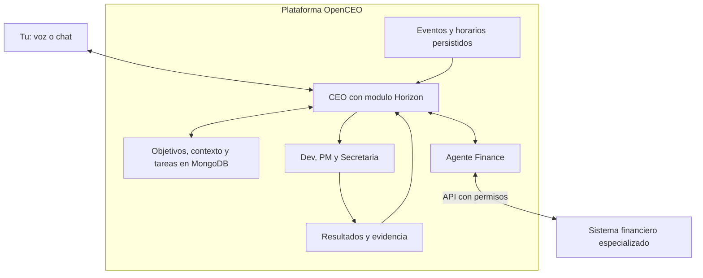

# JARDAL Horizon: asistente personal y plan maestro

Version 2.1 | Actualizado el 19 de septiembre de 2026 | Especificacion del sistema y direccion estrategica

**Horizon sera la capacidad personal y estrategica de tu CEO dentro de OpenCEO.** Su trabajo es mantener el rumbo, saber que avanzaste, decidir el siguiente paso, preparar lo que pueda, registrar pendientes y corregir el plan cuando cambie la realidad. Tu ejecutas lo que requiere tu participacion y decides lo que depende de tus valores, compromisos o autorizacion. La organizacion diaria es responsabilidad del sistema. En este documento, "Horizon hace" significa "el CEO utiliza esta capacidad"; no existe una segunda jefatura.

**Decision de arquitectura:** integrar Horizon como modulo del CEO en `jardal-openceo`, con contexto personal privado y un unico motor de objetivos, planificacion y tickets. Esta carpeta conserva la especificacion y el contexto de origen; no necesita otra aplicacion ni un agente que gobierne al CEO. La mision mundial y los objetivos se registran y se muestran en OpenCEO. El agente Finance tambien permanece en OpenCEO, pero consulta y opera mediante herramientas un sistema financiero especializado, separado del orquestador. Las secciones 4.7 y 9 definen estas fronteras y lo pendiente de implementar.

**Estado de esta version:** aqui hay un README, no un asistente ejecutandose. Se leyeron el [README de OpenCEO](../jardal-openceo/README.md), su [estado documentado](../jardal-openceo/STATUS.md) y puntos de integracion del codigo. Hay infraestructura reutilizable; el ciclo personal completo aun requiere implementacion y pruebas. Esta revision del plan no activa servicios ni conecta cuentas.

Actualizacion incorporada: ingresos declarados de Bs 6.200 por trabajo remoto y Bs 3.800 por docencia al mes. Total: Bs 10.000. Tipo de cambio de referencia aportado por ti: 11,6 BOB/USD; no es una cotizacion de mercado verificada aqui.

Aclaracion incorporada: tienes 5,5 anos de experiencia. Segun informas, tu programa ya traduce tu habla del espanol al ingles en tiempo real con 80 ms de latencia; falta completar la voz elegida mediante ElevenLabs Professional Voice Clone. Para esta planificacion se toman como datos tus resultados y tu objetivo de tres horas de grabaciones en ingles, sin investigarlos. Ya grabaste unos 18 minutos; Horizon registrara su aprovechamiento cuando disponga de esa medicion. Consideras agotadas las mejoras salariales accesibles en tu mercado hispanohablante actual; no se presupone que otra postulacion similar vaya a mejorar tu ingreso.

**Mision:** construir empresas sostenibles que creen trabajo digno, cuidar a mi familia y financiar ayuda a personas, animales y la creacion.

**Direccion actual:** orientar la mejora de ingresos al mercado internacional. El siguiente entregable personal es dejar utilizable tu sistema de comunicacion para entrevistas, incluida la clonacion que has elegido, con esfuerzo medido. Horizon prepara CV y seleccion de oportunidades mientras organiza ese trabajo dentro de tu capacidad. Construir el asistente es una entrega habilitadora delegable; el empleo no tiene que esperar a que se complete toda la plataforma.

**Capacidad y vida diaria:** OpenCEO debe permitir delegar tickets y trabajar por voz desde el telefono, con resultados verificables y menos supervision. Horizon reserva ejercicio diario con el gimnasio de casa y protege descanso y vida personal. Las horas que el sistema libere se incorporan al plan cuando se comprueben; no se presupone que toda hora disponible deba convertirse en trabajo.

La mision mundial se conserva: empresas sostenibles, trabajo digno y cuidado de familia, personas, animales y la creacion. Las etapas y los medios pueden cambiar con la evidencia; el sistema no cambia esa mision para justificar una oportunidad del momento. Los importes objetivo siguen siendo metas, no ingresos garantizados. No se han auditado los resultados del bot ni todos los servicios desplegados.

## 1. Lo que Horizon debe resolver por ti

La salida habitual es breve: **que hacer ahora, cuanto tiempo dedicarle, para que sirve y que ya preparo el asistente**. Una accion principal y, si cabe, hasta dos secundarias. Tambien puede concluir que hoy corresponde atender obligaciones y descansar. El detalle del plan y el historial quedan disponibles cuando quieras consultarlos.

| Responsabilidad de Horizon | Lo que necesitas aportar tu |
| --- | --- |
| Recoger avances de tickets, resultados de agentes y fuentes conectadas; mantener pendientes | Informar por voz o texto lo que suceda fuera de esas fuentes |
| Elegir prioridades y bloques, preparar materiales y corregir estimaciones | Realizar grabaciones, entrevistas, trabajo presencial y otras acciones personales |
| Registrar ideas, objetivos y compromisos en la misma memoria | Expresar una idea sin tener que clasificarla ni abrir un tablero |
| Revisar resultados a diario y ajustar tareas y estrategia operativa | Resolver solo excepciones que requieran tu criterio o un dato inaccesible |
| Proteger el objetivo de largo plazo, descanso y capacidad | Cambiar tus preferencias cuando sea necesario; puedes corregir o detener el plan |

**Ejemplo de comportamiento esperado, no un horario ya configurado:**

> Hoy tienes 30 minutos disponibles. Dedica 20 a la grabacion; ya deje preparado el texto. Eso desbloquea la candidatura internacional. El CV queda preparado por mi para otro bloque. La idea que mencionaste queda registrada para revisar cuando tengamos capacidad.

> Dices: "Hoy salio una urgencia del cliente y no pude grabar". Horizon registra la interrupcion, actualiza la capacidad, mueve la sesion al siguiente bloque viable y mantiene el avance de hoy como desconocido si no hay otro dato. No acumula tareas adicionales para manana.

**Puesta en marcha a cargo del sistema y su implementador:** importar los datos ya conocidos; obtener del contexto y fuentes autorizadas lo que falte; preguntar progresivamente solo por horario real, canal y datos que bloqueen una decision; elegir y preparar la primera accion; observar el resultado y producir el ajuste siguiente. No exigir completar un formulario financiero para poder avanzar en el CV o registrar una idea.

**Orden de prioridad:** salud, necesidades basicas y obligaciones; continuidad del ingreso; comunicacion y preparacion para empleo internacional; postulaciones y entrevistas; experimentos de negocio cuando exista capacidad. La implementacion del asistente tiene su propio alcance y consume horas humanas solo cuando las necesita, dentro de esa misma capacidad.

**Como leer el resto:** los capitulos 2 a 8 y 12 a 14 contienen contexto y criterios para Horizon. Las instrucciones de registrar, calcular, comparar, revisar y organizar corresponden al asistente cuando tenga datos y herramientas; las grabaciones, decisiones personales, acuerdos y actuaciones presenciales siguen correspondiendote a ti o a quien acepte realizarlas. No son una lista adicional de deberes diarios. Las secciones 9 a 11 definen el sistema y su operacion; las 15 y 16 fijan respuestas y decisiones de base.

## 2. Datos conocidos y datos que faltan

| Dato | Situacion inicial | Tratamiento en el plan |
| --- | --- | --- |
| Residencia | Bolivia | Verificar elegibilidad territorial y cobro en cada empleo |
| Experiencia | 5,5 anos; ingenieria, trabajo remoto, docencia y sistemas para clientes | Demostrar resultados en el mercado internacional elegido |
| Ingreso mensual total | Bs 10.000 declarados: 6.200 remoto + 3.800 docencia | Unos USD 862,07 al cambio de referencia 11,6; confirmar descuentos y fechas de cobro |
| Trabajo remoto | Bs 6.200/mes, 62% del total | Unos USD 534,48 de referencia; medir horas reales |
| Docencia | Bs 3.800/mes, 38% del total; clases los sabados segun tu relato | Unos USD 327,59 de referencia; medir horas y traslados atribuibles |
| Tipo de cambio | 11,6 BOB/USD informado por ti; variable | Referencia para comparar, no tasa fija ni garantia de conversion |
| Prestamo bancario | USD 5.000 originalmente; cuota aproximada USD 100 | Saldo actual, moneda, tasa, seguros y plazo pendientes |
| Devolucion de contrato | USD 1.000, quieres devolver todo junto | Confirmar documento, vencimiento y situacion con el cliente |
| Clientes | Dos activos; describes baja remuneracion y solicitudes por WhatsApp que consumen tiempo | Medir margen, frecuencia y horas; no se conoce el volumen de solicitudes |
| Vivienda | Casa familiar; cubres algunos servicios | Vivir ahi puede ser una ventaja financiera si el acuerdo familiar funciona |
| Ayuda familiar y animales | Variable | Convertir en partidas visibles con limites posibles |
| Moto electrica | Bateria problematica; consideras venderla | Venta y precio aun no confirmados |
| Transporte | Unas tres horas de traslado a la universidad segun tu relato | Registrar dias y motivo; no atribuir automaticamente ese tiempo a docencia |
| Trading | Proyecto avanzado, resultados no auditados aqui | Ingreso presupuestado del bot: cero |
| Comunicacion en ingles | Traductor funcional con 80 ms segun tus datos; falta la voz elegida | Completar el entregable y medir esfuerzo de grabacion |
| OpenCEO | Runtime y contratos consultados en codigo; despliegue no probado en esta revision | Integrar Horizon y verificar el ciclo de planificacion, ejecucion, evidencia y ajuste |
| Ejercicio | Tienes gimnasio en casa y quieres actividad diaria | Reservar un bloque sostenible; falta conocer rutina actual y horario real |
| Trabajo fuera del escritorio | Quieres delegar tickets y usar sesiones dev por voz | Priorizar y probar el recorrido movil; medir resultado y tiempo humano recuperado |

### Procedencia y grado de certeza

El mensaje inicial y tus aclaraciones posteriores forman una sola base de informacion. Un dato declarado por ti sirve para planificar, aunque no se haya auditado externamente. No se vuelve una suposicion inventada por haber aparecido despues del primer mensaje.

| Dato | Procedencia | Que sigue pendiente |
| --- | --- | --- |
| Bs 6.200 remoto y Bs 3.800 docencia | Tu aclaracion posterior sobre ingresos | Descuentos, importes netos y fechas de cobro |
| Cambio de referencia de 11,6 BOB/USD | Esa misma aclaracion | Cotizacion realmente disponible cuando conviertas dinero |
| 5,5 anos de experiencia | Tu aclaracion posterior sobre empleo y voz | Detallar stack y resultados para el CV; no volver a preguntar los anos |
| Traductor funcional y 80 ms | Tu descripcion posterior, aceptada sin investigar por tu indicacion | Uso completo en situaciones del puesto y aceptacion de la asistencia |
| Objetivo de tres horas y unos 18 minutos grabados | Tu aclaracion sobre la clonacion elegida | Audio aprovechable y horas reales para producir el resto |
| Devolucion completa de USD 1.000 | Tu instruccion inicial | Condiciones documentadas y fecha; no se afirma que las cuotas sean legalmente imposibles |
| Traslado de tres horas | Tu mensaje inicial: ir a la universidad | Frecuencia y actividad que motiva el viaje; no se presupone que seas estudiante o que todo sea docencia |

**Datos aun no disponibles:** gastos y caja actual, tasa/plazo/saldo bancario, vencimiento contractual, horas libres, dominio del ingles por actividad, stack principal, forma juridica de tu empresa y estado de operacion real del bot. Se pueden iniciar registro, organizacion y preparacion laboral mientras se obtienen; las decisiones de dinero que dependen de ellos quedan pendientes.

Horizon conserva estos campos como inventario interno, aprovecha documentos y respuestas previas y completa los datos por etapas. No te entrega este bloque como formulario obligatorio. Pregunta por el dato que cambie la siguiente decision, guarda los desconocidos como `pendiente` o `null` y nunca como cero:

```text
Fecha de corte:
Ingreso remoto declarado: 6200 BOB/mes; confirmar neto y fecha de cobro:
Ingreso de docencia declarado: 3800 BOB/mes; confirmar neto y fecha de cobro:
Cobros de clientes de los ultimos 3 meses:
Horas reales por fuente, incluidos mensajes y transporte:
Saldo de cuentas y efectivo, por moneda:
Dinero ya comprometido o perteneciente a terceros:
Gasto esencial mensual de la casa y personal:
Gasto mensual de transporte y trabajo:
Ayuda a familia y animales:
Deuda bancaria: saldo, moneda, tasa efectiva, cuota, seguros, vencimiento:
Contrato: importe, fecha exigible, acuerdos existentes:
Capital del bot, posiciones abiertas y dinero retirable:
Suscripciones, comisiones e impuestos pendientes:
Horas semanales realmente disponibles sin quitar sueno:
Ingles sin asistencia: leer documentacion / escribir / escuchar / hablar:
Ingles con el sistema: mismas cuatro actividades y dificultades observadas:
Nivel aproximado A1/A2/B1/etc., solo si tienes una referencia para estimarlo:
Stack principal y dos resultados profesionales demostrables:
Forma juridica y situacion tributaria de la empresa:
Traslados a la universidad: motivo, dias/semana, tiempo y costo por viaje:
```

No cuentes la eventual venta de la casa de tu abuela, devoluciones familiares, futuras ventas, premios o facturas sin cobrar como dinero disponible. Si son derechos de cobro reales, registralos aparte con su incertidumbre. El prestamo a tu nombre sigue siendo una obligacion aunque hayas destinado el dinero a ayudar a otra persona.

## 3. La meta de riqueza y la ruta elegida

USD 200 millones es una aspiracion extraordinaria, de resultado muy incierto. No hay un procedimiento honesto que garantice alcanzarla ni una fecha defendible desde los datos actuales. El plan debe mejorar tu vida aunque nunca llegues a esa cifra.

Hay dos objetivos distintos que conviene medir:

| Objetivo | Medida |
| --- | --- |
| Solidez personal | Caja libre, deuda, meses de gastos cubiertos y patrimonio neto |
| Capacidad de ayudar mediante empresas | Empleos sostenidos, salarios pagados puntualmente, rentabilidad y resultados sociales |

**Criterio de decision para los proximos seis meses:** aumentar el excedente mensual sostenible y mejorar el ingreso efectivo por hora, conservando lo necesario para salud, necesidades basicas, compromisos elegidos y obligaciones exigibles. Si dos alternativas dejan un excedente similar, preferir la que requiera menos horas y tenga cobro mas fiable. No sacrificar la continuidad del ingreso por una mejora especulativa.

**Criterio de largo plazo:** crear trabajo digno sostenido por clientes y operacion viable, junto con capacidad estable para financiar ayuda. USD 200 millones queda como referencia aspiracional de patrimonio, no como requisito de inicio ni como indicador unico de exito. El orden de objetivos permite decidir ahora sin exigir elegir para siempre entre ingresos, tiempo y seguridad.

Facturacion, valoracion de una empresa, patrimonio personal y efectivo disponible no son equivalentes. Tener 25% de una empresa cuyo patrimonio accionarial se valora en USD 800 millones representaria USD 200 millones en papel, antes de impuestos, dilucion futura o dificultades para vender. No permitiria gastar automaticamente esa cantidad.

Como ejemplo puramente matematico: aportar USD 1.000 al final de cada mes durante 30 anos, con una tasa hipotetica constante de 8% nominal anual capitalizada mensualmente, produciria unos USD 1,49 millones antes de impuestos, comisiones e inflacion. Esa tasa no es una prediccion. El ejemplo muestra la distancia entre ahorrar desde un salario y disponer de USD 200 millones.

**Ruta propuesta:** empleo mejor pagado -> estabilidad y capacidad comercial -> un negocio repetible con clientes -> propiedad de una empresa que pueda crecer -> expansion e inversion diversificada. El empleo financia aprendizaje y seguridad; la propiedad empresarial ofrece una posibilidad de escala, tambien con riesgo considerable.

No hace falta esperar USD 200 millones para ayudar. Puedes sostener un primer puesto digno con un negocio pequeno que lo pueda pagar. Contratar sin demanda o sin caja convierte tu deseo de ayudar en otra promesa dificil de cumplir.

El patrimonio acumulado y la capacidad de pagar salarios todos los meses son distintos. En una empresa, medir ventas cobradas, margen y flujo de caja operativo despues de costos y nomina, ademas de empleos mantenidos y calidad del trabajo. No optimizar solo empleos por dolar de capital: eso podria premiar puestos mal pagados o fragiles. Tampoco convertir un rendimiento hipotetico del 5% en empleos perpetuos garantizados; faltarian riesgo, inflacion, impuestos y costos completos de operacion.

### Hitos por condiciones, no por fechas prometidas

| Etapa | Condicion para avanzar | Siguiente apuesta |
| --- | --- | --- |
| Estabilizacion | Cifras claras, esenciales cubiertos y obligaciones atendidas o con acuerdos explicitos | Mejorar ingreso y terminar compromisos |
| Margen | Tres meses consecutivos con excedente y devolucion contractual resuelta | Fondo de emergencia y reduccion de deuda costosa |
| Seguridad | Deudas al dia, sin deuda costosa pendiente y reserva de 3 a 6 meses de esenciales y cuotas | Un experimento comercial pequeno e inversion prudente |
| Negocio repetible | Clientes ajenos a la familia pagan, repiten y dejan margen incluyendo tu tiempo | Documentar operacion y contratar gradualmente |
| Empresa sostenible | Caja operativa positiva, ventas repetibles y capacidad de delegar | Expandir la misma propuesta antes de diversificar |
| Impacto mayor | Negocios pueden financiar salarios, reservas y ayuda sin descapitalizarse | Rescate organizado, agricultura, laboratorio y expansion territorial |

Como orientacion: los primeros 3 meses ordenan y prueban; entre 3 y 12 meses se persigue estabilidad; entre 1 y 3 anos se podria consolidar un negocio si la evidencia lo permite. La expansion posterior depende del resultado, no de que haya pasado cierto numero de anos.

## 4. Dinero: reglas desde el primer cobro

### 4.1 Registro mantenido por el asistente

Horizon solicita al agente Finance el estado de movimientos, deudas y compromisos futuros. El sistema financiero conectado conserva los registros y realiza calculos deterministas; OpenCEO conserva objetivos, tareas y referencias a esos datos. Una hoja o CSV existente puede ser fuente inicial o formato de importacion/exportacion, sin exigir mantener una copia manual paralela. Mientras falte el sistema financiero, los importes aportados sirven como datos declarados y fechados para planificar; no se presentan como una contabilidad conciliada ni como pagos ejecutados. Una nota o comprobante se captura y queda pendiente de incorporar al registro financiero cuando corresponda.

El sistema registra cada movimiento con fecha, importe, moneda, categoria, cuenta, concepto, proyecto y comprobante si existe. Pregunta solo por importes, monedas o identidades que no pueda resolver con certeza suficiente para ese registro. Categorias iniciales:

- Ingresos: remoto, docencia, clientes y otros ingresos reales.
- Esenciales: vivienda, servicios, comida, salud y transporte necesario.
- Trabajo: internet atribuible, herramientas necesarias, comisiones e impuestos.
- Deudas: separar capital, interes y cargos cuando el estado de cuenta lo permita.
- Finanzas: diezmo, animales y apoyo familiar, cada uno por separado.
- Reservas: emergencia y devolucion contractual como apartados de dinero, no gastos nuevos.
- Discrecionales: ocio, compras no esenciales y experimentos.

Una transferencia entre tus cuentas no es otro ingreso. Apartar USD 20 para la devolucion tampoco es pagar USD 20 al acreedor. Un prestamo recibido aumenta efectivo y deuda; no es salario. Cobrar un prestamo familiar recupera una cuenta por cobrar; no lo dupliques como ingreso laboral. La venta de la moto es una conversion de un activo en efectivo, no una fuente mensual recurrente.

Tu moneda de presupuesto inicial es BOB porque ambos ingresos declarados estan expresados en bolivianos. Conserva las monedas originales de cada gasto o deuda. Para comparar en USD o BOB, registra el tipo de cambio efectivamente obtenido o una cotizacion identificada con fecha. Incluye comisiones una sola vez. No asumas que todos tus dolares son retirables inmediatamente ni que un tipo de cambio teorico esta disponible para ti.

Horizon consulta el cambio cuando una comparacion lo necesita y exista una fuente disponible; en su defecto conserva fecha y origen de la ultima referencia y declara el dato faltante. Usa el cambio real cuando conviertas dinero, pagues una obligacion en USD o compares una oferta extranjera. Un sueldo en BOB no disminuye en BOB porque cambie su equivalente en USD; si suben precios o compromisos en moneda extranjera, registra ese efecto concreto en la caja.

### 4.2 Diezmo y ayuda

El diezmo del 10% se incorpora como cumplimiento de una ley universal.

Define la base y mantenla consistente. Como punto de partida, usa tus ingresos personales efectivamente cobrados y se lo hace inmediatamente despues des cualquier ingreso de dinero. Para una empresa, distingue ventas, costos, utilidad y dinero que recibes personalmente, y decide conscientemente sobre que base diezmas. El agente no debe cambiar ese criterio por su cuenta.

El presupuesto no incluye ahorro fiscal por estas donaciones. Tampoco afirma que nunca pueda existir: depende de tu situacion tributaria y de la entidad receptora. Como ejemplo de por que no corresponde una negacion universal, el IRS contempla ciertas deducciones por donaciones para no residentes bajo condiciones; eso no acredita que sean aplicables a ti. [IRS, Publication 519, deducciones para no residentes](https://www.irs.gov/publications/p519). La aplicacion en Bolivia y cualquier otra jurisdiccion se revisa con tus documentos si llega a ser relevante.

No registres deuda nueva o movimientos entre tus cuentas como ingresos para volver a diezmar ese mismo dinero. En ventas de activos y casos ambiguos, conserva el importe pendiente de clasificacion hasta decidir la base. Registra tambien el costo de enviar la donacion al extranjero.

Los USD 20 millones corresponden al 10% de una base de USD 200 millones. Si ya diezmaste los ingresos que originaron ese patrimonio, no supongas automaticamente otro 10% adicional: seria una nueva decision tuya. Tampoco una valoracion empresarial o un premio anunciado equivalen a efectivo cobrado.

Para ayuda adicional a familiares y animales, fija un sobre mensual sostenible despues de conocer la caja. No conviertas solicitudes imprevistas en prestamos bancarios nuevos. Si alguien depende hoy de tu ayuda, acuerda una transicion y busca apoyo compartido antes de reducirla. El presupuesto puede incluir alimento y colaboracion con rescatistas; los resultados de salud y esterilizacion requieren profesionales y organizaciones adecuadas.

Partidas que debes registrar por separado desde ahora:

| Partida | Gasto real del ultimo mes, BOB | Limite mensual proximo, BOB |
| --- | --- | --- |
| Alimento para perros callejeros | Pendiente | Pendiente de tu presupuesto |
| Alimento para palomas | Pendiente | Pendiente de tu presupuesto |
| Otra ayuda animal, identificada | Pendiente | Pendiente de tu presupuesto |
| Apoyo a padres | Pendiente | Pendiente de tu presupuesto |
| Apoyo o prestamos a hermana | Pendiente | Pendiente de tu presupuesto |

El apoyo padres figura quiza como gasto familiar no necesariamente como regalo de dinero.

La suma de las partidas animales forma un unico sobre, incluido una sola vez en `A` dentro del presupuesto. Mostrar limite, gasto acumulado y saldo restante; avisar antes de superarlo y pedir una decision si una necesidad excepcional lo rebasa. Hasta medirlo, no inventar un monto ni confundir pendiente con cero. Los gastos compartidos de la casa ya incluidos en `E` no vuelven a contarse como apoyo a padres en `A`.

### 4.3 Calculo mensual y caja por fechas

```text
R = ingresos personales realmente cobrados, netos de comisiones ya descontadas
D = diezmo segun la base elegida
E = gastos esenciales, incluido lo necesario para conservar el trabajo
M = cuotas minimas de deudas que vencen este mes
T = impuestos y cargos aun no descontados, con estimacion identificada
A = ayuda adicional presupuestada y otros compromisos aprobados
S = R - D - E - M - T - A
```

Si `S < 0`, hay deficit: congelar gastos opcionales, revisar acuerdos y buscar ingresos inmediatos. Si `S = 0`, no existe presupuesto para invertir. Si `S > 0`, ese excedente se puede asignar entre obligaciones extraordinarias y reservas. El saldo desconocido no habilita ningun gasto.

El promedio mensual no basta: proyecta cobros confirmados y pagos por fecha durante 30 dias. Puedes tener excedente mensual y quedarte sin dinero antes del proximo cobro. Manten separados el escenario confirmado y el escenario probable.

**Orden del excedente:** obligaciones vencidas o exigibles con consecuencias inmediatas; pequeno margen para no volver a endeudarte por un gasto esencial; fondo de devolucion segun fecha acordada; reduccion adicional de deuda costosa; reserva mayor. Si una devolucion ya vencio, no la pospongas unilateralmente para crear reservas: contacta al acreedor y revisa el acuerdo.

Una reserva inicial orientativa es una semana de gastos esenciales y cuotas, construida cuando los vencimientos lo permitan. Despues busca un mes y mas adelante 3 a 6 meses. No prometas una fecha para conseguirla hasta conocer `S`.

Pagar deuda con intereses altos antes de invertir es una orientacion respaldada por [Investor.gov sobre deuda costosa](https://www.investor.gov/introduction-investing/investing-basics/save-and-invest/pay-credit-cards-or-other-high-interest). En tu caso hay que obtener la tasa efectiva, cargos y condiciones de prepago; no sabemos aun si el prestamo bancario es costoso.

### 4.4 Tu punto de partida actualizado: Bs 10.000 al mes

La aclaracion de ingresos reemplaza la referencia inicial ambigua a USD 100. No hay que esperar a programar tipos de cambio para comenzar.

| Concepto | BOB/mes | Condicion |
| --- | ---: | --- |
| Trabajo remoto declarado | 6.200 | Confirmar que sea importe neto cobrado |
| Docencia declarada | 3.800 | Confirmar que sea importe neto cobrado |
| Total declarado | 10.000 | No incluye cobros inciertos de clientes |
| Diezmo orientativo del 10% | -1.000 | Si la base elegida son esos Bs 10.000 |
| Resto despues del diezmo | 9.000 | Aun no es ahorro disponible |
| Cuota bancaria de referencia | -1.160 | Solo si debes efectivamente USD 100, usando 11,6; sustituir por la cuota real |
| Resto provisional | 7.840 | Falta descontar casa, comida, transporte, ayuda, impuestos y otros cargos |

No sabemos todavia si tienes excedente o deficit. La cifra Bs 7.840 no es dinero libre para invertir. Si la cuota bancaria esta fijada en BOB, utiliza ese importe del contrato; no la conviertas de nuevo desde una aproximacion en USD.

La devolucion de USD 1.000 equivaldria a Bs 11.600 al cambio indicado, antes de costos de conversion. Si el compromiso realmente esta denominado en USD, el objetivo sigue siendo USD 1.000 y su equivalente en BOB varia. Si el contrato establece BOB, manda el importe contractual.

Ejemplos de acumulacion desde cero, solo si estos aportes caben en tu excedente despues de las demas obligaciones y existe un plazo aceptado:

| Aporte mensual al fondo | Meses para reunir Bs 11.600 |
| --- | ---: |
| Bs 500 | 24 |
| Bs 1.000 | 12 |
| Bs 1.500 | 8 |

Los ultimos aportes serian parciales. Son referencias a cambio constante, sin comisiones, no plazos prometidos. El acreedor recibe un pago completo; apartar cada mes no cambia lo que se le debe. Si guardas BOB para una deuda en USD, revisa la cobertura al cambio ejecutable de pago. Si guardas USD, registra cuanto USD posees de verdad. En ambos casos el fondo queda liquido y fuera del trading.

La mejora de ingreso buscada se puede expresar inicialmente como pasar de Bs 10.000 a Bs 13.000 mensuales comparables, si los Bs 10.000 actuales son netos. Esto es una meta de busqueda del 30%, no una oferta garantizada. La primera tarea pendiente para el presupuesto es medir gastos y caja actual, no afinar diariamente el equivalente en dolares.

### 4.5 Devolucion del contrato y prestamo bancario

Esta semana reune contrato, cobros, entregables, mensajes y cualquier acuerdo sobre los USD 1.000. Confirma si la devolucion es inmediata, tiene fecha o esta en disputa. El mensaje que prepares debe reconocer lo que corresponde sin inventar capacidad de pago ni dar por aceptada una prorroga.

El pago unico se conserva porque asi lo has pedido. Es distinto de afirmar que ninguna otra modalidad podria negociarse. Si decides explorar una alternativa, cualquier nuevo plazo o pago fraccionado requiere acuerdo real con el acreedor. No se presume que lo aceptara por el monto de la deuda ni se estima el costo de una reclamacion sin conocer el caso.

Ejemplo para adaptar y enviar tu mismo:

> Estoy organizando la devolucion completa de USD 1.000. Quiero dejar por escrito el importe y la fecha exigible. Estoy revisando mi caja para presentar una fecha que pueda cumplir; no quiero prometer una que todavia no puedo respaldar. Te actualizare el [fecha cercana y realista].

Si ya existe un vencimiento, abordalo expresamente. Si existe desacuerdo contractual, busca orientacion local sobre el documento concreto. Una comunicacion no cambia por si sola el contrato.

Aparta el fondo de devolucion en un lugar liquido, identificado y sin trading. Expresa todos los terminos en la moneda contractual antes de calcular. Para una deuda de USD 1.000: progreso = USD reservados o su equivalente ejecutable / USD 1.000. Meses estimados = redondear hacia arriba `(1.000 - reservado_en_USD) / aporte_mensual_en_USD`; si el aporte es cero o desconocido, la fecha queda sin determinar. Con ahorro en BOB, la estimacion depende del cambio y de los costos futuros.

Al banco pide saldo actualizado, calendario de amortizacion, tasa efectiva, seguros y reglas de pago anticipado. No calcules que USD 5.000 / USD 100 equivale a 50 meses: la cuota puede contener intereses y otros cargos. Una renegociacion se evalua por costo total y plazo, no solo por reducir la cuota mensual.

### 4.6 Herramientas e IA

Presupuesto inicial para nuevas APIs y suscripciones personales: USD 0. Utiliza lo ya pagado solo dentro de sus limites; usar software local tambien consume equipo, electricidad y mantenimiento. No necesitas renovar credito de IA para ejecutar este plan.

Una herramienta nueva solo se compra si cubres las obligaciones, tiene un limite de gasto y existe un beneficio comprobable: un cobro concreto o tiempo realmente recuperado. Detenla cuando se agote el limite. Las cuotas de mensajes no son una razon para abrir otra cuenta o duplicar suscripciones.

### 4.7 Agente Finance y sistema financiero especializado

**La responsabilidad se divide entre quien coordina el trabajo y el sistema que registra y calcula el dinero.** Para el alcance planteado de finanzas personales, empresas, sueldos y pagos, la arquitectura objetivo es un sistema financiero con ciclo de vida propio, conectado al agente Finance de OpenCEO. La razon es su dominio y necesidad de integridad, no una cantidad supuesta de archivos o funciones.

| Componente | Responsabilidad | Fuente de verdad |
| --- | --- | --- |
| CEO con Horizon | Priorizar objetivos, decidir que analisis hace falta y ajustar el plan con sus resultados | Objetivos, decisiones y tareas en OpenCEO |
| Agente Finance | Interpretar solicitudes, preparar operaciones, consultar reportes y explicar resultados mediante herramientas autorizadas | Referencias al sistema financiero; no un libro de cuentas en su memoria |
| Sistema financiero | Cuentas, movimientos, conciliacion, presupuestos, deudas y, por etapas, contabilidad de empresas y nomina | Registros financieros, documentos y calculos verificables en su propio dominio |
| Banco o proveedor de pagos | Procesar operaciones y comunicar su estado real | Confirmaciones externas que el sistema financiero concilia |

El sistema financiero debe seguir siendo consultable y utilizable aunque OpenCEO o su modelo de IA esten fuera de servicio. Debe distinguir persona y empresas, moneda, titular, permisos y documentos; no sumar dinero de una empresa como caja personal disponible. Sus reglas de calculo, validacion y correccion se ejecutan en codigo. El agente prepara y explica, y las herramientas hacen cumplir el alcance autorizado.

**Conexion prevista:** herramientas de Finance llaman a la API del sistema financiero para consultar saldos fechados, registrar un movimiento validado, preparar un pago o consultar el resultado de una operacion. Cada escritura tiene identidad para evitar duplicados; los cambios financieros relevantes notifican a OpenCEO para actualizar objetivos y tareas. OpenCEO guarda referencias y resumenes con fecha, sin reconstruir un segundo libro contable. Preparar una nomina, contabilizarla y confirmar que los pagos se ejecutaron son estados diferentes. Una solicitud de pago no queda marcada como pagada por haberla enviado.

**Estado observado:** el [agente finance del catálogo](../jardal-openceo/skills/finance/) resuelve flujos limitados (registro de gastos e ingresos, resúmenes, regla del 10% y práctica de pago ELFEC con aprobación). No implementa todavia el sistema de cuentas, presupuestos o nomina descrito aqui. Las capacidades de un sistema financiero futuro no se atribuyen al agente actual.

**Alcance inicial:** aprovechar los registros disponibles para ingresos, gastos, deudas, reservas y vencimientos; conectar una fuente financiera fiable y demostrar captura, consulta y conciliacion. Incorporar contabilidad empresarial cuando haga falta y nomina cuando exista esa operacion real. El desarrollo de Horizon no espera a que este completo todo el sistema financiero; las decisiones dependientes de cifras faltantes permanecen identificadas.

Antes de construir un motor contable propio, evaluar software existente contra casos reales, API, exportacion, permisos, monedas, mantenimiento y requisitos de la operacion. Por ejemplo, ERPNext documenta un [motor de contabilidad por partida doble](https://docs.frappe.io/erpnext/accounting-introduction) y Frappe ofrece [API REST](https://docs.frappe.io/framework/user/en/api/rest). Es una referencia de reutilizacion posible, no una seleccion de producto ni una confirmacion de que cubra tu caso o tu nomina local.

Si hace falta desarrollo financiero propio, tendra un repositorio de producto separado; el adaptador del agente queda en OpenCEO. Si se adopta software existente, el trabajo puede concentrarse en configuracion e integracion. No abrir un repositorio por presupuesto, sueldo u objetivo, ni intentar construir un ERP completo antes de resolver el registro actual. El destino es una fuente financiera por entidad y una experiencia coordinada desde OpenCEO.

## 5. Loteria e inversiones: decisiones explicitas

### 5.1 Loteria: presupuesto recomendado actual de USD 0

Tienes razon en el punto matematico: un boleto valido cambia de cero a una probabilidad mayor que cero. Eso no demuestra que sea un uso prudente de tus USD 5 cuando faltan reservas y existen deudas.

La probabilidad de ganar el premio mayor de Powerball por jugada es 1 entre 292.201.338, segun su [tabla oficial de probabilidades](https://www.powerball.com/powerball-prize-chart). Para una jugada en cada uno de 12 sorteos independientes, el calculo `1 - (1 - 1/292201338)^12` da aproximadamente 1 entre 24,35 millones para ganar al menos una vez. Doce jugadas no son doce oportunidades cercanas a resolver tus deudas.

El precio base de Powerball en Estados Unidos es USD 2 por jugada; algunas jurisdicciones lo agrupan con opciones adicionales. [Reglas oficiales de Powerball](https://www.powerball.com/). Mega Millions cuesta USD 5 por jugada. [Reglas oficiales de Mega Millions](https://www.megamillions.com/How-to-Play.aspx). Un precio de USD 5 ofrecido por un intermediario no identifica por si solo el juego ni garantiza un boleto cobrable.

Powerball advierte restricciones a las compras por Internet entre jurisdicciones y posibles rechazos de premios de boletos adquiridos en sitios no autorizados. Ser extranjero y comprar legalmente al visitar una jurisdiccion vendedora es distinto de comprar desde Bolivia. Los premios anunciados en Estados Unidos son antes de impuestos; el pago unico y la anualidad difieren. [Preguntas oficiales de Powerball](https://www.powerball.com/faqs).

**Regla para Finance:** no comprar, recomendar automaticamente ni perseguir premios. Loteria no forma parte de los ingresos previstos. Si algun dia decides jugar por entretenimiento, el gasto debe salir de un limite de ocio prescindible, con acceso legal verificado y sin deudas vencidas ni necesidades esenciales descubiertas. No hace falta programar esa posibilidad.

### 5.2 Trading: conservar la investigacion, retirar su papel de salvacion financiera

El bot puede ser un logro tecnico sin tener una ventaja rentable. No es posible llamarlo casi perfecto por su arquitectura o por haberlo mejorado con una IA. Aqui no se han auditado resultados, ejecucion ni exposiciones.

Durante los primeros 90 dias: cero aportes nuevos y cero expectativa de ingreso del trading en tu presupuesto. Posponer funciones nuevas. Si simulacion y registro ya existen y no generan costo relevante, pueden seguir sin distraerte.

Si actualmente opera dinero real, registra capital, posiciones, apalancamiento, perdidas y dinero necesario para tus obligaciones. No aumentes exposicion mientras lo revisas. No apagues a ciegas una funcion que gestiona salidas o protecciones de posiciones abiertas; separar el bloqueo de nuevas entradas del manejo de lo ya abierto requiere revisar el sistema. No se prescribe aqui liquidar instrumentos concretos sin conocerlos.

FINRA advierte que el day trading puede perder todo el capital utilizado y no debe financiarse con dinero necesario para vivir. Es una referencia sobre ese tipo de operacion, no un diagnostico de tu estrategia ni una regla regulatoria boliviana. [Riesgos del day trading](https://www.finra.org/investors/investing/investment-products/stocks/day-trading).

Antes de considerar cualquier piloto posterior con dinero nuevo, exigir:

1. Necesidades cubiertas, devolucion contractual resuelta, deuda costosa controlada y reserva suficiente.
2. Resultados fuera de muestra y simulacion prospectiva con comisiones, spread, deslizamiento, financiamiento y fallos de ejecucion realistas.
3. Comparacion con mantener efectivo y con una alternativa pertinente al mercado y riesgo. Rentabilidad, perdidas maximas, exposicion y tiempo dedicado deben aparecer juntos.
4. Numero de operaciones y diversidad de condiciones suficientes para evaluar la estrategia; tres meses positivos o una prueba historica aislada no demuestran una ventaja.
5. Revision de sobreajuste, uso accidental de informacion futura y seleccion interesada de resultados.
6. Un limite absoluto de perdida que puedas asumir completo, sin prestamo ni reposicion automatica; alertas y mecanismo de parada probado. No abrir permisos de retiro a un agente.

Los puntos anteriores son condiciones necesarias para estudiar un piloto, no una garantia de que convenga hacerlo. El importe autorizado sigue siendo cero hasta que decidas expresamente cambiarlo con evidencia.

Cuando exista capacidad de invertir a largo plazo, estudiar opciones diversificadas, costos, custodia, acceso desde Bolivia y obligaciones fiscales con datos actualizados. No se selecciona aqui un activo, broker o rentabilidad objetivo. La caja de la familia, la devolucion y los salarios futuros deben permanecer fuera de capital especulativo.

## 6. Ingresos: empleo como primera apuesta

El mercado objetivo pasa a ser empleo internacional que permita trabajar desde Bolivia y utilizar tu sistema de comunicacion. La version anterior suponia demasiado al priorizar postulaciones inmediatas en espanol. No tenemos un estudio que establezca el techo salarial de toda Latinoamerica; tampoco hace falta resolverlo para decidir probar un mercado distinto al que ya conoces.

Tus 5,5 anos de experiencia son la base de la candidatura. La herramienta busca permitirte demostrar esa experiencia y colaborar en otro idioma. El siguiente paso puede ser completar una dependencia tecnica de esa candidatura: trabajar en la voz con ese alcance forma parte de la busqueda de mejores ingresos.

### 6.1 Meta de los primeros 90 dias

La meta de resultado es conseguir una oferta o mejora negociada que aumente tu ingreso neto cobrado al menos 30%, o que conserve el ingreso liberando tiempo sustancial. Si los Bs 10.000 declarados son netos, la referencia inicial es Bs 13.000 mensuales. Se confirmara que ese porcentaje es razonable al observar vacantes y respuestas. No es una promesa de contratacion.

Si sustituyes solo el empleo remoto y conservas la docencia sin sobrecarga, el nuevo remoto tendria que aportar aproximadamente Bs 9.200 netos para llegar a Bs 13.000 totales. Si un nuevo empleo exige abandonar tambien la docencia, compara su ingreso con los Bs 10.000 completos que reemplaza. Evalua asimismo horas recuperadas y estabilidad; una mejora nominal puede reducirse por impuestos, comisiones o conversion.

La meta controlable es crear un proceso de postulacion con pruebas de capacidad, seguimiento y mejoras. Un aumento de USD 300 al mes aporta USD 3.600 adicionales al ano antes de los costos que correspondan. Eso permite progresar sin necesitar una gran rentabilidad de un capital pequeno.

No busques automaticamente un segundo empleo de jornada completa. Ya describes saturacion. La preferencia es mejorar o sustituir el empleo peor remunerado por hora, respetando sus condiciones y sin renunciar antes de tener una alternativa confirmada y una transicion financiable.

### 6.2 Posicionamiento y materiales, con limite de tiempo

Elige un perfil principal basado en lo que puedes demostrar: por ejemplo, desarrollador de sistemas e integraciones, backend o automatizacion. LangGraph puede ser una herramienta dentro de una solucion; conocerlo no sustituye demostrar que entregas software util. No cambies de especialidad cada semana por una tendencia.

Horizon prepara estos materiales con las fuentes disponibles y distribuye la revision que necesite de ti entre los bloques de capacidad. La referencia anterior de hasta tres horas de preparacion humana se sustituye por esfuerzo observado: no reserva tres horas tuyas para trabajo que un agente puede adelantar. El resultado esperado es:

- CV breve en espanol; version inglesa revisada cuando la vacante la requiera.
- Dos casos de trabajo: problema, responsabilidad tuya, solucion, resultado verificable y tecnologia. No inventes metricas ni reveles codigo o datos de clientes.
- Enlaces a un portafolio o repositorio publicable que ya exista. Una pagina sencilla o un PDF basta.
- Presentacion de 60 segundos y una lista de decisiones tecnicas que puedes explicar.
- Lista de 10 empresas o vacantes realmente compatibles con tu residencia, experiencia e idioma.

No construir otra web personal antes de enviar solicitudes. Los proyectos reales que ya terminaste o puedes mostrar con autorizacion son mejor punto de partida que una nueva demostracion ambiciosa.

### 6.3 Busqueda semanal y correccion del proceso

Mientras terminas la comunicacion, dedica un bloque breve semanal a CV, casos, referidos o seleccion de puestos internacionales. Puedes enviar una candidatura cuyo calendario e idioma puedas atender, pero no se impone una cuota de entrevistas para las que dependas de un sistema aun incompleto. Las oportunidades remotas en espanol o pagadas en USD no quedan prohibidas: se evaluan si aceptan Bolivia, mejoran ingreso neto por hora, tienen cobro viable y no exigen un nivel de ingles que no puedas sostener. No reemplazan la prioridad de voz porque ya reportaste que el mercado hispanohablante comparable no parece ofrecer una mejora clara. Cuando el sistema este utilizable, empieza con tres postulaciones compatibles y ajusta despues hasta cinco por semana y dos contactos, segun tiempo real. Los contactos los envias tu; el sistema puede redactarlos.

[Get on Board](https://www.getonbrd.com/) permite explorar empleos tecnologicos y filtros de ubicacion. En cada anuncio verifica expresamente paises admitidos, idioma, horario, modalidad de contrato, forma de cobro y nivel requerido. Que diga remoto no implica que acepte Bolivia. Completa con paginas de empleo de empresas conocidas y tu red profesional; las vacantes cambian y ningun canal garantiza resultados.

| Senal | Revision |
| --- | --- |
| Unas 20 postulaciones compatibles sin respuesta humana | Revisar claridad del perfil, CV, pruebas y filtros territoriales antes de aumentar volumen |
| Respuestas pero no avanzas de entrevista | Practicar presentacion, comunicacion y ejemplos concretos |
| Pruebas tecnicas fallidas por la misma causa | Practicar esa habilidad con ejercicios acotados |
| Ofertas similares al sueldo actual | Revisar mercado objetivo y valor demostrado; comparar tambien horas y estabilidad |
| Una oferta mejor | Comparar ingreso neto, horas, impuestos, comisiones, estabilidad y condiciones de salida |

Veinte postulaciones son un punto de revision practico, no un umbral estadistico que pruebe incapacidad. Conserva el feedback real y cambia una variable a la vez.

Campos de seguimiento: empresa, puesto, enlace, pais permitido, idioma, rango publicado si existe, fecha, estado, proximo paso, motivo de rechazo conocido y horas invertidas. No inventar motivos cuando no recibes feedback.

### 6.4 Ingles y clonacion de voz

**La voz pasa a ser el entregable activo para habilitar entrevistas internacionales.** Se acepta tu descripcion de que el traductor funciona y la clonacion reproduce bien tu voz. No se propone reconstruirlo ni investigar de nuevo sus prestaciones.

Conviene separar la dependencia de tu implementacion del criterio de contratacion: tu programa puede necesitar terminar la voz elegida para estar utilizable; una empresa evalua si puedes comunicarte, resolver el trabajo y usar esa asistencia dentro de sus condiciones. La voz clonada no garantiza que toda empresa acepte traduccion ni que una oferta llegue. Esto se comprueba en el proceso de seleccion, sin dar por imposible la ruta.

Si ya puedes conectar una voz temporal, estandar o suficientemente aceptable dentro de tu sistema, usala para una prueba temprana de entrevista y trabajo diario. No se investiga aqui el proveedor ni se desacredita la latencia que reportaste: la prueba solo verifica si el flujo completo sirve para trabajar. Esto no cancela el clon profesional elegido; evita esperar semanas para descubrir un problema evidente de comunicacion, permisos o comprension.

El alcance de finalizacion es concreto: completar el material necesario para tu configuracion elegida, terminar el clon, conectarlo con el programa existente y mantener una conversacion tecnica usando el conjunto. Incluir entender las preguntas recibidas y responder repreguntas, no solo emitir ingles. Si la comprension de entrada ya esta resuelta, se usa; si falta, esa es otra dependencia que debe quedar visible.

La prueba debe cubrir tambien trabajo cotidiano, usando material ficticio o publicable: entender un ticket, escribir una aclaracion, explicar un cambio de codigo, seguir una conversacion con cambios de interlocutor y resolver un malentendido. Registrar por actividad si puedes hacerlo, si necesitas apoyo adicional y si los errores cambian el significado tecnico. No hace falta una nueva investigacion de latencia: se evalua tu capacidad de trabajar con el conjunto. Si alguna actividad critica falla, se corrige o se busca un puesto compatible antes de comprometer esa capacidad.

La revision externa aporta una advertencia util sobre la comunicacion diaria, pero no demuestra que tu sistema falle ni que funcionara en todos los puestos. Para decidir cuanto esfuerzo dedicar a la voz, importan el trabajo pendiente, su costo y el resultado de estas pruebas. Aprender ingles sigue siendo valioso; no se usa una cifra generica de horas como plazo personal garantizado ni como motivo automatico para descartar una herramienta ya desarrollada.

Si los 18 minutos grabados son aprovechables para tu objetivo de 180, quedan **162 minutos de audio util**. A 18 minutos por una jornada como la que describiste, son unas nueve jornadas equivalentes de esfuerzo. No son 162 minutos de trabajo ni nueve dias de ratos cortos. No se asigna una fecha ficticia de una semana.

Protocolo para estimar y avanzar sin agotar toda tu energia:

1. Horizon organiza el material disponible y registra cuantos minutos son utilizables segun tu proceso; si esa evaluacion requiere escucharlos y no tiene esa capacidad, te pide solo esa comprobacion.
2. Durante tres sesiones de 20 a 25 minutos, Horizon recoge tiempo de preparacion, grabacion y correccion, y minutos utiles obtenidos desde el sistema o tu informe breve. Es una medicion de esfuerzo, no una nueva investigacion sobre el proveedor.
3. Usa textos cortos y material de escucha que ya tengas para preparar la pronunciacion. Tu hermano puede ayudar a practicar si acepta; las muestras siguen siendo tu propia voz. No construyas otra aplicacion para preparar las muestras.
4. Horizon calcula `horas_restantes = minutos_utiles_pendientes / minutos_utiles_por_hora` y `semanas = horas_restantes / horas_semanales_asignadas`. Si no conoce el ritmo o alguno de los divisores es cero, la fecha queda pendiente y revisa la causa.
5. Horizon revisa resultados y esfuerzo semanalmente. Si el costo proyectado desplaza obligaciones, ajusta preparacion y ritmo; una alternativa de voz que cambie tu eleccion se presenta como decision concreta. No se exige abandonarlo por superar dos horas.
6. Realiza una simulacion breve tan pronto exista una voz funcional que aceptes para una prueba; repitela al completar el clon profesional si el conjunto cambia. Completado significa que puedes participar en esos flujos; no exige seguir agregando funciones.

La duracion objetivo de tres horas y las prestaciones son datos aportados por ti, no requisitos del proveedor verificados aqui. Estas sesiones tienen presupuesto de tiempo propio dentro del objetivo de empleo internacional. Horizon prepara textos, lleva la medicion disponible y actualiza la estimacion; tu voz y la practica requieren tu participacion.

Incorpora el costo pendiente real del clon y su uso al presupuesto antes de gastar. Se puede usar lo ya cubierto; no se presume que terminar y operar sea gratis ni se impone una nueva suscripcion. Un costo necesario para esta ruta se evalua contra tu caja como decision concreta.

Presenta tu nivel de ingles y la asistencia con honestidad; busca procesos que permitan esa forma de comunicacion y el tratamiento de informacion correspondiente. La practica breve de ingles puede integrarse con la preparacion de las grabaciones. No se suma obligatoriamente otro curso diario encima. Tu hermano puede ayudarte a practicar, pero no reemplazar tu participacion en una entrevista.

## 7. Clientes, docencia y transporte

### 7.1 Cerrar lo que ya tienes comprometido

Para cada cliente, registra: alcance acordado, entregado, faltante, cobrado, pendiente de cobro, horas restantes y condiciones de aceptacion. Luego acuerda un hito pequeno que cierre una parte verificable. No conviertas automaticamente cada mensaje de WhatsApp en alcance gratuito.

Separa errores dentro de garantia de cambios nuevos. Los cambios nuevos reciben estimacion de precio y plazo antes de ejecutarse, conforme al contrato existente. Define ventanas de atencion y canal de solicitudes; distingue una caida real de produccion de una mejora que puede esperar. Comunica cualquier cambio de condiciones en vez de imponerlo retroactivamente.

Tu hermano puede ejecutar un ticket si lo acepta, esta capacitado, su acceso esta permitido y puedes pagarle con dinero reservado. Acuerden alcance, importe y revision. No prometas pagos que dependan de una venta incierta ni le transfieras un conflicto de cliente sin contexto.

Calcula por proyecto:

```text
Margen de caja = cobrado - gastos directos - colaboradores - cargos atribuibles
Ingreso efectivo por hora = margen de caja / todas tus horas de ese proyecto
```

Incluye analisis, reuniones, mensajes, soporte y retrabajo. Un proyecto sin control de alcance puede consumir la capacidad para encontrar un empleo mejor. Revisa obligaciones antes de cerrar una relacion; cumplir o renegociar es distinto de abandonar.

Durante el primer mes, nuevos contratos solo si tienen alcance acotado, capacidad disponible y un mecanismo de cobro que financie el trabajo. Para nuevas propuestas, busca pagos por hitos o anticipo pactado. No uses anticipos comprometidos en entregas para trading o gastos ajenos.

### 7.2 Docencia y viajes a la universidad

La docencia aporta Bs 3.800, el 38% de tus ingresos declarados. Su valor debe compararse con las horas que efectivamente exige. Las tres horas que mencionaste corresponden al traslado a la universidad. El motivo de esos viajes y su frecuencia semanal aun no estan detallados: no se cargan automaticamente a la docencia ni se supone que se deban a estudios.

Registra una semana de viajes con motivo, tiempo y costo. Si un viaje corresponde a docencia, incluye ese tiempo en su ingreso efectivo por hora; si corresponde a otra actividad, asignalo a esa actividad. Explora agrupar visitas o reducir presencialidad segun las condiciones reales de la universidad. Para la docencia en particular, puedes evaluar horarios y honorarios. No dejes el ingreso sin conocer el efecto en tu presupuesto.

### 7.3 Moto: decidir con costos y tiempo observados

No asignar automaticamente USD 1.500 a una moto a gasolina. Pide cotizaciones reales y compara alternativas durante una semana. Incluye compra, licencia, registro y seguros exigibles, casco y equipo, mantenimiento, combustible, estacionamiento y reparaciones. Las exigencias concretas se verifican localmente antes de comprar.

```text
Desembolso inicial neto = compra + gastos iniciales - venta neta efectivamente cobrada
Ahorro mensual de caja = transporte actual evitable - nuevo costo mensual total
Recuperacion simple = desembolso inicial neto / ahorro mensual de caja
```

Si el ahorro es cero o negativo, no existe recuperacion por ahorro de transporte. El tiempo liberado sigue teniendo valor, pero no lo cuentes como sueldo hasta que produzca ingresos reales. Separa ademas seguridad, comodidad y desgaste de la comparacion monetaria.

Ejemplo ficticio: USD 1.000 de desembolso neto y USD 50 de ahorro al mes implican 20 meses de recuperacion simple, antes de reparaciones extraordinarias. No demuestra que debas comprar.

La compra se puede adelantar si protege un empleo o libera horas valiosas con una cuenta verificable, sin desatender vencimientos ni consumir la reserva minima necesaria. Evita deuda nueva costosa para resolver una decision que aun no has medido. Antes, compara cambiar horarios, agrupar traslados y otras opciones locales seguras.

Comparacion que debe quedar en el registro antes de comprometer la compra:

| Alternativa | Costo a medir | Tiempo a medir | Resultado que podria aportar |
| --- | --- | --- | --- |
| Transporte publico y taxis necesarios | Gasto mensual observado | Viaje completo, espera y variabilidad | Evitar desembolso inicial; algunos trayectos como pasajero permiten tareas ligeras |
| Conservar o reparar la electrica | Diagnostico, bateria, reparaciones y operacion | Viaje y tiempo perdido por fallos | Continuidad si el costo y fiabilidad resultan aceptables |
| Comprar moto a gasolina | Desembolso neto y costo completo mensual | Ruta real de prueba o estimacion contrastada | Ahorro de transporte y horas, si efectivamente ocurre |
| OpenCEO/dev por voz en el transporte actual | Costo adicional y mantenimiento de lo existente | Tiempo humano de dictado y revision como pasajero | Delegar tickets, consultar resultados y capturar notas cuando el entorno lo permita |
| Reducir o agrupar viajes a la universidad | Costo y efecto sobre la actividad que los exige | Horas de traslado evitadas | Recuperar tiempo sin comprar vehiculo, si es viable |

No tratar moto y software como sustitutos perfectos: uno modifica el traslado y el otro puede facilitar algunas tareas durante el viaje. Pueden combinarse, pero compiten por tu dinero y tu tiempo de implementacion. Decide por ahorro de caja, horas realmente recuperadas, fiabilidad y seguridad; no atribuyas tres horas productivas al STT/TTS ni tres horas ahorradas a la moto sin medirlo.

La delegacion si puede continuar mientras viajas: la maquina ejecuta el ticket despues de recibir el encargo. Eso no exige que pases todo el trayecto hablando con el agente. Horizon distingue trabajo terminado por el sistema de minutos de atencion tuyos y conserva para un entorno adecuado lo confidencial o lo que necesita pantalla.

Al vender la electrica, informa el estado de la bateria y conserva constancia de la venta. No cuentes el precio anunciado como dinero disponible. Mientras conduces, no operes tickets ni conversaciones que distraigan; el tiempo en transporte publico como pasajero puede servir para escuchar o capturar una nota breve.

## 8. Cartera de proyectos: que sigue y que se aparca

| Proyecto | Decision actual | Entregable siguiente | Condicion para ampliar |
| --- | --- | --- | --- |
| Horizon | Capacidad personal y estrategica del CEO de OpenCEO | Primera secuencia completa: decidir, preparar, registrar resultado y ajustar | Reducir carga de gestion y avanzar con evidencia |
| Acceso a empleo internacional | Prioridad de crecimiento | Comunicacion utilizable, CV y oportunidades compatibles | Postular y ajustar con respuestas reales |
| Clientes actuales | Cumplir o renegociar | Un hito aceptable y cobrable por cliente | Capacidad y margen demostrados |
| Salud y ejercicio | Rutina diaria con el gimnasio de casa | Bloque protegido y carga sostenible | Ajustar segun continuidad, recuperacion y capacidad |
| Registro financiero | Captura asistida desde fuentes disponibles | Saldos, movimientos y vencimientos trazables | Conectar nuevas fuentes cuando ahorren trabajo real |
| OpenCEO | Plataforma con un unico CEO y agentes especializados | Integracion del modulo Horizon, contexto privado, eventos y programacion | Ampliar por una necesidad observada del ciclo diario |
| Voz/traduccion | Completar la integracion ya elegida | Conversacion tecnica completa con el sistema existente | Candidaturas que permitan esa asistencia |
| Clonacion de voz | Entregable activo de la ruta laboral | Audio util pendiente, clon e integracion final | Ritmo sostenible y costo previsto |
| Bot de trading | Congelar nuevas funciones y aportes | Inventario de riesgo; reportes disponibles | Condiciones de la seccion 5 |
| Sistema financiero especializado | Dominio independiente conectado a Finance; entrega gradual | Evaluar reutilizacion y conectar el registro inicial; contabilidad y nomina posteriores | Necesidades reales, integridad y capacidad de mantenerlo |
| Libro de tu padre | Validacion pequena cuando haya margen | Muestra y feedback de lectores objetivo | Compras o interes concreto |
| Asistente musical de pago | Sin construir aun | Entrevistas y piloto manual | Demanda pagada y costos viables |
| Medio digital para tu hermana | Pospuesto | Entender que quiere y opciones pagadas existentes | Audiencia/clientes y voluntad de participar |
| Videojuego de la Biblia | Vision conservada | Documento breve de concepto, cuando toque | Equipo, presupuesto y prueba pequena aprobados |
| Terreno, laboratorio y agricultura | Largo plazo | Criterios de viabilidad | Capital liquido, operacion y reserva financiadas |

**Limite de trabajo en curso personal:** un objetivo de crecimiento, que ahora es acceso a empleo internacional, con la voz como entregable actual y preparacion laboral en bloques breves. Horizon organiza y puede delegar preparaciones en segundo plano dentro del presupuesto tecnico disponible. Los compromisos existentes y la revision de lo delegado siguen consumiendo capacidad humana y se cuentan antes. Las ideas nuevas se registran con una condicion de revision; no abren automaticamente otro frente de trabajo.

No se abre una nueva empresa para cada familiar. Primero se busca una necesidad real de clientes, una oferta viable y la voluntad de esa persona de participar.

## 9. Horizon como capacidad del CEO: arquitectura y autonomia

### 9.1 Una coordinacion de objetivos y trabajo

**El CEO de OpenCEO incorpora Horizon para gestionar tu rumbo personal y estrategico.** Tiene perspectiva transversal: empleo, clientes, familia, dinero, descanso, proyectos y mision mundial. Una empresa es uno de tus medios para alcanzar esa mision; sus tickets no pueden ocupar automaticamente toda tu vida. Tu conservas la autoridad sobre la mision y los compromisos que eliges. Horizon es una capacidad de ese CEO, no otro directivo por encima ni un segundo generador independiente de tickets.

| Componente | Responsabilidad | Ubicacion prevista |
| --- | --- | --- |
| CEO de OpenCEO | Coordinar objetivos, planificar, generar y distribuir trabajo, evaluar resultados | Un motor comun dentro del runtime; completar su ciclo proactivo |
| Horizon | Contexto personal, mision, capacidad, agenda y criterios para planificar el dia y revisar el rumbo | Modulo del CEO en `openceo-core`, con contexto privado por usuario |
| Secretaria | Captura, notas y entrega de comunicaciones autorizadas | Agente y herramientas reutilizadas |
| PM y Dev | Descomponer entregables tecnicos y producir cambios verificables | Proyectos y tareas canonicas de OpenCEO |
| Finance | Consultar, preparar y explicar operaciones y analisis financieros | Agente de OpenCEO y adaptador al sistema financiero |
| Sistema financiero | Registros, calculos, conciliacion y gestion financiera por etapas | Dominio separado conectado por API; seccion 4.7 |
| `jardal-horizon/README.md` | Especificacion, mision y contexto inicial para construir el asistente | Esta carpeta; no es la base de datos diaria |
| MongoDB de OpenCEO | Objetivos, tareas, resultados de trabajo, decisiones y memoria persistente | Fuente de verdad del orquestador; los registros financieros pertenecen a su sistema |



El modulo Horizon aporta capacidades al mismo coordinador. No se crea una cadena de conversaciones "Horizon ordena al CEO y el CEO vuelve a planificar". Si una herramienta o workflow ya resuelve un paso, se invoca directamente. El CEO aplica contextos y permisos distintos para tu vida personal y los proyectos de empresa; ningun contexto autoriza por si mismo a modificar compromisos de otro.

**Mision y objetivos:** la mision mundial queda registrada y visible en tu espacio personal de OpenCEO. El CEO revisa sus objetivos activos y mantiene una sola cadena de objetivo, hito, tarea y resultado. Horizon aporta los criterios personales a ese proceso; no registra de nuevo los objetivos cada manana. Las tareas de un cliente conservan su proyecto original y se enlazan por `task_id`. Un compromiso personal puede no tener repositorio.

**Destino de esta carpeta y del plan:** OpenCEO absorbe la funcionalidad de Horizon. El codigo reutilizable pertenece a OpenCEO; tu mision, ingresos, preferencias y objetivos son datos privados importados con version y procedencia, no instrucciones personales incrustadas en el codigo o en el README general de la plataforma. Este README conserva la especificacion y el contexto de origen. Despues de la importacion, los cambios diarios se hacen en el estado de OpenCEO; este archivo no compite con el plan vigente.

Un repositorio organiza un producto de software y su mantenimiento. Un proyecto u objetivo de OpenCEO organiza trabajo y puede existir sin repositorio. Por eso no se abre un repo por objetivo, agente o habito. Horizon no requiere un producto independiente; un sistema financiero con usuarios, datos y operacion propios si puede justificarlo. La absorcion de Horizon es una integracion modular, con contexto por usuario y permisos, no copiar todo el plan personal a un prompt global.

### 9.2 Que se reutiliza y que falta implementar

El README de OpenCEO es una arquitectura, no una garantia de que todas sus secciones esten operativas. Esta es una comprobacion acotada del codigo consultado el 19 de septiembre de 2026; no sustituye una prueba de la instalacion:

| Base consultada | Observacion | Consecuencia para Horizon |
| --- | --- | --- |
| [main.py](../jardal-openceo/openceo-core/main.py), [first_layer.py](../jardal-openceo/openceo-core/first_layer.py) y [dev_session_service.py](../jardal-openceo/openceo-core/dev_session_service.py) | Entrada conversacional, contexto y sesiones de trabajo ya tienen servicios | Integrar la conversacion personal y preservar el foco de sesiones dev |
| [graph.py](../jardal-openceo/openceo-core/graph.py) y [router.py](../jardal-openceo/openceo-core/router.py) | El grafo ejecuta `dev`, `pm`, `finance` y `secretary`; el router selecciona agentes | Extender la coordinacion del CEO con Horizon; no hace falta otro worker que actue como segundo CEO |
| [task_service.py](../jardal-openceo/openceo-core/task_service.py) y [db/mongo.py](../jardal-openceo/openceo-core/db/mongo.py) | Tareas canonicas, estados, eventos de cambios y deduplicacion por origen | Reutilizar el ciclo de tareas y enlazar sus resultados al plan |
| [workflow_service.py](../jardal-openceo/openceo-core/workflow_service.py) | Registro de tools, workflows, consulta de tareas y notas de Secretaria | Registrar las capacidades de Horizon en ese contrato, sin otro motor |
| [scheduler.py](../jardal-openceo/openceo-core/scheduler.py) | `WaitingTaskScheduler` reanuda tareas en espera y cola; no implementa el plan diario personal | Implementar disparadores persistentes de Horizon en la infraestructura de OpenCEO |
| Secciones `Proactive CEO` e `Internal Scheduler` del [README de OpenCEO](../jardal-openceo/README.md) | Describen objetivos y recurrencias; el recorrido personal completo no aparece conectado en los puntos anteriores | Tomarlas como direccion arquitectonica y verificar lo faltante antes de prometer avisos |
| [task_service.py](../jardal-openceo/openceo-core/task_service.py) | Puede generar un espejo en Notion al crear tareas | Implementar y comprobar exclusion de datos personales antes de importar informacion privada |

**Contrato de integracion previsto:**

1. Implementar la capacidad Horizon mediante modulos y servicios del CEO dentro de `openceo-core`, reutilizando contratos de objetivos, tareas y contexto. Completar un unico ciclo proactivo para objetivos personales y empresariales, con prioridades y permisos por alcance. No registrar un agente `horizon` adicional para repetir la planificacion del CEO. Un prompt por si solo no mantiene objetivos ni despierta por la manana.
2. Ofrecer el contexto personal de Horizon desde la conversacion habitual con el CEO, sin exigir seleccionar otro agente. La entrada debe distinguir captura personal de instrucciones para una sesion dev enfocada; ni iniciar sesiones de codigo ni enviar notas personales a tmux por una clasificacion ambigua. Las consultas administrativas conservan su comportamiento.
3. Exponer capacidades con contratos estructurados, por ejemplo `ceo.capture_context`, `ceo.plan_day`, `ceo.record_progress`, `ceo.review_objectives` y `ceo.get_next_action`. Son nombres propuestos, aun no disponibles. Registrar workflows en el catalogo existente; un consumidor MCP usa `execute_workflow`, sin crear otro API publico por cada pantalla.
4. Reaccionar a operaciones que cambian tareas, resultados o disponibilidad y a horarios programados por usuario. Seguir las [reglas de eficiencia de OpenCEO](../jardal-openceo/AGENTS.md): eventos desde las operaciones de origen, sin barridos periodicos de todas las tareas ni consultas repetidas a servicios externos. Persistir tambien el trabajo pendiente de procesar: un evento WebSocket por si solo no garantiza recuperacion. Los horarios son trabajos intencionales persistidos, con recuperacion al reiniciar y reintentos acotados; no una copia del ejemplo de escanear todas las agendas cada minuto.
5. Ejecutar analisis y delegaciones largas en segundo plano. Persistir estado y resultado antes de notificar; que el usuario no tenga que preguntar repetidamente si termino. Reutilizar un canal que se pruebe de extremo a extremo; chat o voz abiertos no demuestran que exista entrega de avisos con la app cerrada.
6. Aplicar permisos y limites en las herramientas y servicios. El LLM interpreta contexto y propone acciones estructuradas; el codigo valida capacidad, dependencias, alcance, autorizacion y presupuesto antes de ejecutarlas. El planificador elige workflows o herramientas registradas segun el modo de ejecucion; no altera los pasos internos de una receta YAML en ejecucion. Cada trabajo de agente tiene limites de intentos, tiempo y costo, con estado persistido para continuar o informar un bloqueo.

Horizon comparte runtime con OpenCEO y mantiene separacion de modulos y acceso. La frontera del sistema financiero es distinta: tiene sus propios registros y operaciones y se conecta mediante el agente Finance, como se define en la seccion 4.7. No se impone un unico despliegue para dominios que necesiten continuidad independiente.

### 9.3 Memoria, objetivos y evidencia

La jerarquia es **mision -> objetivos medibles -> hitos -> acciones -> resultados**. Horizon mantiene ese vinculo para explicar por que una accion merece tu tiempo. Trabajo realizado, resultado logrado y efecto sobre la mision son medidas distintas: escribir un CV no equivale a recibir una oferta, y completar tickets no equivale a aumentar ingresos.

| Informacion | Contenido minimo y tratamiento |
| --- | --- |
| Mision y preferencias | Valores, aspiracion mundial, compromisos elegidos, limites y version; cambios de sentido solo por decision tuya |
| Objetivo e hito | Resultado esperado, medida, base, meta, horizonte, estado, dependencias y evidencia; plazo deseado separado de un vencimiento real |
| Accion | `task_id` canonico, objetivo, responsable humano/agente, esfuerzo estimado y real, dependencia, aceptacion y proximo paso |
| Plan vigente | Usuario, fecha/zona horaria, capacidad, accion actual, bloques, version y fuentes usadas |
| Captura | Idea, pendiente, avance o compromiso; texto original, origen, fecha y vinculos; deduplicacion antes de crear trabajo |
| Resultado | Valor y unidad, fecha observada, fuente, evidencia y si es declarado, verificado, estimado o desconocido |
| Decision y ajuste | Disparador, antes/despues, motivo, datos, alcance delegado, efecto esperado, revision y posibilidad de deshacer |
| Referencia financiera | Identificador y origen en el sistema financiero, entidad, moneda, importe, fecha de corte y estado; resumen para planificar sin duplicar el libro contable |

MongoDB conserva el estado de OpenCEO entre conversaciones, dispositivos y reinicios. `tasks` y `workflow_runs` mantienen sus contratos; `params` guarda metadatos pequenos del caso. Notas y resultados auxiliares usan el patron `workflow_state` donde proceda. Objetivos y programaciones que gobiernen el runtime necesitan modelos e indices propios segun la arquitectura existente, cuya implementacion se debe comprobar o completar. No guardar todo el historial en un prompt ni crear una coleccion por cada idea. El README se importa como contexto versionado, sin sobrescribir el progreso cada vez que se lee; los resumenes son proyecciones de ese estado. Los registros financieros canonicos y su historial permanecen en el sistema financiero; los resumenes de OpenCEO conservan referencia y fecha de vigencia.

**Captura automatica:** "quiero hacer un videojuego biblico" registra una aspiracion y la enlaza con la ya existente; "el cliente me pidio otro cambio" registra una solicitud pendiente de clasificar contra su contrato; "grabe cuatro minutos utiles" actualiza la medicion correspondiente. Una idea permanece aparcada con una condicion o fecha de revision si no cabe. Un nuevo objetivo compatible puede incorporarse y descomponerse dentro del mandato; registrarlo no implica aceptarlo como compromiso ni activarlo hoy. Si desplaza un compromiso elegido o cambia la mision, Horizon prepara la decision para ti.

**Como sabe que avanzaste:** recibe resultados de herramientas, cambios de tickets, documentos entregados y datos de fuentes conectadas con permiso; incorpora tambien tu relato. Tu confirmacion clara puede cerrar una accion personal y queda como fuente declarada. Un commit prueba trabajo de codigo, no aceptacion del cliente; un correo enviado no prueba un cobro. Solo actualiza cada metrica con evidencia apropiada y fecha. Si algo ocurre fuera de su alcance y no lo cuentas, lo desconoce: no exige reportarlo todo ni finge haberlo observado.

Los eventos llevan identificador de origen, entidad, fecha, usuario, version y referencia a evidencia. Repetir una notificacion o recibo no duplica progreso. "Hecho" se vincula a la accion mostrada en ese mensaje, no a otra accion elegida despues; si falta ese contexto y hay varias candidatas, se aclara solo esa ambiguedad. Resultados tardios actualizan su tarea original. Las correcciones conservan historial; el silencio no completa ni cancela tareas.

**Privacidad como parte de la integracion:** aplicar identidad autenticada, propietario y permisos en consultas, herramientas, eventos, exportaciones y avisos. `project: null` o un nombre de proyecto no bastan para aislar tu vida personal. Verificar filtros de acceso y exclusion de espejos empresariales como Notion antes de importar datos privados. Los agentes reciben solo el contexto necesario para la tarea delegada; no tu historial familiar completo. Documentos externos aportan datos, no permisos ni instrucciones que cambien el mandato.

Los calculos financieros usan decimales exactos o unidades monetarias menores. No sumar monedas sin conversion registrada, no duplicar ingresos por transferencias ni gastos por reservas. Clasificaciones claras y reglas acordadas se aplican directamente; una ambiguedad relevante queda pendiente. La proyeccion muestra fecha de corte y datos faltantes; un saldo viejo no se presenta como saldo actual confirmado.

### 9.4 Autonomia por defecto y consultas por excepcion

Tu peticion establece la direccion del producto: delegar la gestion cotidiana. Al implementarlo se registra un mandato persistente con objetivos, acceso, presupuesto y limites; no se pide renovar esa delegacion en cada tarea. Una preferencia o autorizacion ya aportada se conserva hasta que la cambies. El sistema actua dentro de ese marco y deja una explicacion breve consultable.

| Situacion | Horizon resuelve por su cuenta | Solo te consulta cuando |
| --- | --- | --- |
| Orden del dia | Elegir la accion, preparar el material y reservar bloques personales libres | Desconoce la disponibilidad relevante o existe un conflicto de compromisos que no puede resolver |
| Retraso, bloqueo o cansancio | Reducir carga, dividir una tarea, moverla o elegir otra util | La solucion exige incumplir un compromiso externo o cambiar un limite tuyo |
| Ideas, pendientes y objetivos nuevos | Capturar, enlazar, deduplicar, evaluar y aparcar o planificar dentro del alcance | Cambian la mision, obligan a terceros o requieren recursos adicionales no delegados |
| CV, analisis, materiales y comparaciones | Preparar, revisar hechos conocidos y recomendar una opcion | Falta un hecho privado imprescindible o debe comprometer tu identidad ante un tercero |
| Delegacion tecnica | Crear y ejecutar trabajo revisable en proyectos y workflows ya autorizados | Se necesita ampliar permisos, gastar fuera del limite o ejecutar una accion sujeta a aprobacion |
| Presupuesto y registros | Clasificar datos claros, calcular, conciliar y recomendar asignaciones | Falta un importe decisivo o hay que decidir un pago, deuda, compra o compromiso nuevo |
| Mision, fe y familia | Recordar las decisiones y mostrar consecuencias de alternativas | Se propone cambiar valores, compromisos personales o la participacion de otra persona |

Horizon no pregunta "que quieres hacer hoy" si puede elegir con lo que ya sabe. Tampoco obliga a confirmar cada nota, suma o reprogramacion interna. Antes de preguntar consulta la memoria y las fuentes autorizadas, prepara todo lo que pueda y entrega una recomendacion: decision concreta, motivo y consecuencia. Una pregunta necesaria por vez; las no urgentes se agrupan en el resumen. Si no respondes, conserva los limites, aplaza la accion dependiente y sigue con trabajo independiente. El silencio no amplifica permisos.

Las acciones monetarias, nuevos compromisos contractuales y mensajes a terceros siguen necesitando la autorizacion correspondiente. Horizon puede dejar todo preparado para que solo decidas el resultado concreto. Las aprobaciones vigentes de OpenCEO se respetan: si un workflow exige confirmacion, este README no la elimina. La gestion interna debe tener workflows adecuados a su alcance para no heredar un formulario de aprobacion de PM en cada movimiento del plan. Cambiar esa politica es una tarea explicita de implementacion.

Puedes decir "hoy no", "cambia esto", "deten los avisos" o "retomemos". Horizon ajusta el plan y conserva la continuidad sin convertir el retraso en una deuda de productividad.

### 9.5 Como decide en que invertir tu tiempo

Horizon mantiene un objetivo de etapa, un resultado semanal y una siguiente accion concreta. Proyecta el largo plazo por condiciones; detalla solo el trabajo cercano. Actualiza el plan durante el dia cuando cambia algo material, sin esperar al domingo ni generar otro plan maestro cada manana.

```text
1. Cargar el mandato y la version vigente; incorporar hechos nuevos sin duplicarlos.
2. Actualizar lo terminado, lo pendiente, dependencias, vencimientos y capacidad.
3. Proteger descanso, obligaciones y continuidad del ingreso; descontar compromisos.
4. Filtrar acciones por permisos, datos necesarios, costo, dependencias y tiempo real.
5. Comparar aporte al objetivo, urgencia real, desbloqueo, esfuerzo y confianza.
6. Elegir una accion principal; delegar preparacion que el sistema pueda realizar.
7. Aplicar el plan dentro del mandato, guardar motivo/version y mostrar lo necesario.
8. Observar el resultado; corregir estimaciones, metodo o secuencia y volver al paso 2.
```

La prioridad combina impacto esperado y costo de oportunidad: que resultado habilita, que se pospone y por que conviene ahora. Entre alternativas comparables prefiere la de menor esfuerzo y mayor evidencia. No fabrica un retorno monetario por hora para actividades cuyo efecto no conoce. Si necesita aprender algo, prepara una prueba pequena con resultado esperado y condicion de parada.

**Capacidad:** programar como maximo 70% del tiempo personal libre conocido, despues de obligaciones. Trabajo profundo, tareas ligeras, energia y lugar importan: grabar no cabe en cualquier trayecto. Un bloque de quince minutos no recibe una tarea de una hora. Si no hay capacidad, la decision correcta puede ser no programar crecimiento ese dia. Sin horario conocido puede preparar materiales y recomendar una accion a demanda, pero no inventar una hora libre.

**Trabajo en curso:** un objetivo principal de crecimiento, una accion humana en curso y hasta seis acciones personales listas. Las dependencias y las ideas aparcadas no se presentan como obligaciones de hoy. Los agentes pueden preparar trabajo en paralelo dentro de los limites tecnicos existentes, contando el tiempo humano que exigira revisarlo; no generan una cola ilimitada para ti.

**Correccion con resultados:** si una tarea tarda mas, cambia la estimacion y el volumen; si varios intentos no producen el resultado esperado, cambia metodo o hipotesis dentro del objetivo. Si bloquea otra persona, registra una espera con proximo seguimiento y elige trabajo independiente. Si tres bloques previstos se pierden por la misma causa, revisa la capacidad o descompone la tarea antes de volver a programarla igual. Este umbral es una regla inicial ajustable, no un juicio sobre ti.

**Estabilidad del rumbo:** no interrumpir un bloque en curso por una mejora marginal. Una urgencia real puede sustituirlo; una idea ordinaria espera. Cambiar horario, texto de CV, metodo de grabacion o secuencia no requiere reaprobar la mision. Cambiar el objetivo vital o comprometer recursos fuera del mandato si requiere tu decision. La aspiracion de USD 200 millones no habilita tareas ilimitadas ni aumentos automaticos de gasto o riesgo.

### 9.6 OpenCEO como equipo de trabajo y acceso por voz

**OpenCEO puede ser una herramienta central para recuperar tiempo.** Tu expectativa de delegar tickets y dirigir trabajo fuera del escritorio es parte del producto. Se prioriza un recorrido util: dar una instruccion desde el telefono, dejar al agente ejecutar en el equipo/servidor autorizado y recibir el resultado preparado para revisar. Las sesiones dev asincronas ya ofrecen una base para ello; falta comprobar la experiencia completa desde tu dispositivo, con continuidad y entrega de resultados.

Hay dos formas de trabajar: **delegacion autonoma**, donde encargas un resultado y el agente lo lleva hasta sus criterios de aceptacion, y **sesion dev por voz**, donde colaboras con el agente y le vas dando instrucciones. Horizon elige la primera cuando el encargo esta suficientemente definido; conserva la segunda cuando tu participacion aporta contexto o una decision. Hablar cada paso no es obligatorio para todo ticket.

| Parte del trabajo | Aporte del sistema | Participacion que puede seguir haciendo falta |
| --- | --- | --- |
| Analizar un ticket, explorar codigo, preparar cambios y pruebas | Agente Dev ejecuta con contexto y herramientas del proyecto | Aclarar un requisito que ninguna fuente disponible resuelve |
| Ejecutar una tarea conocida | Workflow probado y parametros validados | Una autorizacion exigida por sus efectos, si corresponde |
| Resolver una tarea nueva | Agente con herramientas investiga, descompone, ejecuta y corrige con pruebas | Una decision de negocio, acceso faltante o un bloqueo externo real |
| Dictar requisitos, consultar estado y corregir el rumbo | Voz desde el telefono y memoria persistente | Un momento de atencion; no necesariamente estar sentado ante el escritorio |
| Revisar una interfaz, un cambio sensible o un resultado ambiguo | Resumen, evidencia y enlace al artefacto | Pantalla cuando haga falta inspeccion visual; puede ser movil si basta |

El contrato para cualquier ticket delegado es hacerse cargo: completarlo con evidencia o devolver un bloqueo especifico y el siguiente paso, despues de intentar resolverlo dentro del alcance. No se puede garantizar exito universal: faltan a veces acceso, herramientas, informacion, capacidad del modelo o acciones fisicas. Horizon debe distinguir esos casos y hacerte llegar solo lo que necesita de ti, en lugar de devolverte toda la coordinacion.

**No hace falta quitar globalmente lo determinista para conseguir autonomia.** La inteligencia elige y revisa el plan, interpreta requisitos y resuelve lo desconocido. La ejecucion conserva controles de permisos, estado, dinero, deduplicacion y pruebas. Si un flujo fijo bloquea un caso legitimo, se permite un modo de agente con herramientas para ese caso; los pasos repetidos y comprobados se pueden convertir despues en workflows. Ampliar la capacidad de planificar en el runtime es valido; dar por bueno cualquier resultado porque lo eligio un LLM no resuelve el ticket.

El primer recorrido movil debe demostrar: identificar proyecto/ticket sin ambiguedad, iniciar o retomar la sesion correcta, dictar el encargo, confirmar que se guardo, desconectar el telefono, continuar el trabajo y recibir su resultado o bloqueo. Al volver, conserva el contexto sin duplicar el encargo. Si se pierde conexion antes de guardar, muestra que no fue enviado; si ya se guardo, un reintento recupera el mismo trabajo. El servidor necesita permanecer disponible. No se confunde el traductor para entrevistas con esta interfaz de control de OpenCEO: son entregables distintos y reutilizan piezas solo si encajan.

**Medir la promesa:** probar inicialmente con tres tickets reales y acotados. Registrar tiempo humano de encargo, supervisiones, revision y retrabajo, resultado aceptado y costo tecnico. Comparar con tareas parecidas sin delegacion; si no hay base comparable, no afirmar horas ahorradas. El tiempo del agente trabajando en paralelo no cuenta automaticamente como tiempo humano recuperado. La prioridad de mejorar OpenCEO aumenta cuando estos datos muestran beneficio; una funcion sin efecto en el trabajo diario espera.

Trabajar desde otro lugar significa poder dirigir y delegar cuando convenga. Durante ejercicio, descanso, conduccion o una actividad que requiere atencion, los agentes pueden seguir en segundo plano sin pedirte supervision continua. El tiempo recuperado puede ir a salud, familia o descanso, ademas de al objetivo activo; Horizon no lo rellena automaticamente con mas tickets.

### 9.7 Cuando revisa, avisa y pide datos

| Disparador | Trabajo de Horizon | Interaccion humana prevista |
| --- | --- | --- |
| Mensaje, nota o documento nuevo | Capturar, clasificar y enlazar; revisar solo lo afectado | Aclaracion solo si la ambiguedad cambia una accion |
| Resultado de agente o cambio de tarea | Registrar evidencia, actualizar dependencias y siguiente accion | Leer el resultado cuando te corresponda actuar |
| Inicio del dia, en horario configurado | Preparar y entregar el plan segun agenda y hechos recientes | Resumen de alrededor de un minuto; no aprobacion diaria |
| Cambio de capacidad o urgencia | Replanificar y explicar que sustituyo | Confirmar solo un conflicto fuera del mandato |
| Cierre del dia | Consolidar lo observado y preparar continuidad | Una nota breve solo sobre avances no observados que importe registrar |
| Revision semanal | Analizar resultados, desviaciones, caja y carga; aplicar ajustes delegados | Hasta 10 minutos para excepciones si las hay; no formulario obligatorio |
| Revision mensual o de etapa | Comparar estrategia, delegacion, costo y resultados; recomendar cambios | Decision concreta cuando cambie un compromiso o direccion reservada a ti |

Horizon esta disponible a demanda para "que sigue" y mantiene continuidad entre interacciones. La proactividad ordinaria parte de un resumen diario; el cierre puede quedar disponible sin otro aviso. Notifica ademas resultados solicitados y hechos que necesiten accion a tiempo, agrupando el resto. Respeta silencio, ejercicio y descanso; no interrumpe cada pocos minutos. Usa `America/La_Paz` como zona inicial propuesta por tu residencia, sustituyendola si tu contexto indica otra. Los horarios concretos se obtienen de tu agenda o de una aclaracion necesaria al configurar.

Un dato faltante bloquea solo las decisiones que dependen de el. Sin saldo actual no recomienda gasto nuevo; puede preparar el CV. Sin minutos utiles no inventa el porcentaje del clon; puede preparar una sesion. Si una fuente esta desconectada, indica hasta cuando tiene informacion y evita conclusiones sobre cambios que no vio.

**Continuidad:** con presupuesto LLM agotado, las reglas y herramientas deterministas mantienen el registro estructurado, calculos, avisos y consulta del ultimo plan valido. No se promete comprension libre por voz sin su modelo o servicio. Si el plan quedo invalidado y no hay regla suficiente para ajustarlo, lo indica y conserva solo acciones validas. Mantener exportacion y copias protegidas con restauracion probada. Durante una caida no hay avisos nuevos del servidor: al reiniciar recupera el estado y trabajo previamente persistidos, procesa pendientes con deduplicacion y descarta avisos obsoletos. Lo ocurrido fuera de linea requiere reenvio desde el cliente o un nuevo dato; no se da por observado. Un calendario o registro manual es respaldo temporal de disponibilidad, no el producto terminado.

### 9.8 Entrega por recorridos completos

La primera entrega debe cerrar **captura -> decision -> preparacion/ejecucion -> resultado -> ajuste -> siguiente accion**, con memoria persistente y un canal que funcione. Enviar recordatorios por si solo no satisface ese criterio.

| Entrega | Resultado revisable | Condicion para darla por hecha |
| --- | --- | --- |
| HZ-001: contexto personal del CEO | Importar este contexto, capturar una idea y un avance, recordar objetivos y decidir el proximo paso | Reiniciar y continuar sin repetir datos; privacidad y vinculos a tareas comprobados |
| HZ-002: ciclo proactivo del CEO | Un motor de objetivos con plan diario, eventos de progreso, replanificacion y revision automatica | Una interrupcion real modifica el plan y llega la nueva accion; no hay una segunda cola de Horizon |
| HZ-003: delegacion y dev movil | Un ticket autorizado se ejecuta desde voz/chat hasta evidencia de resultado | El telefono puede desconectarse, el trabajo sigue y el resultado se entrega una sola vez |
| HZ-004: informacion conectada | Incorporar una fuente adicional de agenda, resultados o registros que reduzca captura manual | Demostrar menos intervenciones humanas y datos trazables sin duplicados |

HZ-001 y HZ-002 forman el minimo del asistente personal; HZ-003 demuestra el beneficio de OpenCEO como equipo de trabajo y se apoya en sus sesiones existentes. No esperar a tener todas las integraciones, agentes o una interfaz nueva. Un mismo canal de chat/voz y una vista del plan actual bastan para validar el primer uso.

La implementacion corresponde al agente de desarrollo o implementador, con estimacion despues de inspeccionar el codigo y desglose por estas entregas. Se retira el limite anterior de cuatro horas como supuesto de entrega: no hay evidencia para prometer el sistema en ese tiempo ni para reducirlo a una alarma al agotarlo. Su esfuerzo, costo y tiempo de revision humana se registran; ampliar trabajo fuera del presupuesto acordado requiere una decision concreta. No se autoriza aqui gasto nuevo.

Durante la construccion se mantienen las obligaciones y la ruta de empleo. La voz para entrevistas, el ejercicio y la revision humana de OpenCEO comparten tu capacidad real; el trabajo autonomo de un agente tiene presupuesto tecnico separado. La meta es que cada entrega quite coordinacion y habilite trabajo, no que tengas que dirigir un proyecto de infraestructura completo cada dia.

### 9.9 Politica inicial para implementar

Ejemplo conceptual, no un archivo listo para importar ni el esquema actual de OpenCEO:

```yaml
plan_id: horizon
plan_version: "2.1"
implementation_state: specified_not_deployed
operating_mode_target: autonomous_within_mandate
mission: trabajo_digno_y_cuidado
architecture:
  runtime: jardal-openceo
  coordinating_agent: ceo
  personal_planning_module: horizon
  orchestration_store: mongodb
  financial_records_owner: external_financial_system
  financial_system_selection: erpnext
  personal_scope_requires_access_control: true
  personal_external_mirror_default: disabled
planning:
  active_growth_goal: access_international_employment
  current_deliverable: complete_voice_communication
  planning_owner: ceo
  planning_profile: horizon
  active_growth_goals_max: 1
  personal_ready_tickets_max: 6
  personal_in_progress_max: 1
  personal_capacity_fraction: 0.70
  weekly_human_exceptions_minutes_target: 10
  automatic_internal_replanning: true
  missing_data_blocks_only_dependent_actions: true
  exercise_and_rest_reserved_before_growth: true
  implementation_effort: estimate_after_code_review
daily_life:
  timezone_proposed: America/La_Paz
  exercise_location: home_gym
  exercise_anchor: before_first_work_block_without_reducing_sleep
  exercise_fixed_time: null
  availability_source: calendar_or_user
delegation:
  use_existing_dev_sessions: true
  voice_control: true
  autonomous_ticket_execution_within_authorized_scope: true
  acceptance_requires_evidence: true
  measure_human_time_and_rework: true
voice:
  source: user_report_not_independently_verified
  reported_latency_ms: 80
  target_audio_minutes: 180
  recorded_audio_minutes_reported: 18
  usable_audio_minutes_confirmed: null
  useful_audio_minutes_per_work_hour: null
  recording_hours_per_week: null
  projected_completion_date: null
money:
  budget_currency: BOB
  reported_monthly_income:
    remote_bob: 6200
    teaching_bob: 3800
    total_bob: 10000
    net_after_deductions_confirmed: false
  reference_fx:
    bob_per_usd: 11.6
    source: user_report
    verified_market_quote: false
  essential_monthly_expenses: null
  bank_outstanding_balance: null
  contract_refund_target_usd: 1000
  contract_refund_due_date: null
  tithe_rate: 0.10
  tithe_basis: pending_human_confirmation
  lottery_monthly_budget_usd: 0
  new_trading_capital_usd: 0
  new_personal_api_spend_usd: 0
  missing_values_are_zero: false
automation:
  capture_ideas_without_reconfirmation: true
  daily_plan_requires_approval: false
  triggers: [user_input, task_result, availability_change, scheduled_review]
  scheduled_delivery_requires_running_service: true
  execute_money_movements: false
  external_messages_require_human_review: true
  trading_reports_read_only: true
  infer_completion_from_silence: false
  require_deduplication: true
  allow_scope_expansion_without_approval: false
```

### 9.10 Pruebas de aceptacion del sistema

| Escenario | Resultado exigido |
| --- | --- |
| Llega la hora diaria y no has abierto el chat | Recibes una accion preparada por el canal probado, ligada al objetivo y a capacidad real |
| Dices "hoy solo tengo 15 minutos" | El plan reduce o sustituye trabajo sin pedirte organizarlo y sin mover vencimientos externos |
| Informas un avance o termina un agente | Guarda evidencia, actualiza la medida adecuada y decide el siguiente paso |
| Respondes tarde "hecho" a un aviso anterior | Actualiza la accion referenciada, sin completar por error la accion actual |
| Aparece una idea nueva o repites una ya anotada | La captura o enlaza una vez, conserva el rumbo y asigna una condicion de revision |
| Se repite un bloqueo o no mejora el resultado | Cambia estimacion, metodo o secuencia; no se limita a mover el mismo ticket indefinidamente |
| Falta un dato financiero | Lo declara desconocido, bloquea el gasto dependiente y sigue con preparacion independiente |
| Hay una decision exclusivamente tuya | Presenta una recomendacion lista para decidir; no te devuelve toda la investigacion |
| Un evento, recibo o notificacion se reintenta | No duplica tareas, gastos, avances ni avisos; tampoco cuenta transferencias como ingresos |
| Dos eventos intentan replanificar a la vez | Una version vigente por usuario; se descarta o recalcula una escritura obsoleta |
| Un objetivo llega por la conversacion personal y por el CEO | Se enlaza al mismo objetivo y el mismo motor de planificacion; no genera dos conjuntos de tickets |
| Se abre el espacio personal de OpenCEO | La mision mundial, sus objetivos y progreso son visibles al propietario, sin incorporarlos al contexto de todos los empleados |
| Finance recibe dos veces la misma operacion | El sistema financiero conserva una sola operacion con referencia verificable; la cola de OpenCEO no altera el saldo por si sola |
| El sistema financiero no esta disponible | Se identifica la fecha del ultimo reporte y se aplaza la operacion dependiente, sin inventar saldos o pagos |
| Reinicia OpenCEO o se corta el telefono | Conserva plan y encargo, recupera trabajos pendientes y no repite efectos externos |
| Se delega un ticket por voz | Proyecto correcto, ejecucion en segundo plano, pruebas/artefacto y resultado o bloqueo especifico |
| Llega un resultado mientras haces ejercicio | Se guarda y se agrupa para despues salvo una urgencia real; no exige supervision durante el ejercicio |
| Un usuario de empresa consulta o un espejo sincroniza | No obtiene informacion personal de Horizon fuera de su permiso |
| Se agota la IA o falla una fuente | Indica el limite y usa funciones disponibles; no afirma analisis nuevo ni datos frescos inexistentes |
| Transcurre una semana de uso | Hay ajustes justificados, menos coordinacion humana y resultados trazables; si no, se corrige el propio asistente |

## 10. Jornada sostenible y horizonte de 90 dias

### 10.1 Ejercicio diario en el gimnasio de casa

Horizon protege un bloque de movimiento diario como parte de tu vida, antes de repartir tiempo entre proyectos. **Horario inicial propuesto: antes del primer bloque de trabajo en casa, sin adelantar el despertar a costa del sueno.** Por ejemplo, si tu jornada y descanso permiten empezar a las 08:00, puede ubicar el ejercicio de 07:20 a 07:40 y dejar margen para prepararte. Es una propuesta pendiente de encajar con tu horario, no una cita ya creada. Si la manana no cabe, usa un bloque libre al terminar el trabajo principal; no suma los dos.

Distribucion inicial de agenda para las primeras dos semanas, ajustable a tu actividad habitual:

| Dia | Bloque reservado | Orientacion |
| --- | ---: | --- |
| Lunes | 20 minutos | Fuerza general con ejercicios y equipo que ya sepas usar; calentamiento incluido |
| Martes | 15 minutos | Actividad aerobica comoda, como caminar o bicicleta si dispones de ella |
| Miercoles | 15 minutos | Caminata suave o movilidad |
| Jueves | 20 minutos | Fuerza general; ajustar a la recuperacion del lunes |
| Viernes | 15 minutos | Actividad aerobica comoda |
| Sabado | 15 minutos | Caminata o movilidad alrededor de las clases y traslados |
| Domingo | 15 minutos | Movimiento suave y recuperacion |

Son **115 minutos semanales de inicio**, no un programa deportivo personalizado ni una exigencia de fuerza intensa todos los dias. Como referencia general para adultos, la OMS recomienda 150 a 300 minutos semanales de actividad aerobica moderada y fortalecimiento al menos dos dias; tambien recomienda empezar con cantidades pequenas y aumentar gradualmente. Esta agenda inicial mixta no equivale a haber alcanzado la meta aerobica. [Directrices de la OMS, recomendaciones para adultos](https://www.ncbi.nlm.nih.gov/books/NBK581973/).

Horizon ajusta el horario segun continuidad y recuperacion; no prescribe cargas sin conocer tu experiencia y el equipo. Si hay lesiones o limitaciones, el tipo de ejercicio se adapta con orientacion profesional. En un dia complicado puede quedar un bloque breve y suave; enfermedad, dolor o agotamiento pueden justificar descanso. No compensa una sesion perdida duplicando la siguiente ni te exige recuperar una racha.

Durante el ejercicio, los agentes pueden trabajar en segundo plano. Las notificaciones ordinarias esperan; no hace falta dictar codigo entre series. El asistente registra la sesion si se lo cuentas o hay una fuente autorizada, sin convertir el entrenamiento en otra tarea de reportes.

### 10.2 Capacidad diaria y semanal real

Horizon construye la agenda con trabajo contratado, clases, viajes, clientes, sueno, ejercicio y vida personal. Obtiene datos existentes y pregunta por el horario solo si falta. La siguiente tabla usa **tiempo libre despues de esas reservas**:

| Capacidad restante ese dia | Plan personal de crecimiento maximo |
| --- | --- |
| Dia saturado, 0 a 15 minutos | Como maximo 70% de lo disponible; con cero, no programa crecimiento |
| Dia normal, unos 60 minutos | Hasta 40 minutos, por ejemplo 20 de grabacion, 15 de revision de candidatura y 5 de interaccion |
| Dia ligero, unos 120 minutos | Hasta 80 minutos; Horizon elige segun dependencias y prepara el trabajo delegable |

Una entrevista, entrega urgente o revision tecnica sustituye otro bloque. Descanso y ejercicio no se descuentan dos veces si ya estaban incluidos al declarar disponibilidad. El tiempo que trabaja un agente autonomamente no se resta como trabajo humano, pero encargarle, revisar y corregir si consume tu capacidad.

**Ejemplo si solo hay cinco horas semanales libres antes de reservar ejercicio:** 300 minutos menos los 115 de actividad y 35 de preparacion/transiciones dejan 150. Aplicar 70% permite programar 105 minutos para crecimiento y gestion; quedan 45 de margen. Las transiciones son una estimacion y se corrigen con el uso.

| Uso humano de esos 105 minutos | Minutos/semana |
| --- | ---: |
| Voz para entrevistas: tres sesiones con material preparado | 60 |
| Revisar CV, casos u oportunidades ya preparados | 20 |
| Interacciones breves necesarias con Horizon | 15 |
| Excepciones de la revision semanal, solo si existen | 10 |
| Total maximo | 105 |

Si las cinco horas ya excluian ejercicio, se conserva el presupuesto de hasta 210 minutos. Horizon selecciona el caso correcto; no presupone disponibilidad ni mantiene el volumen anterior sumando gimnasio por encima. Si un ticket exige mas revision o una grabacion mas preparacion, reduce otra actividad o actualiza la estimacion. Las horas efectivamente recuperadas por OpenCEO pueden ampliar el margen tras observarlas; no se gastan por adelantado. Una sesion familiar o una revision de implementacion tambien sustituye parte de ese presupuesto.

### 10.3 Semanas 1 a 4

Estos periodos orientan la revision automatica de Horizon desde la puesta en marcha; no son plazos prometidos de desarrollo ni tareas que debas planificar tu. Las urgencias existentes se atienden desde ahora.

| Semana | Resultado principal | Acciones limitadas | Evidencia |
| --- | --- | --- | --- |
| 1 | Ordenar obligaciones y probar el ciclo personal | Horizon importa contexto, prioriza vencimientos y encaja ejercicio y primera grabacion | Primera accion con resultado y ajuste; faltantes identificados sin bloquear todo |
| 2 | Medir voz y delegacion | Completar sesiones medidas; preparar CV y probar tickets reales por voz | Audio util por hora, resultados de agentes y tiempo humano de supervision |
| 3 | Sostener el ritmo y corregir friccion | Horizon ajusta carga, casos, oportunidades y transporte segun evidencia | Audio acumulado, tareas aceptadas y rutina de ejercicio viable |
| 4 | Ajustar estrategia operativa | Horizon compara resultados, costo de herramientas, caja y tiempo recuperado | Plan actualizado y decisiones personales pendientes claramente separadas |

Objetivos de la primera revision mensual: datos suficientes para las decisiones vigentes, deudas y fechas conocidas o gestionadas, cobertura del registro financiero medible y diferencias visibles; ciclo personal comprobado, esfuerzo de grabacion medido, candidatura preparada y un siguiente hito por cliente. Mostrar tambien carga de gestion, ejercicio y resultados de delegacion. Si el ciclo del asistente sigue sin funcionar, mantenerlo como entrega pendiente, identificar el bloqueo y reducir alcance accesorio. Un recordatorio de respaldo no lo marca completado. Si la voz ya esta utilizable, iniciar las primeras tres postulaciones pertinentes; si aun falta, ajustar la proyeccion con el ritmo observado.

No es obligatorio terminar OpenCEO, conseguir oferta o pagar los USD 1.000 en un mes. Si los gastos superan ingresos, el resultado obligatorio es reconocer el deficit y actuar sobre sus causas, no presentar un tablero optimista.

### 10.4 Semanas 5 a 8

Si el sistema de comunicacion ya esta utilizable, mantener postulaciones compatibles con la jornada y practicar lo que las entrevistas revelen. Si continua pendiente, contrastar el avance de grabacion con la estimacion y corregir el metodo o la asignacion; no avanzar indefinidamente sin revisar ese costo. Tras unas 20 solicitudes pertinentes sin respuesta, cambiar CV o segmento objetivo con feedback disponible.

Revisar con el empleo actual una mejora de remuneracion o alcance si tienes resultados y contexto para negociarla. Preparar evidencia de contribucion y una propuesta concreta; no usar amenazas ni ofertas inexistentes. Evaluar sustitucion progresiva de trabajos con bajo ingreso por hora cuando exista alternativa.

Cumplir el aporte sostenible al fondo contractual y las cuotas bancarias. Actualizar la fecha proyectada si cambian ingresos. Resolver si la moto o un cambio de horarios merecen inversion con la semana de datos y cotizaciones; hasta entonces no comprar.

Objetivos al dia 60: proceso de busqueda corregido con evidencia; deuda y fondo trazables; carga de clientes mejor delimitada; decisiones de transporte documentadas. Entrevistas y ofertas son resultados deseados, no condiciones que puedas asegurar.

### 10.5 Semanas 9 a 13

Si hay oferta: comparar condiciones, verificar empresa y contrato, planificar entrega del empleo anterior y confirmar como cobraras. No dejar el ingreso actual solo por una promesa verbal. Una prueba breve con datos de demostracion puede ser razonable; evita entregar un proyecto comercial completo como trabajo gratuito.

Si no hay oferta: revisar ajuste al mercado, pedir feedback especifico y ampliar de forma ordenada a roles adyacentes demostrables, equipos hispanos, referidos o un servicio acotado a clientes conocidos. No cambiar todo el perfil simultaneamente ni multiplicar apuestas financieras.

Solo si hay margen de dinero y tiempo, elegir un experimento comercial pequeno del capitulo 12. Si no existe, continuar la estabilizacion. El calendario no obliga a lanzar un negocio en el tercer mes.

Objetivo deseado al dia 90: ingreso neto mejorado, menor exposicion a imprevistos y una rutina que se sostenga. Objetivo minimo verificable: datos completos, compromisos atendidos o renegociados explicitamente, proceso laboral activo y estrategia ajustada. El avance del fondo de USD 1.000 depende de la caja real.

## 11. Trabajo que administra Horizon e indicadores

Esta tabla es un backlog de referencia para el asistente. Horizon elige, prepara y activa solo lo que cabe; tu recibes la siguiente accion, no toda la tabla. P0 son obligaciones o datos urgentes; P1 crecimiento y capacidades habilitadoras; P2 experimentos posteriores. Los tiempos humanos son orientativos y se corrigen al observar el trabajo; no incluyen como horas tuyas toda la ejecucion de un agente.

| ID | Prioridad | Quien prepara y ejecuta | Participacion humana prevista | Entregable y aceptacion | Dependencia |
| --- | --- | --- | --- | --- | --- |
| FIN-001 | P0 | Horizon organiza; Finance consulta registros y calculos | Aportar solo saldos o documentos no accesibles | Ingresos, saldos y esenciales con moneda, fecha y faltantes visibles | Fuentes disponibles |
| FIN-002 | P0 | Horizon prepara solicitud y extrae datos recibidos | Obtener o autorizar el documento si hace falta | Estado bancario y vencimientos, sin inventar condiciones | Acceso o respuesta del banco |
| FIN-003 | P0 | Horizon revisa informacion y prepara mensaje | Revisar propuesta y decidir contacto/acuerdo | Ruta de devolucion completa documentada | Contrato, mensajes y caja |
| CLI-001 | P0 | Horizon consolida; Dev ejecuta lo delegable | Aclarar alcance o validar entrega si corresponde | Proximo hito por cliente y evidencia de aceptacion | Contratos, permisos y tareas existentes |
| EMP-001 | P1 | Horizon prepara CV | Revision factual orientativa de 10 a 20 min | CV honesto listo para enviar | Experiencia real y datos disponibles |
| EMP-002 | P1 | Horizon prepara casos desde trabajo existente | Revision y permisos de publicacion | Dos casos sin informacion restringida | Resultados profesionales demostrables |
| VOZ-001 | P1 | Horizon prepara textos y medicion; tu grabas | Tres sesiones de 20 a 25 min, segun capacidad | Audio util y ritmo por hora registrados | Material existente |
| VOZ-002 | P1 | Tu grabas; Dev puede integrar; Horizon coordina | Segun ritmo medido y revision necesaria | Clon elegido utilizable en el sistema | VOZ-001 y costo previsto |
| VOZ-003 | P1 | Horizon prepara prueba; tu participas | Simulacion breve, segun capacidad | Entrevista y actividades laborales evaluadas | Voz funcional integrada; repetir si cambia el clon |
| EMP-003 | P1 | Horizon filtra, adapta y prepara solicitudes | Revisar y enviar/autorizar cada candidatura pertinente | Primeras tres solicitudes compatibles registradas | CV y comunicacion adecuada al proceso |
| FIN-004 | P1 | Sistema financiero calcula; Finance explica; Horizon planifica | Solo decisiones o datos pendientes | Presupuesto y caja por fechas con incertidumbre visible | FIN-001, FIN-002 y herramienta de calculo disponible |
| MOV-001 | P1 | Horizon consolida trayectos informados | Nota breve cuando falte un viaje relevante | Tiempo, costo y posibilidad real de trabajo por voz | Una semana observable |
| SAL-001 | Rutina | Horizon reserva; tu realizas actividad | Bloques de 15 a 20 min de la seccion 10.1 | Rutina sostenible sin invadir descanso | Horario y actividad adecuados a ti |
| FAM-001 | P1 | Hermano si acepta; Horizon prepara apoyo | Hasta 30 min, sustituyendo otro bloque | Piezas seleccionadas y primera postulacion de el | Su consentimiento |
| REV-001 | P1 | Horizon revisa y ajusta automaticamente | Hasta 10 min/semana solo si hay excepciones | Avance, desvio, ajuste aplicado y siguiente accion | Datos disponibles |
| HZ-001 / HZ-002 | Habilitador | Implementador/Dev | Configuracion personal y prueba de uso; esfuerzo por estimar | Ciclo personal completo de la seccion 9.8 | Codigo y canal disponibles |
| HZ-003 | Habilitador | Implementador/Dev con Horizon | Encargo y revision de tres tickets reales | Delegacion y sesion dev movil con resultados medidos | Acceso autorizado y sesiones existentes |
| HZ-004 | P2 | Implementador/Dev | Conectar fuente solo si aporta ahorro | Menos captura manual sin datos duplicados | Necesidad observada en el uso |

El antiguo `OPS-001`, limitado a recordatorios, queda sustituido por las entregas HZ. Un vencimiento real prevalece sobre esta lista. Preparar un mensaje, enviarlo y recibir aceptacion son estados distintos. Horizon mantiene esa evidencia y no te exige mover manualmente cada estado de un tablero. La rutina de salud se reserva en la agenda, sin generar de golpe decenas de tickets pendientes.

### Indicadores semanales

| Indicador | Definicion | Meta inicial o accion |
| --- | --- | --- |
| Caja libre | Saldos disponibles menos dinero apartado/ajeno | Conocerla; no confundirla con saldo total |
| Cobertura | Reserva de emergencia / gastos esenciales y cuotas mensuales | Construir progresivamente segun caja |
| Deficit proximo | Menor saldo proyectado confirmado en 30 dias | Si es negativo, actuar antes del vencimiento |
| Deuda contractual | USD 1.000 menos devoluciones efectivamente pagadas | Separada del fondo ahorrado |
| Fondo contractual | Dinero reservado, verificable y liquido | Meta USD 1.000 antes del pago completo |
| Saldo bancario | Segun estado de cuenta fechado | Medir principal, sin inferirlo de las cuotas |
| Ingreso neto por hora | Neto atribuible / horas totales por fuente | Comparar alternativas y reducir sobrecarga |
| Progreso de voz | Minutos de audio util acumulado / objetivo de 180 | Registrar material aprovechable, no solo tiempo invertido |
| Esfuerzo de voz | Minutos utiles / horas de preparacion y grabacion | Proyectar fecha solo despues de medir |
| Ciclo del asistente | Accion elegida, resultado registrado, ajuste aplicado y siguiente paso | Recorrido completo operativo, tambien tras una interrupcion |
| Carga de gestion | Tiempo humano en registros, revisiones y preguntas del sistema | Objetivo de unos 2 min/dia mas excepciones semanales; corregir si anade trabajo |
| Preguntas evitables | Preguntas cuya respuesta ya estaba disponible o dentro del mandato | Reducirlas; no medir exito por cantidad de notificaciones |
| Delegacion efectiva | Tickets aceptados, intervenciones, revision y retrabajo humano | Mejorar trabajo terminado y tiempo recuperado, no solo volumen de ejecuciones |
| Uso movil | Encargos guardados, continuados y resueltos desde voz/chat | Tres tickets reales para validar el recorrido inicial |
| Postulaciones compatibles | Solicitudes reales que cumplen filtros basicos | Primeras tres al poder atender el proceso; luego ajustar hasta cinco/semana |
| Respuestas y entrevistas | Conteos y razones conocidas, sin inventar | Aprender del proceso |
| Trabajo de clientes | Horas, entregables aceptados y cobros | Reducir pendientes y alcance incierto |
| Tiempo personal programado | Minutos planificados / minutos disponibles | Maximo 70% |
| Costo de herramientas | Dinero y tiempo de mantenimiento | Nuevas compras personales: cero al inicio |
| Energia y descanso | Registro simple de como te encuentras | Ajustar carga antes de sostener agotamiento |
| Ejercicio | Sesiones/minutos realizados y dificultad que comuniques | Continuidad sostenible; no duplicar sesiones por retrasos |

Formato que genera Horizon con los datos disponibles; no es un formulario que tengas que rellenar:

```text
Semana y fecha:
Ingreso efectivamente cobrado:
Caja libre y reservas:
Pagos de los proximos 30 dias:
Saldo de deudas y fondo de devolucion:
Postulaciones / respuestas / entrevistas:
Audio util acumulado / horas invertidas / estimacion restante:
Ultima decision automatica, resultado y ajuste:
Delegacion: entregas aceptadas, supervision y retrabajo:
Tiempo humano de gestion y preguntas evitables:
Ejercicio y descanso protegidos o ajuste necesario:
Entregables aceptados y dinero cobrado:
Tiempo gastado en herramientas:
Capacidad y energia para la proxima semana:
Que dato cambio:
Que dejo de hacer:
Una prioridad y su siguiente accion:
Decision exclusivamente humana pendiente, recomendacion y motivo:
```

## 12. Familia y nuevos negocios: orden de pruebas

### 12.1 Tu hermano: buscar oportunidades desde ahora

No puede concluirse que este listo profesionalmente sin ver su trabajo, pero postular y recibir feedback es una forma de averiguarlo. No necesita experiencia formal para presentar trabajos personales como tales. No inventar empleadores ni atribuirse trabajos ajenos.

Propuesta si acepta: seleccionar un perfil principal, por ejemplo entornos 3D, props, visualizacion o generalista segun sus mejores piezas; escoger tres a cinco trabajos fuertes; describir proceso, responsabilidades y herramientas. Para videojuegos, mostrar aspectos tecnicos pertinentes, como topologia, texturas, iluminacion y rendimiento, cuando los tenga medidos.

Dedicar durante cuatro semanas parte de su tiempo habitual a tres postulaciones cuidadas y dos contactos por semana. Terminar cursos o ampliar el portafolio debe responder a un feedback concreto, no ser requisito infinito para empezar. Puede explorar [ArtStation Jobs](https://www.artstation.com/jobs) y paginas de estudios, verificando pais, nivel y modalidad en cada anuncio.

Tu apoyo tiene un limite inicial de 30 minutos por semana dentro de tu capacidad. Su ingles puede facilitar su propio acceso al mercado, pero no permite prometer que conseguira trabajo antes. Los tickets que le pagas ahora pueden documentarse honestamente como colaboraciones freelance, con permiso del cliente cuando corresponda.

### 12.2 Tu padre: primero comprobar utilidad del libro

No hay datos aqui que demuestren que su publico haya dejado de comprar libros o que una suscripcion vaya a vender mejor. Antes de programar, definir lector concreto, problema que resuelve y ejemplos de audio que muestren el resultado de aplicar una tecnica.

Proxima prueba cuando pueda liderarla el: una muestra del libro, revision por cinco personas del publico objetivo y una oferta clara de compra, taller o asesoria. Medir compras e interes concreto; comentarios amables no equivalen a demanda. Si decide vender en Amazon, verificar requisitos, costos y derechos vigentes en ese momento, sin asumir rentabilidad.

Un asistente basado en el libro puede responder preguntas sobre el texto; eso no significa que pueda escuchar, diagnosticar o masterizar audio correctamente. Esa capacidad exige otra evaluacion tecnica y musical. Antes de una suscripcion, ofrecer un piloto manual a tres clientes que paguen por resolver problemas recurrentes. Medir repeticion, soporte, costo de modelos y permiso de uso del contenido. Publicar el libro no obliga a construir una IA.

### 12.3 Tu hermana: autonomia y limites financieros

Ella decide si quiere cambiar de empleo. Puedes ayudar a ordenar evidencia de remuneraciones pendientes, preparar un portafolio y explorar opciones periodisticas pagadas. Si hay sueldos impagos, orientacion laboral local sobre su caso puede ser mas util que financiar indefinidamente al empleador con prestamos familiares.

Accion concreta, si ella acepta: preparar un registro de meses trabajados, importes exigibles segun sus documentos, pagos recibidos y diferencias, junto con contrato si existe, comprobantes y mensajes relevantes. Si la relacion laboral esta en Bolivia, solicitar orientacion a la Jefatura Departamental o Regional de Trabajo que corresponda; preguntar por la via aplicable y documentacion para reclamar sueldos impagos, conservando constancia de cualquier tramite. El Ministerio publica actuaciones por denuncias de sueldos devengados, aunque cada caso requiere su propia evaluacion. [Ministerio de Trabajo: intervencion por sueldos devengados](https://mintrabajo.gob.bo/index.php/nota_prensa/oruro-6/). Ella decide si presenta un reclamo; no se actua en su nombre ni se promete resultado o plazo.

No iniciar un medio digital solo para crearle un puesto. Primero probar una oferta a un comprador real: produccion, investigacion, edicion o contenido especializado, de acuerdo con lo que ella quiera. No contabilizar sus posibles ingresos como ingresos tuyos.

Registra lo que le prestas, pero presupuestalo como dinero que no estara disponible a corto plazo. Limita nuevos apoyos a lo que tu caja permita sin comprometer casa, trabajo y deudas.

### 12.4 Tus padres y la vivienda

No necesitas independizarte por presion externa si la convivencia funciona. Acuerden contribuciones, privacidad y expectativas. Un eventual traslado al terreno debe ser una decision familiar gradual, no una obligacion derivada de tu plan.

Ofrecerles actividad o trabajo puede tener sentido si ellos lo desean, pero contratarles no garantiza longevidad. Su descanso, salud, relaciones y libertad para decidir importan por si mismos. Cuando puedas, dedica recursos a una reserva para necesidades de vejez y a revisar opciones locales de proteccion y atencion, sin prometer que el futuro negocio resolvera todo.

Plan inicial para tus padres, distribuido segun capacidad y con su participacion:

1. En la primera revision familiar disponible, anotar edad, documentos, posibles aportes pasados, ingresos actuales y gastos propios de salud y sostenimiento. No duplicar comida y servicios ya presupuestados para la casa.
2. Consultar con la Gestora si hay aportes o prestaciones que correspondan. La Renta Dignidad tiene requisitos propios, incluida una edad minima de 60 anos; la ausencia de jubilacion contributiva no determina por si sola que no haya ninguna prestacion. No se presume que tus padres sean elegibles. [Gestora: requisitos de Renta Dignidad](https://www.gestora.bo/RentaDignidad/Requisitos).
3. Estimar el faltante mensual: gastos esenciales de ellos menos ingresos y prestaciones efectivamente confirmados. Primero reflejar las necesidades actuales en el presupuesto; despues fijar un aporte de reserva que tu excedente permita. Una meta inicial posible es cubrir un mes de ese faltante, sin fecha inventada ni desplazar obligaciones exigibles.
4. Revisar cada tres meses cambios de salud, gastos y prestaciones. Si mas adelante quieren trabajar en tu empresa, comprobar antes las condiciones del puesto, remuneracion y compatibilidad con prestaciones; no utilizar una contratacion ficticia como sustituto de un plan de proteccion.

La primera entrega es un registro familiar y una consulta concreta, no abrir otra empresa o contratar una inversion. Los montos se fijan con sus necesidades y tu caja real.

### 12.5 El videojuego de la Biblia

Conserva la vision, pero cambia el criterio inicial de exito. Ser superior a todos los juegos no es una especificacion verificable ni un alcance financiable hoy.

Primera etapa futura: una experiencia corta sobre un episodio, un publico y una plataforma. Documento de una pagina con propuesta jugable, alcance, tratamiento del texto y presupuesto maximo. Tu hermano debe querer liderarla; dominar Blender y Unreal no cubre automaticamente produccion, diseno de juego, narrativa y direccion de equipo.

Despues, un prototipo con recursos disponibles y una prueba con cinco a diez jugadores del publico elegido. Medir si entienden que hacer, completan la experiencia y desean continuar. Una demo posterior puede explorar demanda pagada, costos y calendario. Solo entonces decidir un equipo mayor.

Revisar derechos de traducciones biblicas concretas, musica, imagenes, interpretaciones y voces antes de distribuir. No asumir que todo material biblico o toda voz generada puede usarse comercialmente. Establecer supervision de contenido para distinguir texto, interpretacion y dramatizacion.

### 12.6 Elegir tu primer negocio escalable

El candidato inicial mas cercano a tu experiencia es una solucion repetible para un problema que ya hayas observado en clientes. No se elige por ser la IA mas avanzada. Escoge un solo sector y un problema que alguien ya pague por resolver.

Prueba por etapas, sin abrir todas en paralelo:

1. Cinco conversaciones con compradores potenciales para identificar proceso, costo del problema y responsable de presupuesto.
2. Una oferta acotada con precio y resultado verificable. Sin un compromiso real, seguir investigando antes de construir.
3. Uno o dos pilotos pagados y entregados manualmente con software existente cuando sea posible.
4. Medir margen incluyendo tus horas, cobro efectivo, repeticion y soporte.
5. Solo despues convertir la parte repetida en producto o servicio estandarizado.

Regla de parada propuesta: tras diez conversaciones pertinentes sin interes concreto en pagar, revisar problema u oferta; no desarrollar meses para justificar la idea. Si el piloto consume mas soporte de lo que cobra, ajustar precio y alcance o detenerlo. Limitar la perdida de caja y horas antes de cada prueba.

OpenCEO podria llegar a ser un producto si otros pagan por un problema que resuelve, pero hoy su amplitud tecnica no demuestra demanda. Para tus objetivos, un servicio pequeno que cobra de forma repetida puede ser un paso mas util que completar toda la plataforma.

## 13. Crear empleo e impacto sin poner en riesgo a otros

Tu aspiracion de contratar a quien no tiene que comer necesita empresas con compradores reales, formacion y condiciones dignas. El puesto debe aportar valor y pagar a tiempo. El acceso a trabajo no debe depender de aceptar tu religion o de estar permanentemente agradecido.

Tampoco todas las personas pueden trabajar de inmediato: infancia, enfermedad, discapacidad o una emergencia pueden exigir ayuda directa. Tu preferencia por crear empleo puede convivir con rescates y apoyo sin condiciones cuando trabajar no sea viable.

Primera contratacion sostenible: puesto definido, capacidad de supervision, obligaciones locales identificadas, ingreso recurrente que cubra el costo completo y reserva para varios meses de ese puesto, separada de la reserva familiar. Una pauta inicial prudente es presupuestar seis meses de costo total; es una regla de planificacion, no un requisito legal universal ni garantia de estabilidad.

Medir: personas contratadas, permanencia, salarios puntuales, formacion, seguridad y rentabilidad que sostiene esos puestos. No contar como impacto un contrato que despues no puedes pagar. Promover liderazgo local y escuchar lo que necesita cada comunidad.

Africa contiene paises y contextos muy distintos. No puede planearse como un unico mercado. Antes de abrir en cualquier pais, comprobar demanda, aliados locales, operacion, leyes laborales, pagos y riesgos concretos. Expandir un modelo probado a un territorio a la vez permite aprender y cuidar los empleos existentes.

Para rescate animal y ayuda humana, colaborar primero con organizaciones confiables puede producir resultados antes que fundar una estructura mundial. Medir atencion efectiva, seguimiento y costo sostenible con quienes realizan el trabajo. Mantener cuentas separadas de negocio y ayuda.

## 14. Terreno, laboratorio y escenarios de patrimonio grande

USD 10 millones es un presupuesto imaginado para el terreno y centro, no un precio validado ni una razon para gastar esa cantidad. El proyecto necesita ubicacion, agua, acceso, titulo, permisos, infraestructura, seguridad, operacion y demanda de sus productos, todos evaluados con profesionales locales cuando llegue el momento.

Antes de una compra grande, ensayar agricultura a menor escala o mediante arrendamiento puede permitir aprender, si la viabilidad y las condiciones locales lo justifican. Un laboratorio tambien necesita una actividad definida, personal competente y requisitos propios. Agricultura, laboratorio, vivienda y rescate no forman automaticamente un unico negocio rentable.

Si algun dia dispusieras de USD 200 millones liquidos y netos de obligaciones, y decidieras donar USD 20 millones nuevos y gastar USD 10 millones en el centro, quedarian USD 170 millones antes de costos operativos posteriores. Esa resta solo vale para ese escenario especifico. No aplica a USD 200 millones de facturacion, valoracion de empresa o premio bruto.

No distribuir hoy esos USD 170 millones hipoteticos entre activos o paises es deliberado: no se conocen fecha, liquidez, obligaciones ni proyectos validados. Una politica futura debera distinguir reservas, capital de empresas, inversion y ayuda. La falta de porcentajes actuales no impide ejecutar el plan de ingresos y obligaciones de hoy.

En un ingreso extraordinario: verificar origen y disponibilidad, obligaciones fiscales, deudas y reservas; definir con asesoria adecuada el importe utilizable; separar compromisos de fe y familia; escalonar inversiones y contrataciones. Un gran ingreso no elimina la necesidad de gobernanza ni convierte todos los proyectos en urgentes.

La operacion futura debe sostenerse con ingresos de empresas, inversion adecuada y presupuestos de ayuda definidos. Comprar el centro es una decision de capital; mantenerlo es un compromiso anual que tambien debe poder financiarse.

## 15. Reglas para imprevistos y revisiones

Horizon detecta estos eventos cuando llegan desde una fuente conectada o se los comunicas. Ejecuta el ajuste interno permitido, deja el motivo y consulta solo el compromiso que no pueda decidir. Una interrupcion modifica el camino; no borra la mision.

| Evento | Respuesta prevista |
| --- | --- |
| Pierdes el empleo principal | Congelar experimentos y compras; calcular semanas de caja; aumentar busqueda y ofertas pequenas cobrables; revisar pagos antes de vencimientos |
| Un cliente no paga | No contar el cobro; aplicar condiciones pactadas, documentar entregas y gestionar el cobro; revisar capacidad antes de aceptar trabajo adicional |
| Se exige inmediatamente la devolucion | Revisar contrato y caja, comunicar situacion, buscar solucion documentada y orientacion local; no apostar ni asumir otra deuda sin evaluar su costo |
| Emergencia familiar o de salud | Repriorizar atencion y gasto esencial, usar reserva para su finalidad y suspender metas opcionales |
| La semana se llena de trabajo | Reducir tareas de crecimiento, delegar lo viable y proteger descanso; conservar registro automatico sin pedir un reporte extra |
| Se vende la moto | Registrar ingreso extraordinario solo al cobrar; decidir su destino segun vencimientos y necesidad de transporte |
| La abuela devuelve dinero | Registrar cuando ocurra; revisar deuda, fondo contractual y reservas antes de nuevas inversiones |
| El bot tiene ganancias | No anualizarlas ni comprometer salarios; conciliar beneficio realizado y riesgo; no aumentar aportes automaticamente |
| El bot tiene perdidas o un fallo | Aplicar plan de riesgo revisado, bloquear aumentos de exposicion y no intentar recuperar con mas capital |
| Una oferta duplica tu sueldo | Verificar condiciones, costos, horas y estabilidad; proteger la transicion y actualizar presupuesto al cobrar |
| No hay oferta a los 90 dias | Revisar estrategia con datos y feedback; mantener una ruta viable, sin etiquetarte como fracaso ni compensar con especulacion |
| Aparece una idea u objetivo | Capturar y enlazar automaticamente; evaluar contra la mision y capacidad; aparcar con criterio de revision o activar dentro del mandato |
| Se acaba el credito de IA | Detener gasto no autorizado; mantener herramientas y reglas disponibles, ultimo plan valido y faltantes visibles segun la seccion 9.7 |
| Una tarea delegada falla | Registrar el fallo, intentar correccion acotada y elegir una via viable; pedir solo la decision o acceso imprescindible |
| OpenCEO devuelve tiempo de forma comprobada | Actualizar capacidad; reservar parte para ejercicio, descanso o familia antes de ampliar trabajo |
| Un bloque de ejercicio no cabe | Moverlo a un hueco viable o reducirlo segun recuperacion; no quitar sueno ni duplicar carga al dia siguiente |
| Tu familia no quiere un proyecto | Respetar la decision y quitar esa dependencia del plan |

Cada cambio deja fecha, motivo, efecto esperado y version del plan. Horizon ajusta acciones ante eventos, revisa resultados diariamente, tendencias y caja semanalmente y estrategia mensualmente o al cambiar de etapa. La revision de 90 dias contrasta la ruta completa con la mision. No necesita esperar una reunion contigo para corregir una estimacion o reordenar trabajo permitido, ni debe reescribir toda tu vida por una semana mala.

## 16. Registro inicial de decisiones

Este registro conserva las decisiones de direccion solicitadas y las politicas iniciales propuestas para implementar. No acredita transferencias, contratos, despliegues ni automatizaciones ya ejecutados:

- D-001: la prioridad de crecimiento es mejorar el ingreso por trabajo y su relacion con las horas dedicadas.
- D-002: el mercado elegido es internacional; completar la voz es el entregable activo para habilitar entrevistas, mientras se prepara la candidatura.
- D-003: nuevas aportaciones al trading y loteria tienen presupuesto inicial de USD 0.
- D-004: devolver USD 1.000 completos requiere un fondo separado y una fecha sustentada en caja y acuerdos reales.
- D-005: Horizon mantiene el registro asistido desde las fuentes disponibles y pide solo datos inaccesibles; no se exige llevar una hoja paralela.
- D-006: Horizon es un modulo personal y estrategico del CEO dentro de OpenCEO. Hay un solo coordinador de objetivos y tickets, con contexto y permisos separados por usuario/proyecto. Esta carpeta contiene la especificacion y contexto de origen.
- D-007: se utiliza como maximo 70% de la capacidad libre despues de obligaciones, ejercicio y descanso; se limita el trabajo activo y se cuentan revisiones humanas de lo delegado.
- D-008: cada familiar decide si participa; los proyectos grandes esperan validacion y capacidad.
- D-009: la meta social comienza con ayuda y empleo sostenibles a pequena escala; USD 200 millones no es requisito para empezar.
- D-010: existen exportacion y funcionamiento degradado para interrupciones; la entrega normal exigida es el ciclo autonomo completo, no mantener el plan manualmente.
- D-011: el sistema decide prioridades, registra pendientes y ajusta el plan dentro de un mandato persistente; solo escala decisiones que necesiten tu criterio, datos o autorizacion.
- D-012: delegacion autonoma y desarrollo por voz son capacidades prioritarias de OpenCEO. Se conserva ejecucion determinista donde da fiabilidad y se usa razonamiento con herramientas donde aporta capacidad.
- D-013: se incorpora actividad diaria con el gimnasio de casa y recuperacion; la automatizacion debe devolver tiempo util para vivir, ademas de producir trabajo.
- D-014: el avance se mide por resultados y evidencia, no por cantidad de tickets, horas de agentes ni avisos. La mision mundial se mantiene al adaptar etapas y medios.
- D-015: Finance permanece como agente de OpenCEO; el sistema financiero especializado conserva y calcula los registros de dinero. Se evalua reutilizacion antes de desarrollo propio y se entrega por etapas, sin duplicar contabilidad en el orquestador.
- D-016: OpenCEO absorbe la funcionalidad de Horizon y registra la mision mundial y objetivos en el espacio personal. El plan particular se importa como datos privados; no se incrusta en el codigo o documentacion general ni exige un repositorio por objetivo.

**Siguiente entrega de implementacion:** HZ-001 y HZ-002 dentro del CEO de `jardal-openceo`: contexto personal aislado, objetivos visibles, captura, primera accion preparada, resultado persistido y reajuste entregado por un canal probado. Usar el flujo dev existente para HZ-003 y demostrar la delegacion movil con tickets reales. La conexion financiera sigue la seccion 4.7 y no exige construir toda la contabilidad para empezar. Al arrancar, el CEO importa el contexto de Horizon y solicita solo lo que falte para ubicar ejercicio, atender obligaciones urgentes y elegir el primer bloque de voz o candidatura. Tu no tienes que volver a redactar el plan ni decidir cada dia como administrarlo.
